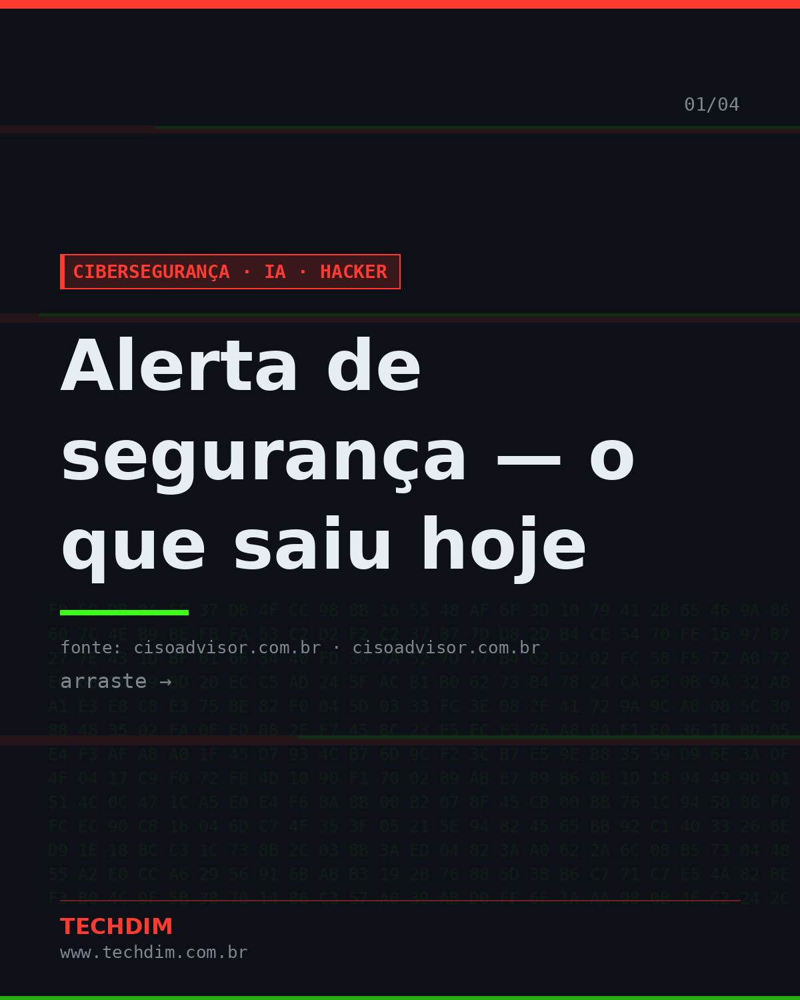
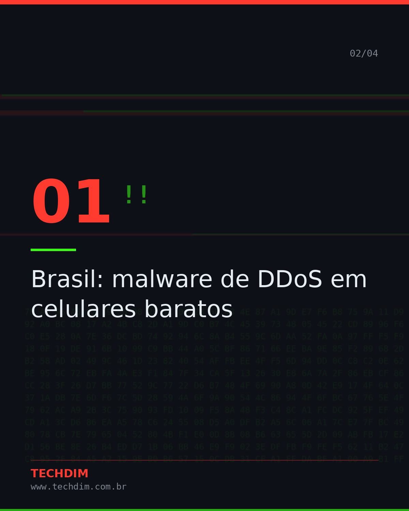
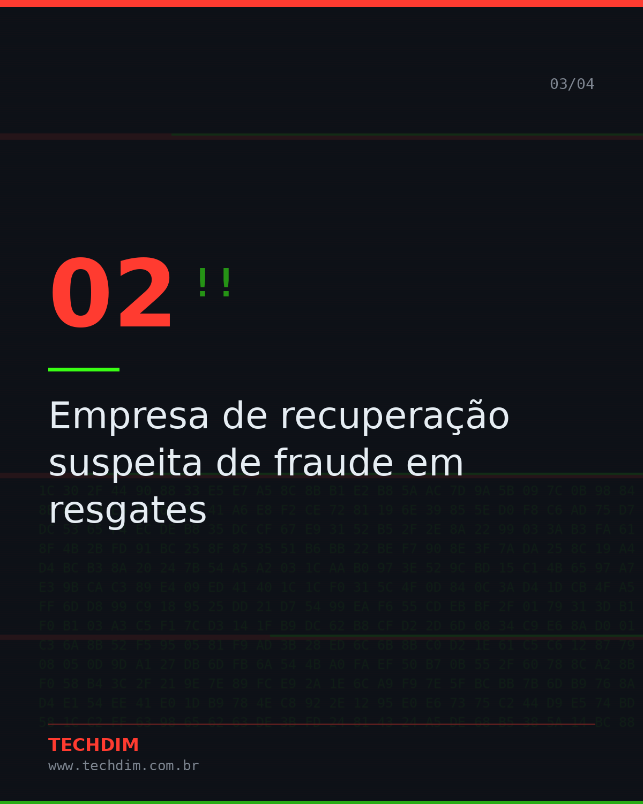
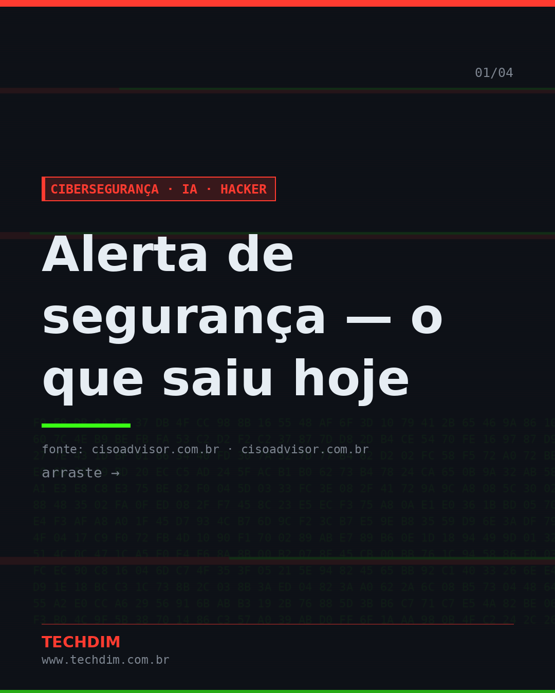
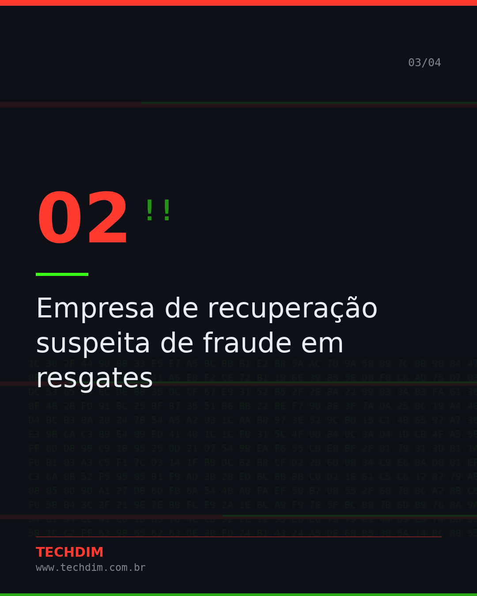
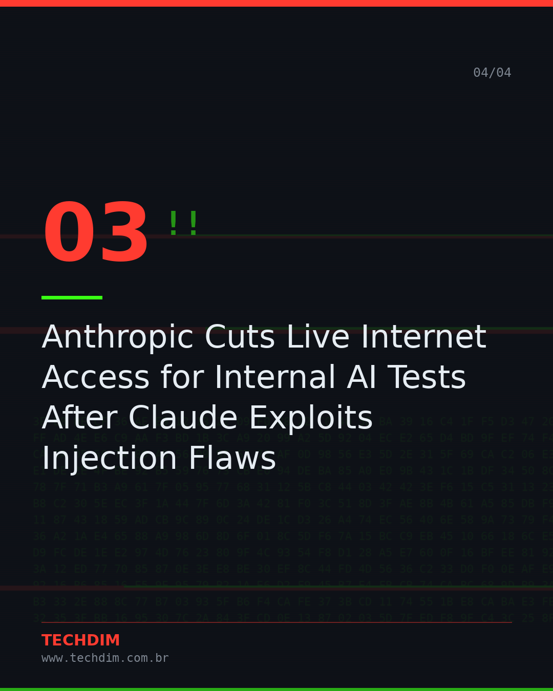

# Cibersegurança · IA · Hacker — Alerta de segurança — o que saiu hoje

- **Data:** 2026-10-10, 15:29 (horário de Brasília)
- **Curadoria:** filtro por palavra-chave
- **Execução no Actions:** https://github.com/Techdimbr/Publi-midia-Techdim/actions/runs/38075848457

## Resultado

| Rede | Status | Link | 1º comentário |
|---|---|---|---|
| linkedin | ✅ publicado | https://www.linkedin.com/feed/update/urn:li:share:7514753645029064704/ | — |
| facebook | ✅ publicado | https://www.facebook.com/122132402349390486/posts/122135006913390486 | ✅ |
| instagram | ✅ publicado | https://www.instagram.com/p/DeUup7zjOIN/ | ✅ |
| Stories | ✅ publicado | https://www.instagram.com/stories/techdimbr/4005031305229906376 | — |

## Fontes

- [cisoadvisor.com.br](https://www.cisoadvisor.com.br/brasil-malware-de-ddos-em-celulares-baratos/)
- [cisoadvisor.com.br](https://www.cisoadvisor.com.br/empresa-de-recuperacao-suspeita-de-fraude-em-resgates/)

## Linkedin

```text
Alerta de segurança — o que saiu hoje

01. Brasil: malware de DDoS em celulares baratos
02. Empresa de recuperação suspeita de fraude em resgates
03. Anthropic Cuts Live Internet Access for Internal AI Tests After Claude Exploits Injection Flaws
04. Cisco corrige falhas críticas em switches Nexus

Precisa avaliar se sua empresa está exposta? Fale com a TECHDIM.

Fontes: https://www.cisoadvisor.com.br/brasil-malware-de-ddos-em-celulares-baratos/ · https://www.cisoadvisor.com.br/empresa-de-recuperacao-suspeita-de-fraude-em-resgates/

TECHDIM — Infraestrutura · Segurança · IA
https://www.techdim.com.br

#CiberSeguranca #SegurancaDaInformacao #InfraestruturaDeTI #TECHDIM
```


## Facebook

```text
Alerta de segurança — o que saiu hoje

• Brasil: malware de DDoS em celulares baratos
• Empresa de recuperação suspeita de fraude em resgates
• Anthropic Cuts Live Internet Access for Internal AI Tests After Claude Exploits Injection Flaws
• Cisco corrige falhas críticas em switches Nexus

Precisa avaliar se sua empresa está exposta? Fale com a TECHDIM.

Fale com a TECHDIM — fontes e site no primeiro comentário 👇

#TECHDIM #Seguranca #TI #Campinas
```

Primeiro comentário:

```text
📎 Fontes:
• cisoadvisor.com.br: https://www.cisoadvisor.com.br/brasil-malware-de-ddos-em-celulares-baratos/
• cisoadvisor.com.br: https://www.cisoadvisor.com.br/empresa-de-recuperacao-suspeita-de-fraude-em-resgates/

🌐 TECHDIM — Infraestrutura · Segurança · IA: https://www.techdim.com.br
```






## Instagram

```text
Alerta de segurança — o que saiu hoje

Arraste para o lado →

1️⃣ Brasil: malware de DDoS em celulares baratos
2️⃣ Empresa de recuperação suspeita de fraude em resgates
3️⃣ Anthropic Cuts Live Internet Access for Internal AI Tests After Claude Exploits Injection Flaws
4️⃣ Cisco corrige falhas críticas em switches Nexus

Precisa avaliar se sua empresa está exposta? Fale com a TECHDIM.

Saiba mais: www.techdim.com.br
Fontes no primeiro comentário 👇

#ciberseguranca #seguranca #hacker #ti #infraestrutura #techdim #campinas
```

Primeiro comentário:

```text
📎 Fontes: cisoadvisor.com.br · cisoadvisor.com.br
```






## Stories


