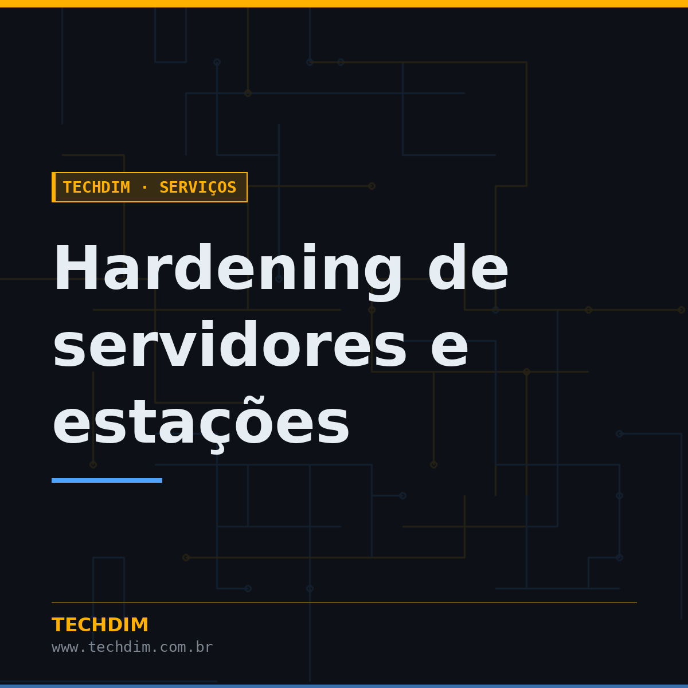
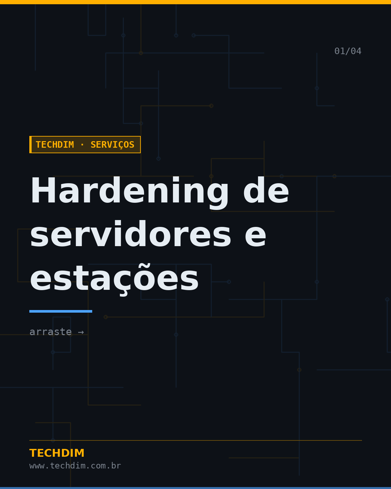
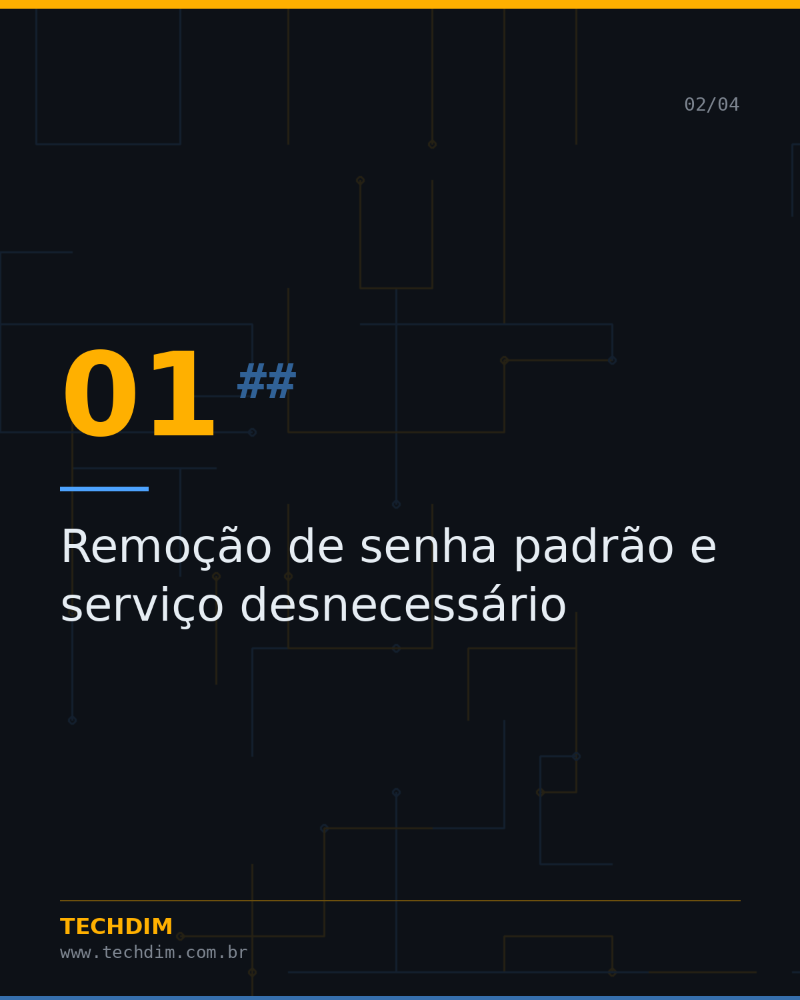
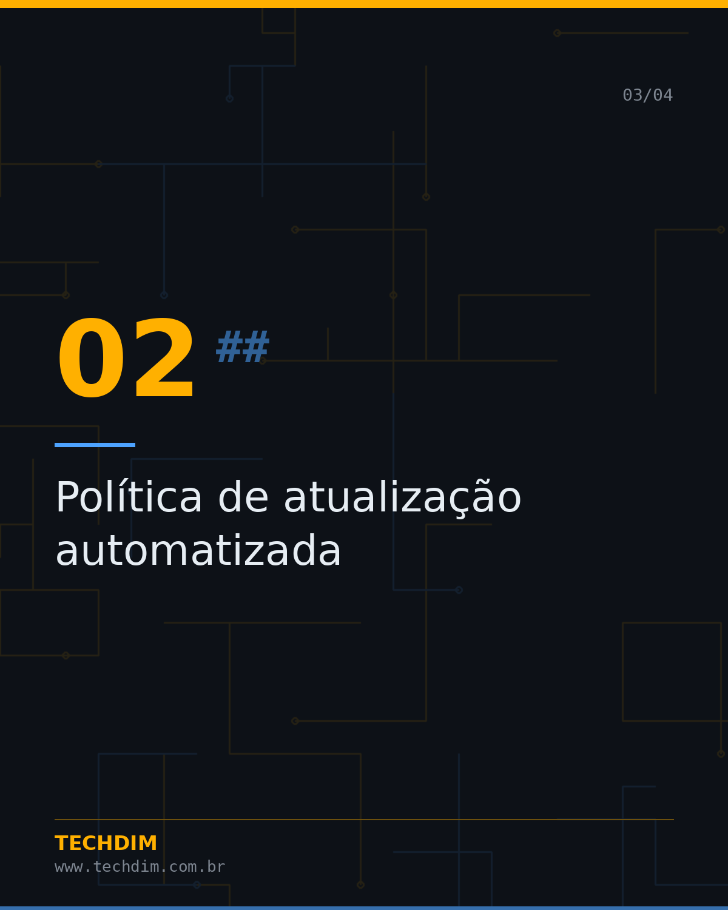
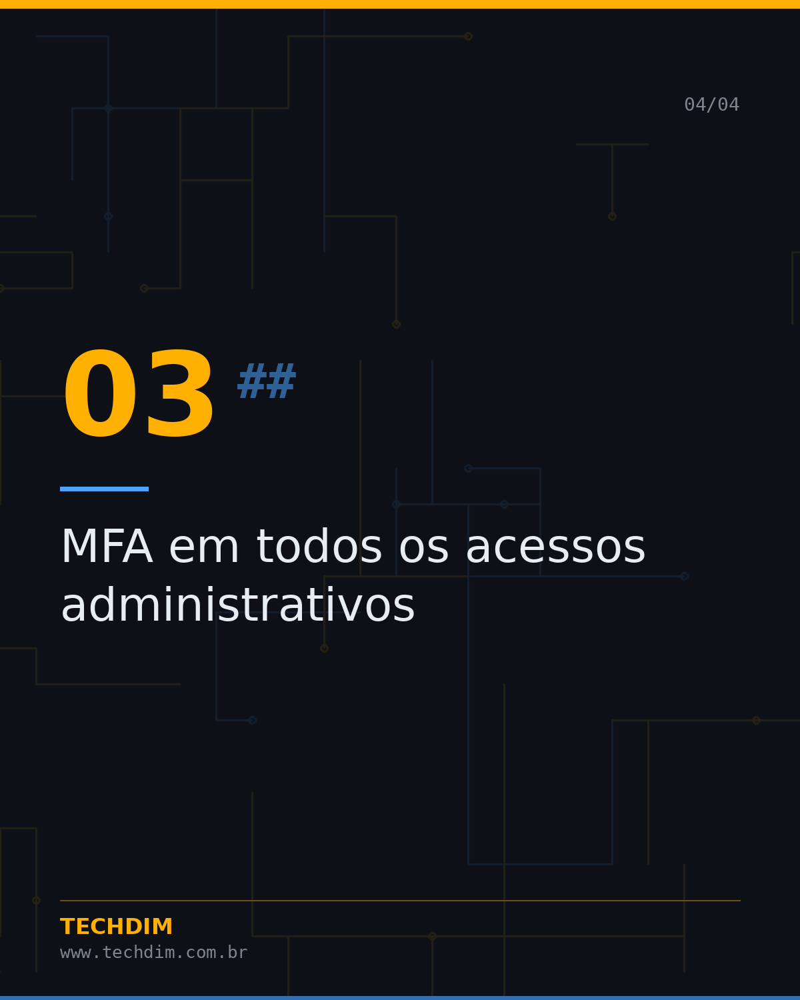
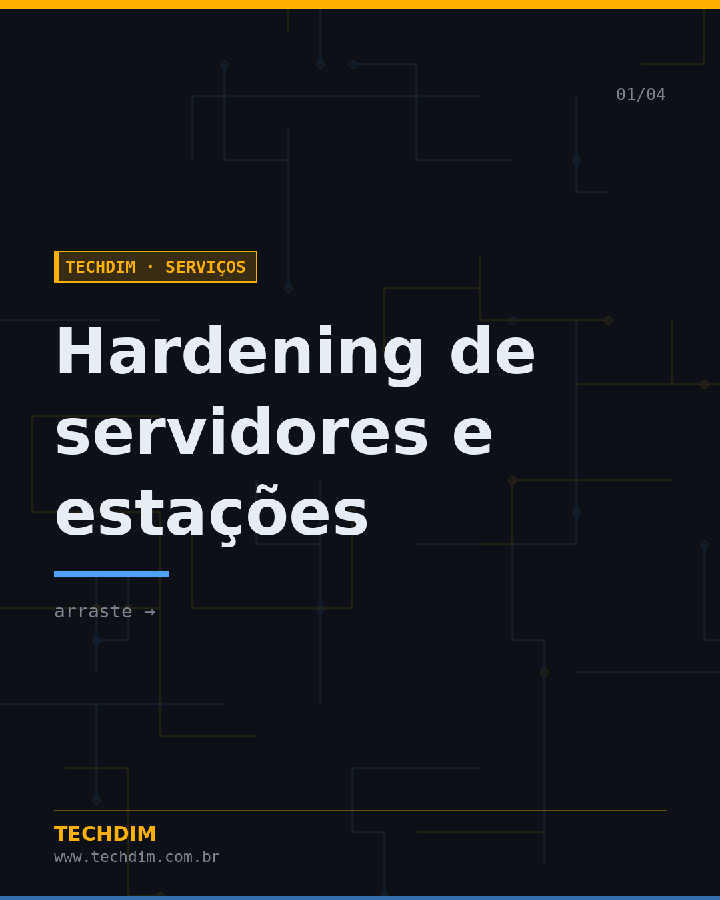
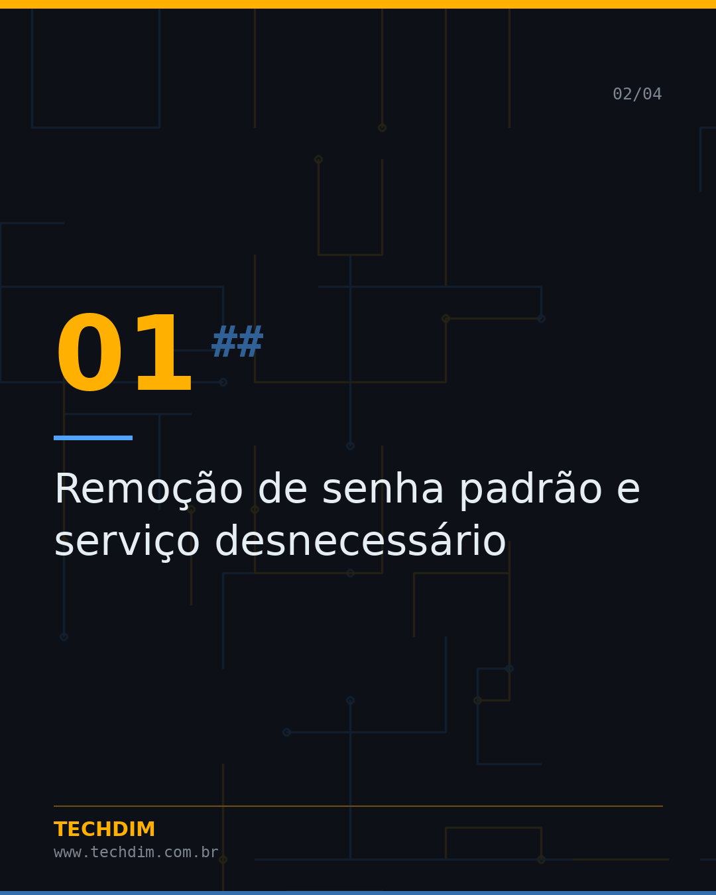
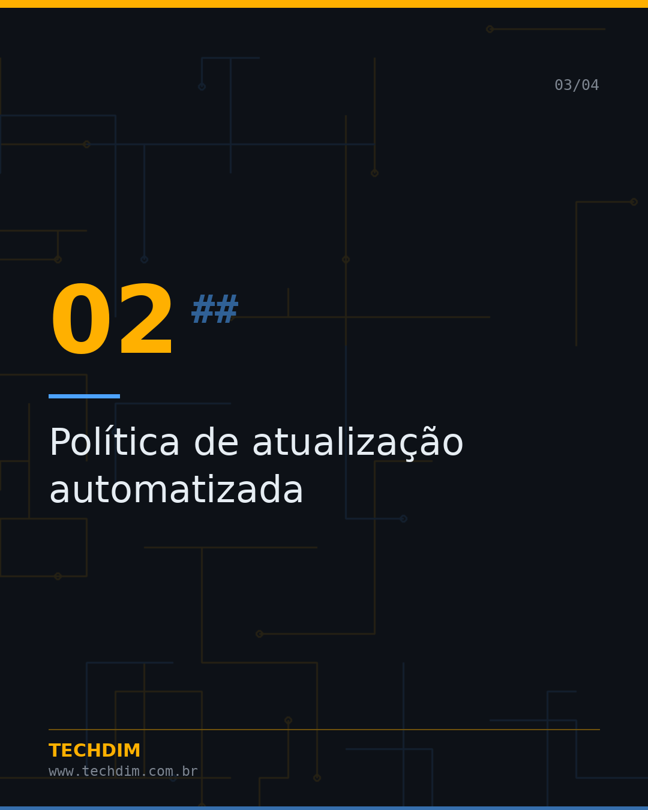

# TECHDIM · Serviços — Hardening de servidores e estações

- **Data:** 2026-10-10, 20:42 (horário de Brasília)
- **Curadoria:** acervo autoral
- **Execução no Actions:** https://github.com/Techdimbr/Publi-midia-Techdim/actions/runs/38095851712

## Resultado

| Rede | Status | Link | 1º comentário |
|---|---|---|---|
| linkedin | ✅ publicado | https://www.linkedin.com/feed/update/urn:li:share:7514832426607726592/ | — |
| facebook | ✅ publicado | https://www.facebook.com/122132402349390486/posts/122135083983390486 | ✅ |
| instagram | ✅ publicado | https://www.instagram.com/p/DeVSed1jNZH/ | — |

## Linkedin

```text
Hardening de servidores e estações

01. Remoção de senha padrão e serviço desnecessário
02. Política de atualização automatizada
03. MFA em todos os acessos administrativos
04. Segmentação de rede e revisão de regras de firewall

Aplicamos a mesma base de 8 camadas que usamos internamente.

TECHDIM — Infraestrutura · Segurança · IA
https://www.techdim.com.br

#TECHDIM #InfraestruturaDeTI #CiberSeguranca #AutomacaoEmpresarial
```



## Facebook

```text
Hardening de servidores e estações

• Remoção de senha padrão e serviço desnecessário
• Política de atualização automatizada
• MFA em todos os acessos administrativos
• Segmentação de rede e revisão de regras de firewall

Aplicamos a mesma base de 8 camadas que usamos internamente.

Fale com a TECHDIM — link no primeiro comentário 👇

#TECHDIM #TI #Campinas #Seguranca
```

Primeiro comentário:

```text
🌐 TECHDIM — Infraestrutura · Segurança · IA: https://www.techdim.com.br
```






## Instagram

```text
Hardening de servidores e estações

Arraste para o lado →

1️⃣ Remoção de senha padrão e serviço desnecessário
2️⃣ Política de atualização automatizada
3️⃣ MFA em todos os acessos administrativos
4️⃣ Segmentação de rede e revisão de regras de firewall

Aplicamos a mesma base de 8 camadas que usamos internamente.

Saiba mais: www.techdim.com.br

#ti #suportetecnico #ciberseguranca #automacao #techdim #campinas
```





