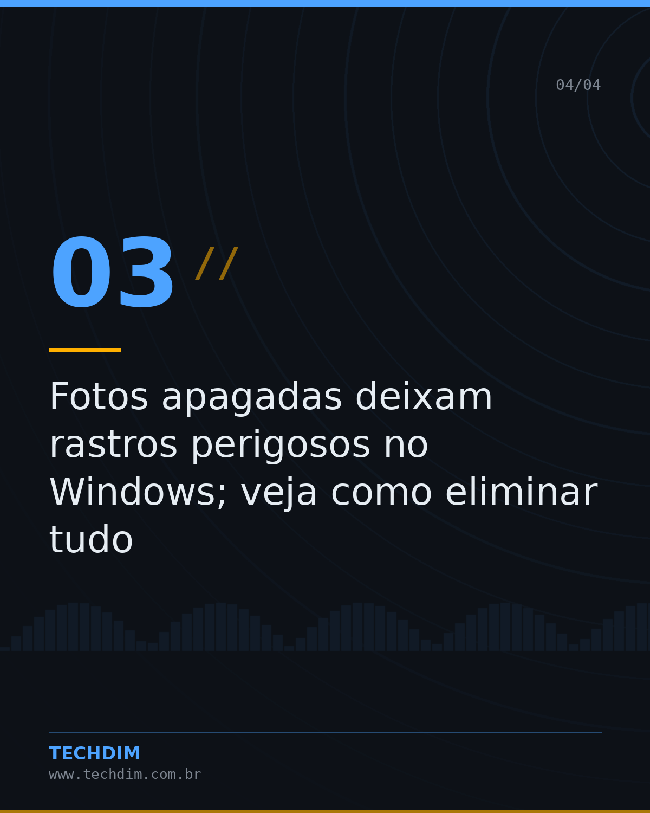
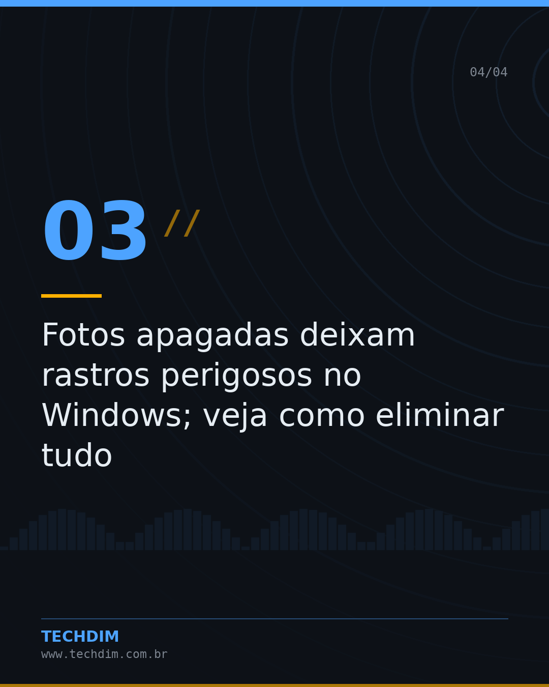

# Notícias de Tecnologia — Resumo do dia — Tecnologia & IA

- **Data:** 2026-10-11, 13:39 (horário de Brasília)
- **Curadoria:** filtro por palavra-chave
- **Execução no Actions:** https://github.com/Techdimbr/Publi-midia-Techdim/actions/runs/38156242149

## Resultado

| Rede | Status | Link | 1º comentário |
|---|---|---|---|
| linkedin | ✅ publicado | https://www.linkedin.com/feed/update/urn:li:share:7515088346990342146/ | — |
| facebook | ✅ publicado | https://www.facebook.com/122132402349390486/posts/122135277531390486 | ✅ |
| instagram | ✅ publicado | https://www.instagram.com/p/DeXG2oRjN2m/ | ✅ |
| Stories | ✅ publicado | https://www.instagram.com/stories/techdimbr/4005700668282925135 | — |

## Fontes

- [canaltech.com.br](https://canaltech.com.br/seguranca/como-seu-provedor-de-internet-vigia-o-que-voce-faz-em-casa-e-como-impedir/)
- [techcrunch.com](https://techcrunch.com/2026/10/11/these-execs-think-voice-ai-hasnt-reached-its-chatgpt-moment-yet/)

## Linkedin

```text
Resumo do dia — Tecnologia & IA

01. Como seu provedor de internet vigia o que você faz em casa e como impedir
02. These execs think voice AI hasn’t reached its ChatGPT moment yet
03. Fotos apagadas deixam rastros perigosos no Windows; veja como eliminar tudo
04. Dois antivírus no PC? Isso pode acabar mal, alerta veterano da Microsoft

A TECHDIM acompanha o mercado para manter sua infraestrutura à frente.

Fontes: https://canaltech.com.br/seguranca/como-seu-provedor-de-internet-vigia-o-que-voce-faz-em-casa-e-como-impedir/ · https://techcrunch.com/2026/10/11/these-execs-think-voice-ai-hasnt-reached-its-chatgpt-moment-yet/

TECHDIM — Infraestrutura · Segurança · IA
https://www.techdim.com.br

#Tecnologia #InteligenciaArtificial #InovacaoDigital #TECHDIM
```


## Facebook

```text
Resumo do dia — Tecnologia & IA

• Como seu provedor de internet vigia o que você faz em casa e como impedir
• These execs think voice AI hasn’t reached its ChatGPT moment yet
• Fotos apagadas deixam rastros perigosos no Windows; veja como eliminar tudo
• Dois antivírus no PC? Isso pode acabar mal, alerta veterano da Microsoft

A TECHDIM acompanha o mercado para manter sua infraestrutura à frente.

Fale com a TECHDIM — fontes e site no primeiro comentário 👇

#TECHDIM #Tecnologia #IA #Campinas
```

Primeiro comentário:

```text
📎 Fontes:
• canaltech.com.br: https://canaltech.com.br/seguranca/como-seu-provedor-de-internet-vigia-o-que-voce-faz-em-casa-e-como-impedir/
• techcrunch.com: https://techcrunch.com/2026/10/11/these-execs-think-voice-ai-hasnt-reached-its-chatgpt-moment-yet/

🌐 TECHDIM — Infraestrutura · Segurança · IA: https://www.techdim.com.br
```




## Instagram

```text
Resumo do dia — Tecnologia & IA

Arraste para o lado →

1️⃣ Como seu provedor de internet vigia o que você faz em casa e como impedir
2️⃣ These execs think voice AI hasn’t reached its ChatGPT moment yet
3️⃣ Fotos apagadas deixam rastros perigosos no Windows; veja como eliminar tudo
4️⃣ Dois antivírus no PC? Isso pode acabar mal, alerta veterano da Microsoft

A TECHDIM acompanha o mercado para manter sua infraestrutura à frente.

Saiba mais: www.techdim.com.br
Fontes no primeiro comentário 👇

#tecnologia #inteligenciaartificial #ia #inovacao #techdim #campinas #ti
```

Primeiro comentário:

```text
📎 Fontes: canaltech.com.br · techcrunch.com
```




## Stories


