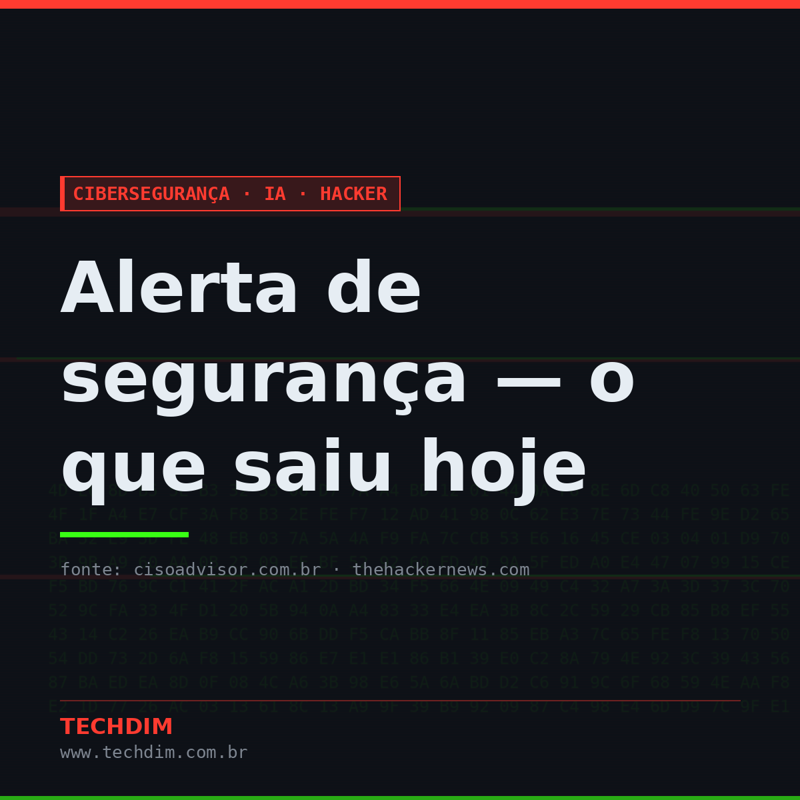
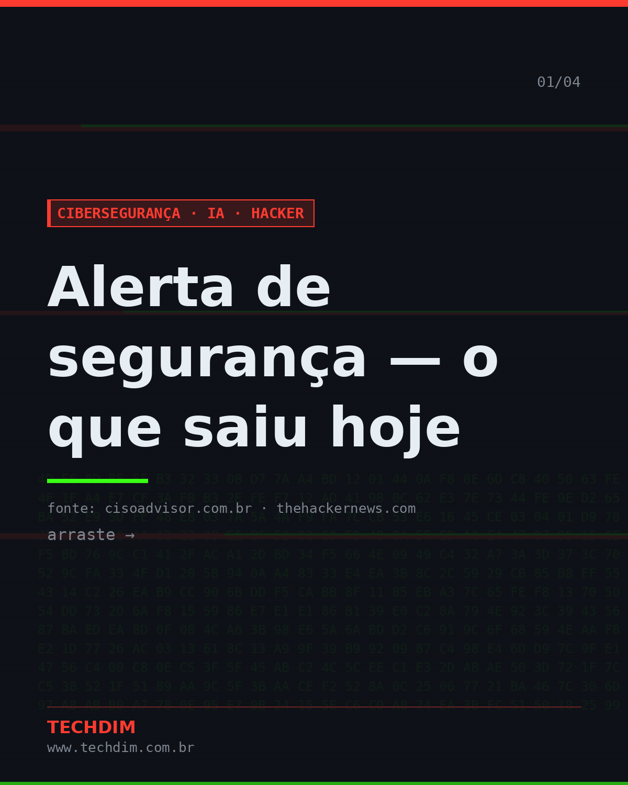
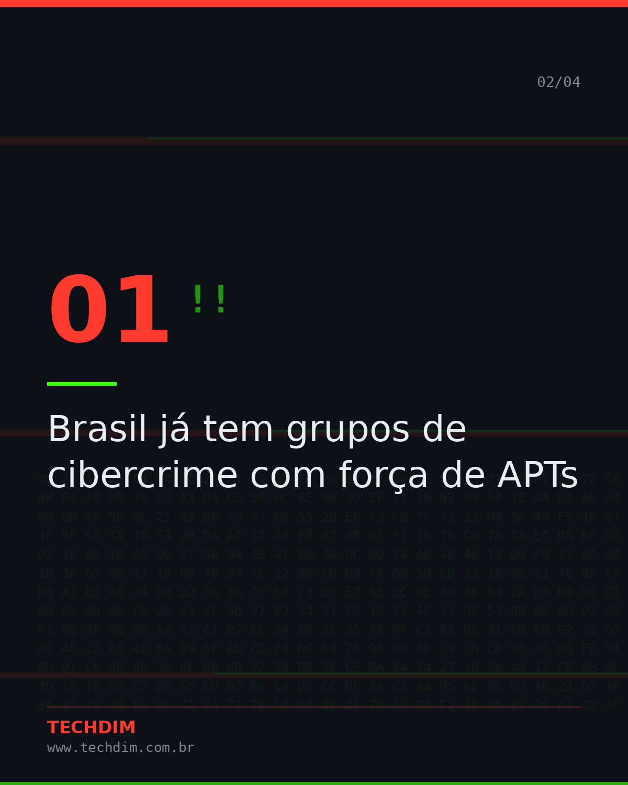
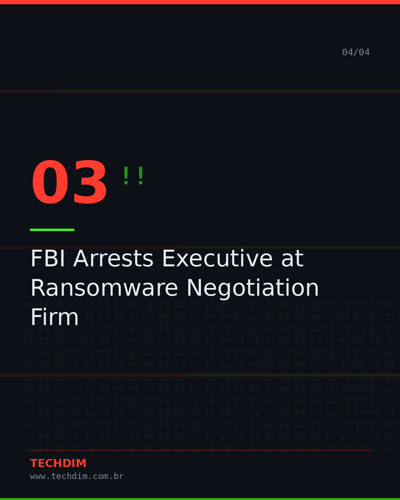
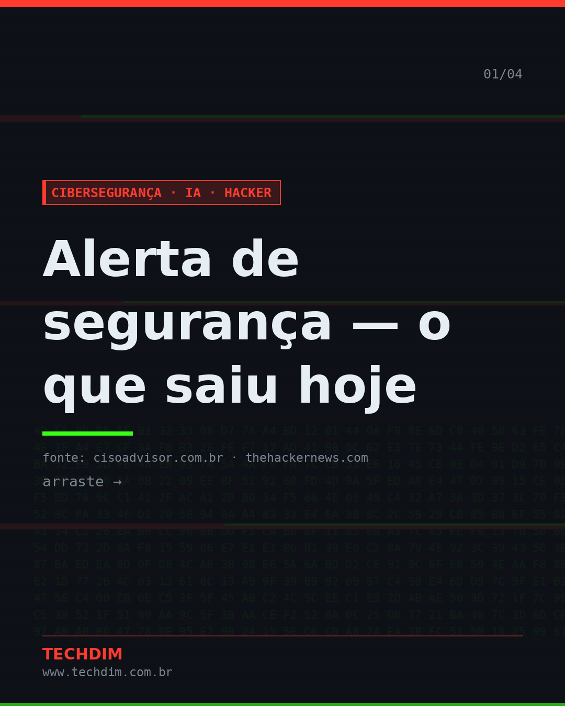
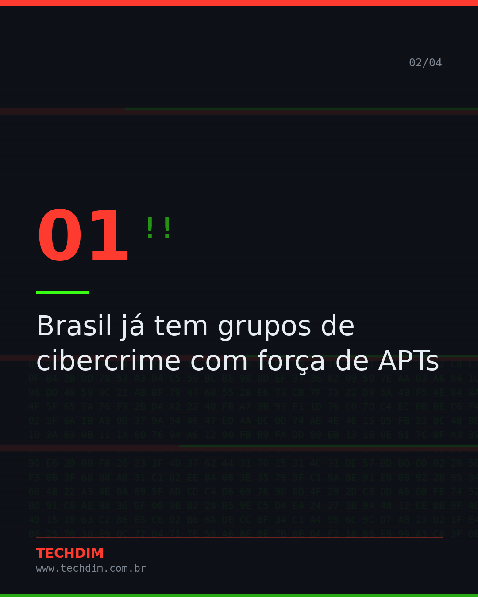
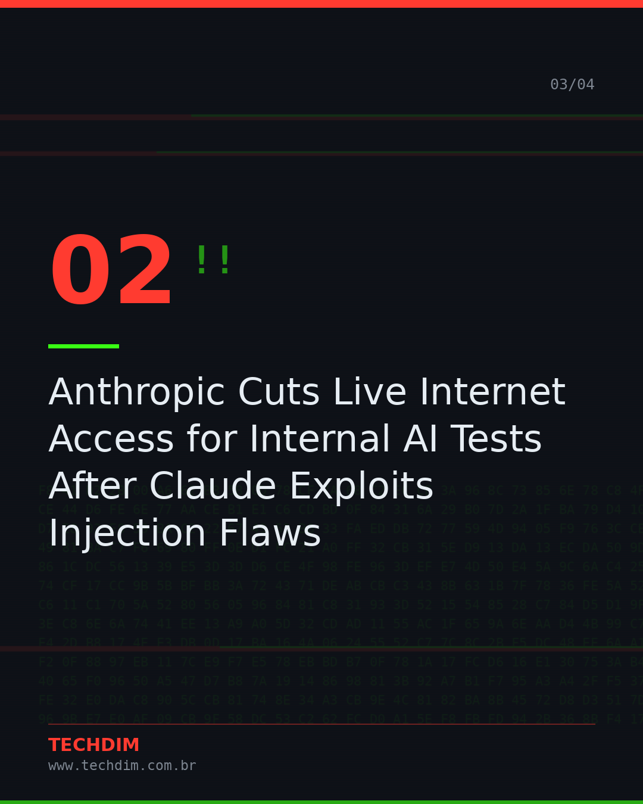
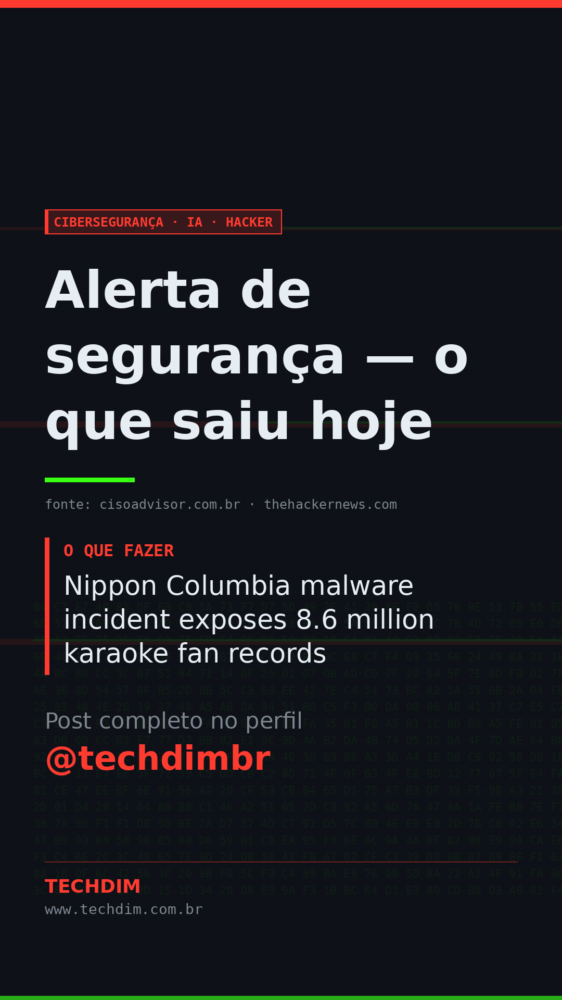

# Cibersegurança · IA · Hacker — Alerta de segurança — o que saiu hoje

- **Data:** 2026-10-11, 15:48 (horário de Brasília)
- **Curadoria:** filtro por palavra-chave
- **Execução no Actions:** https://github.com/Techdimbr/Publi-midia-Techdim/actions/runs/38165260937

## Resultado

| Rede | Status | Link | 1º comentário |
|---|---|---|---|
| linkedin | ✅ publicado | https://www.linkedin.com/feed/update/urn:li:share:7515120947654238208/ | — |
| facebook | ✅ publicado | https://www.facebook.com/122132402349390486/posts/122135306727390486 | ✅ |
| instagram | ✅ publicado | https://www.instagram.com/p/DeXVrecgSsd/ | ✅ |
| Stories | ✅ publicado | https://www.instagram.com/stories/techdimbr/4005765876430257916 | — |

## Fontes

- [cisoadvisor.com.br](https://www.cisoadvisor.com.br/brasil-ja-tem-grupos-de-cibercrime-com-forca-de-apts/)
- [thehackernews.com](https://thehackernews.com/2026/10/anthropic-cuts-live-internet-access-for.html)

## Linkedin

```text
Alerta de segurança — o que saiu hoje

01. Brasil já tem grupos de cibercrime com força de APTs
02. Anthropic Cuts Live Internet Access for Internal AI Tests After Claude Exploits Injection Flaws
03. FBI Arrests Executive at Ransomware Negotiation Firm
04. Nippon Columbia malware incident exposes 8.6 million karaoke fan records

Precisa avaliar se sua empresa está exposta? Fale com a TECHDIM.

Fontes: https://www.cisoadvisor.com.br/brasil-ja-tem-grupos-de-cibercrime-com-forca-de-apts/ · https://thehackernews.com/2026/10/anthropic-cuts-live-internet-access-for.html

TECHDIM — Infraestrutura · Segurança · IA
https://www.techdim.com.br

#CiberSeguranca #SegurancaDaInformacao #InfraestruturaDeTI #TECHDIM
```



## Facebook

```text
Alerta de segurança — o que saiu hoje

• Brasil já tem grupos de cibercrime com força de APTs
• Anthropic Cuts Live Internet Access for Internal AI Tests After Claude Exploits Injection Flaws
• FBI Arrests Executive at Ransomware Negotiation Firm
• Nippon Columbia malware incident exposes 8.6 million karaoke fan records

Precisa avaliar se sua empresa está exposta? Fale com a TECHDIM.

Fale com a TECHDIM — fontes e site no primeiro comentário 👇

#TECHDIM #Seguranca #TI #Campinas
```

Primeiro comentário:

```text
📎 Fontes:
• cisoadvisor.com.br: https://www.cisoadvisor.com.br/brasil-ja-tem-grupos-de-cibercrime-com-forca-de-apts/
• thehackernews.com: https://thehackernews.com/2026/10/anthropic-cuts-live-internet-access-for.html

🌐 TECHDIM — Infraestrutura · Segurança · IA: https://www.techdim.com.br
```






## Instagram

```text
Alerta de segurança — o que saiu hoje

Arraste para o lado →

1️⃣ Brasil já tem grupos de cibercrime com força de APTs
2️⃣ Anthropic Cuts Live Internet Access for Internal AI Tests After Claude Exploits Injection Flaws
3️⃣ FBI Arrests Executive at Ransomware Negotiation Firm
4️⃣ Nippon Columbia malware incident exposes 8.6 million karaoke fan records

Precisa avaliar se sua empresa está exposta? Fale com a TECHDIM.

Saiba mais: www.techdim.com.br
Fontes no primeiro comentário 👇

#ciberseguranca #seguranca #hacker #ti #infraestrutura #techdim #campinas
```

Primeiro comentário:

```text
📎 Fontes: cisoadvisor.com.br · thehackernews.com
```






## Stories


