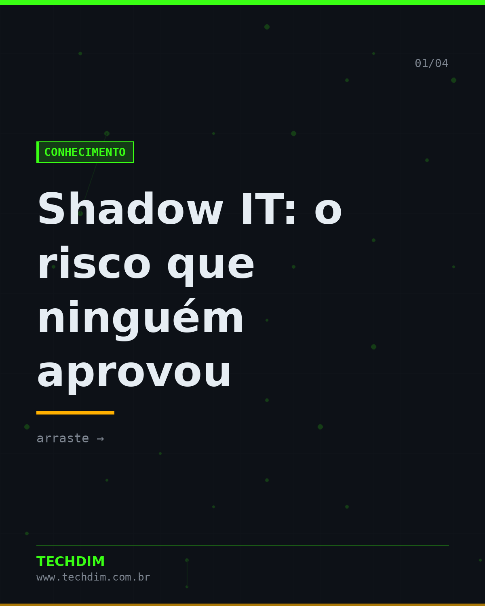
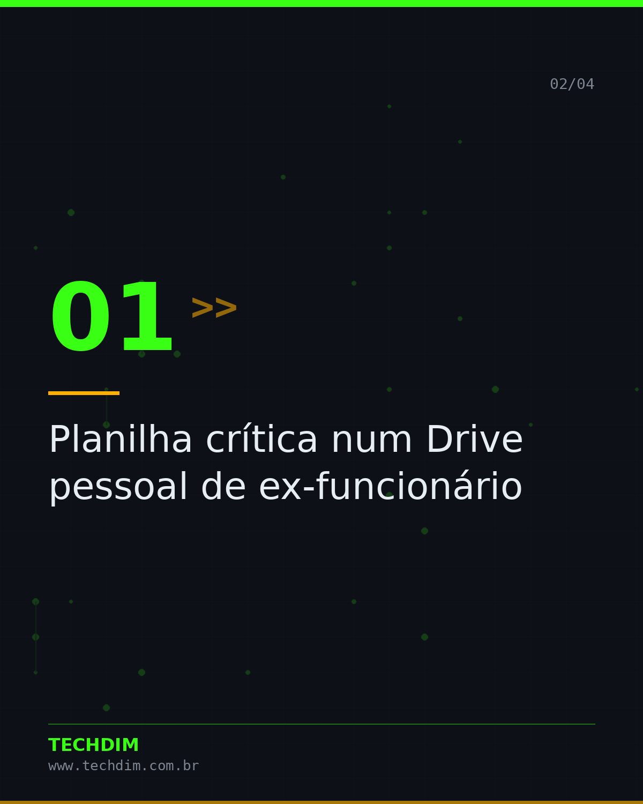
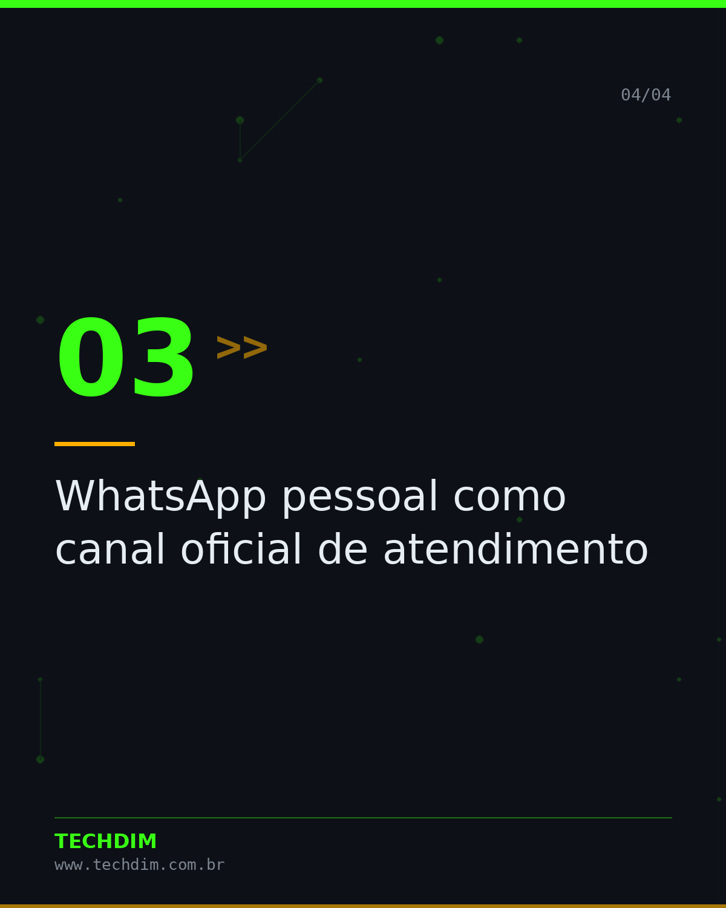
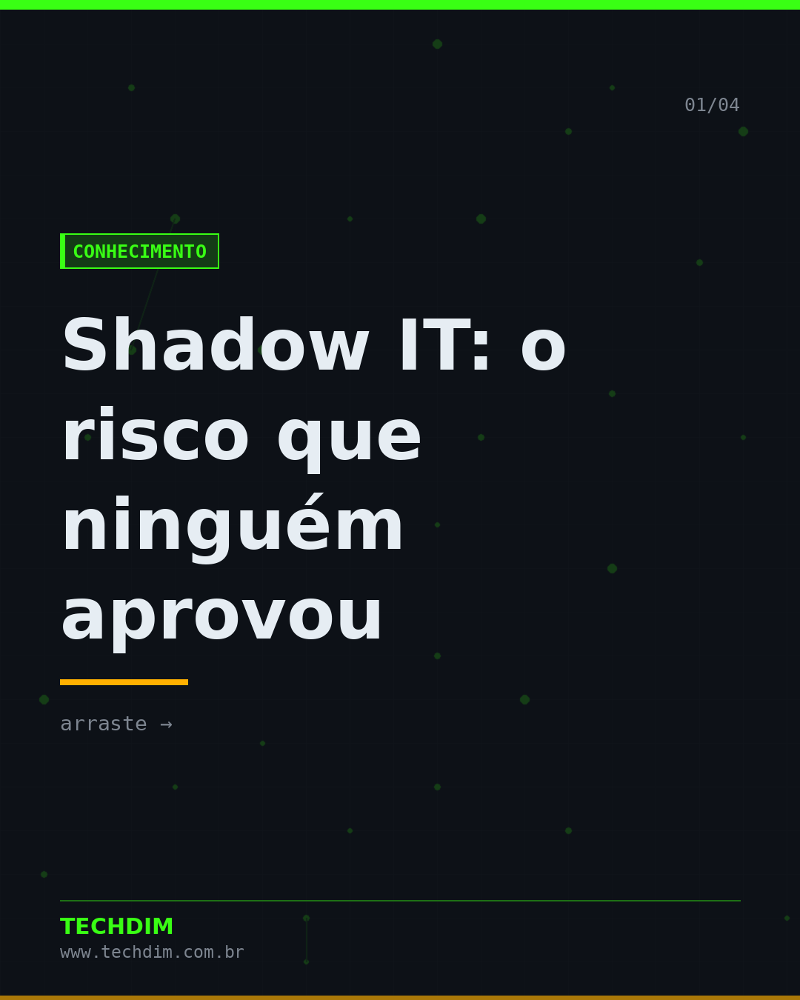
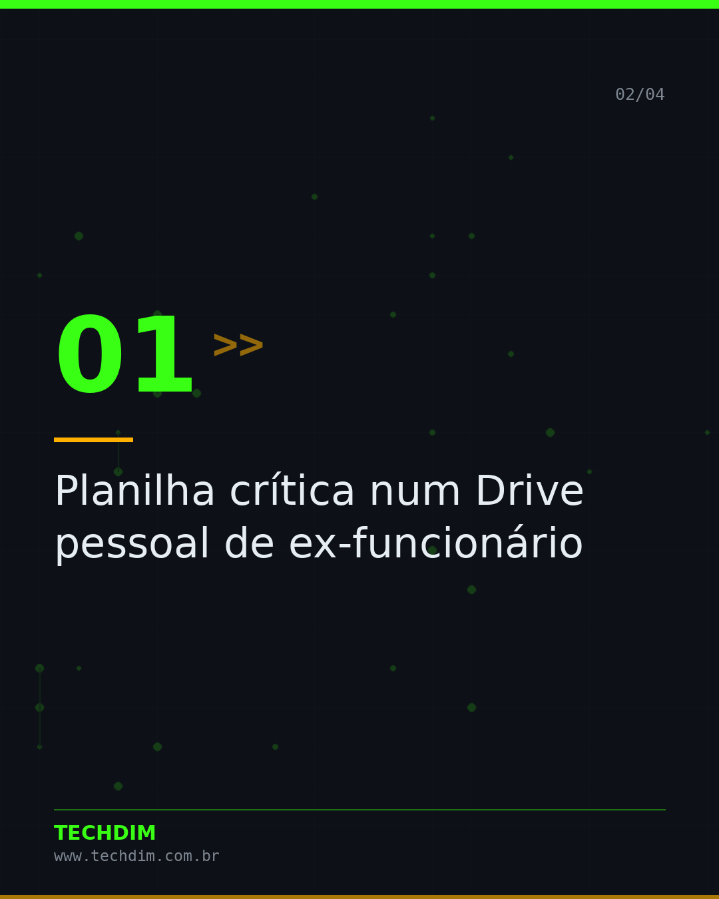
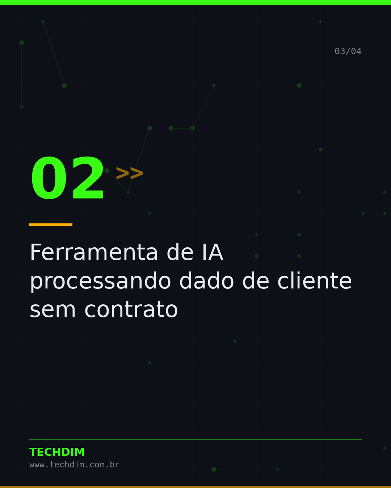
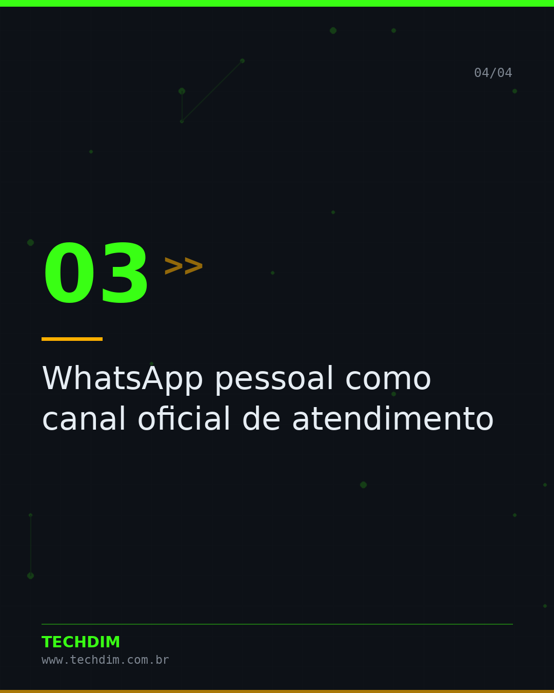

# Conhecimento — Shadow IT: o risco que ninguém aprovou

- **Data:** 2026-10-11, 18:00 (horário de Brasília)
- **Curadoria:** acervo autoral
- **Execução no Actions:** https://github.com/Techdimbr/Publi-midia-Techdim/actions/runs/38174444602

## Resultado

| Rede | Status | Link | 1º comentário |
|---|---|---|---|
| linkedin | ✅ publicado | https://www.linkedin.com/feed/update/urn:li:share:7515154072681795584/ | — |
| facebook | ✅ publicado | https://www.facebook.com/122132402349390486/posts/122135327295390486 | ✅ |
| instagram | ✅ publicado | https://www.instagram.com/p/DeXku5Zl8r3/ | — |

## Linkedin

```text
Shadow IT: o risco que ninguém aprovou

01. Planilha crítica num Drive pessoal de ex-funcionário
02. Ferramenta de IA processando dado de cliente sem contrato
03. WhatsApp pessoal como canal oficial de atendimento
04. Credencial compartilhada entre equipe inteira

Mapear o que já é usado vale mais que proibir no papel.

TECHDIM — Infraestrutura · Segurança · IA
https://www.techdim.com.br

#Conhecimento #TI #CiberSeguranca #GestaoDeTI #TECHDIM
```


## Facebook

```text
Shadow IT: o risco que ninguém aprovou

• Planilha crítica num Drive pessoal de ex-funcionário
• Ferramenta de IA processando dado de cliente sem contrato
• WhatsApp pessoal como canal oficial de atendimento
• Credencial compartilhada entre equipe inteira

Mapear o que já é usado vale mais que proibir no papel.

Fale com a TECHDIM — link no primeiro comentário 👇

#TECHDIM #AprendaTI #Tecnologia #Campinas
```

Primeiro comentário:

```text
🌐 TECHDIM — Infraestrutura · Segurança · IA: https://www.techdim.com.br
```






## Instagram

```text
Shadow IT: o risco que ninguém aprovou

Arraste para o lado →

1️⃣ Planilha crítica num Drive pessoal de ex-funcionário
2️⃣ Ferramenta de IA processando dado de cliente sem contrato
3️⃣ WhatsApp pessoal como canal oficial de atendimento
4️⃣ Credencial compartilhada entre equipe inteira

Mapear o que já é usado vale mais que proibir no papel.

Saiba mais: www.techdim.com.br

#conhecimento #aprendati #tecnologia #ti #ciberseguranca #techdim #campinas
```





