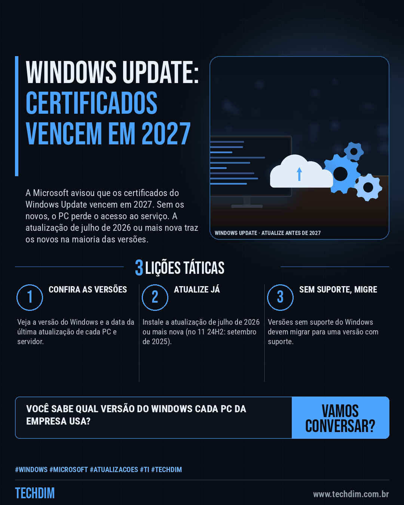
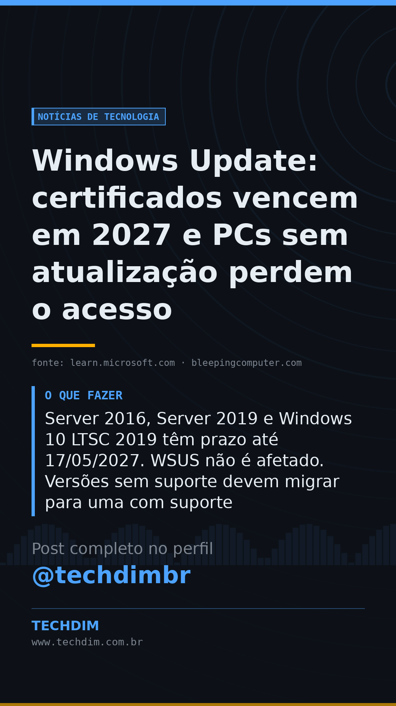

# Notícias de Tecnologia — Windows Update: certificados vencem em 2027 e PCs sem atualização perdem o acesso

- **Data:** 2026-10-12, 08:00 (horário de Brasília)
- **Curadoria:** Claude (Routine) — pauta do dia
- **Execução no Actions:** https://github.com/Techdimbr/Publi-midia-Techdim/actions/runs/38239726935
- **Por que esta pauta:** Aviso oficial da Microsoft com prazo claro: PCs e servidores esquecidos ou fora de suporte podem perder o Windows Update.

## Resultado

| Rede | Status | Link | 1º comentário |
|---|---|---|---|
| linkedin | ✅ publicado | https://www.linkedin.com/feed/update/urn:li:share:7515365552555646976/ | — |
| facebook | ✅ publicado | https://www.facebook.com/122132402349390486/posts/122135459523390486 | ✅ |
| instagram | ✅ publicado | https://www.instagram.com/p/DeZE1bRjwj-/ | ✅ |
| Stories | ✅ publicado | https://www.instagram.com/stories/techdimbr/4006254710113772854 | — |

## Fontes

- [learn.microsoft.com](https://learn.microsoft.com/en-us/windows/release-health/windows-message-center)
- [bleepingcomputer.com](https://www.bleepingcomputer.com/news/microsoft/microsoft-outdated-windows-devices-will-lose-security-protection-next-year/)

## Linkedin

```text
Windows Update: certificados vencem em 2027 e PCs sem atualização perdem o acesso

01. A Microsoft avisou em 08/10 que certificados do Windows Update vencem em 17/05 e 19/06/2027; PCs sem os novos perdem o acesso ao Windows Update
02. A atualização de julho/2026 ou mais nova traz os novos (Windows 10, 11 e Server 2022). No 11 24H2 e no Server 2025 vale a de setembro/2025; o 25H2 não exige nada
03. Server 2016, Server 2019 e Windows 10 LTSC 2019 têm prazo até 17/05/2027. WSUS não é afetado. Versões sem suporte devem migrar para uma com suporte

Confira a versão e a data da última atualização de cada PC e servidor antes do prazo.

Fontes: https://learn.microsoft.com/en-us/windows/release-health/windows-message-center · https://www.bleepingcomputer.com/news/microsoft/microsoft-outdated-windows-devices-will-lose-security-protection-next-year/

TECHDIM — Infraestrutura · Segurança · IA
https://www.techdim.com.br

#Windows #Microsoft #Atualizacoes #TI #TECHDIM
```



## Facebook

```text
Windows Update: certificados vencem em 2027 e PCs sem atualização perdem o acesso

• A Microsoft avisou em 08/10 que certificados do Windows Update vencem em 17/05 e 19/06/2027; PCs sem os novos perdem o acesso ao Windows Update
• A atualização de julho/2026 ou mais nova traz os novos (Windows 10, 11 e Server 2022). No 11 24H2 e no Server 2025 vale a de setembro/2025; o 25H2 não exige nada
• Server 2016, Server 2019 e Windows 10 LTSC 2019 têm prazo até 17/05/2027. WSUS não é afetado. Versões sem suporte devem migrar para uma com suporte

Confira a versão e a data da última atualização de cada PC e servidor antes do prazo.

Fale com a TECHDIM — fontes e site no primeiro comentário 👇

#Windows #Microsoft #Atualizacoes #TECHDIM
```

Primeiro comentário:

```text
📎 Fontes:
• learn.microsoft.com: https://learn.microsoft.com/en-us/windows/release-health/windows-message-center
• bleepingcomputer.com: https://www.bleepingcomputer.com/news/microsoft/microsoft-outdated-windows-devices-will-lose-security-protection-next-year/

🌐 TECHDIM — Infraestrutura · Segurança · IA: https://www.techdim.com.br
```


## Instagram

```text
Windows Update: certificados vencem em 2027 e PCs sem atualização perdem o acesso

1️⃣ A Microsoft avisou em 08/10 que certificados do Windows Update vencem em 17/05 e 19/06/2027; PCs sem os novos perdem o acesso ao Windows Update
2️⃣ A atualização de julho/2026 ou mais nova traz os novos (Windows 10, 11 e Server 2022). No 11 24H2 e no Server 2025 vale a de setembro/2025; o 25H2 não exige nada
3️⃣ Server 2016, Server 2019 e Windows 10 LTSC 2019 têm prazo até 17/05/2027. WSUS não é afetado. Versões sem suporte devem migrar para uma com suporte

Confira a versão e a data da última atualização de cada PC e servidor antes do prazo.

Saiba mais: www.techdim.com.br
Fontes no primeiro comentário 👇

#windows #microsoft #atualizacoes #ti #techdim #tecnologia #inteligenciaartificial #ia
```

Primeiro comentário:

```text
📎 Fontes: learn.microsoft.com · bleepingcomputer.com
```


## Stories


