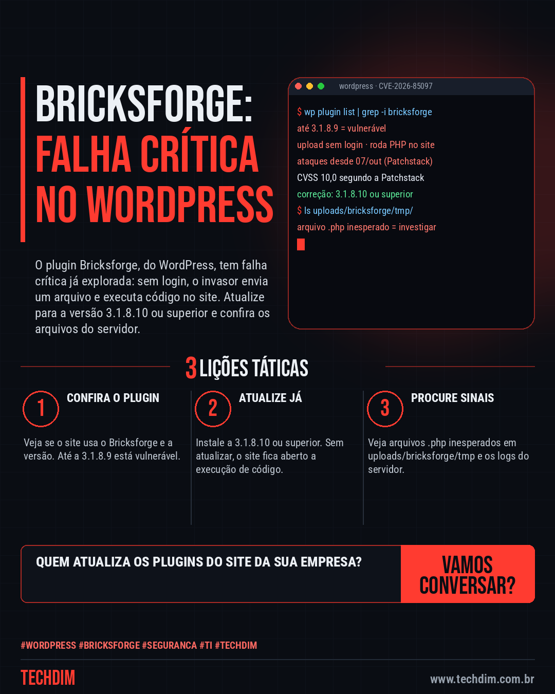

# Cibersegurança · IA · Hacker — Bricksforge CVE-2026-85097: falha crítica em plugin do WordPress já é explorada

- **Data:** 2026-10-12, 11:09 (horário de Brasília)
- **Curadoria:** Claude (Routine) — pauta do dia
- **Execução no Actions:** https://github.com/Techdimbr/Publi-midia-Techdim/actions/runs/38260742150
- **Por que esta pauta:** Falha crítica sem login em plugin do WordPress, já explorada e com correção disponível: sites que não atualizam plugins ficam expostos.

## Resultado

| Rede | Status | Link | 1º comentário |
|---|---|---|---|
| linkedin | ✅ publicado | https://www.linkedin.com/feed/update/urn:li:share:7515413210103996416/ | — |
| facebook | ✅ publicado | https://www.facebook.com/122132402349390486/posts/122135501727390486 | ✅ |
| instagram | ✅ publicado | https://www.instagram.com/p/DeZageqDIXE/ | ✅ |
| Stories | ✅ publicado | https://www.instagram.com/stories/techdimbr/4006350033682772904 | — |

## Fontes

- [patchstack.com](https://patchstack.com/articles/critical-unauthenticated-arbitrary-file-upload-vulnerability-exploited-in-bricksforge-plugin/)
- [thehackernews.com](https://thehackernews.com/2026/10/attackers-exploit-cvss-100-bricksforge.html)

## Linkedin

```text
Bricksforge CVE-2026-85097: falha crítica em plugin do WordPress já é explorada

01. O plugin Bricksforge, do WordPress, tem falha crítica (CVE-2026-85097): sem login, o invasor envia um arquivo e executa código PHP no site. Vai até a versão 3.1.8.9
02. A Patchstack registrou tentativas de ataque desde 07/10 e dá nota 10 (CVSS). A correção é atualizar o plugin para a versão 3.1.8.10 ou superior
03. Procure arquivos .php inesperados em uploads/bricksforge/tmp e, nos logs, chamadas a form_submit com temporaryFileUploads. Se achar, trate como possível invasão

Seu site usa WordPress? Confira se o Bricksforge está instalado e atualize hoje.

Fontes: https://patchstack.com/articles/critical-unauthenticated-arbitrary-file-upload-vulnerability-exploited-in-bricksforge-plugin/ · https://thehackernews.com/2026/10/attackers-exploit-cvss-100-bricksforge.html

TECHDIM — Infraestrutura · Segurança · IA
https://www.techdim.com.br

#WordPress #Bricksforge #Seguranca #TI #TECHDIM
```



## Facebook

```text
Bricksforge CVE-2026-85097: falha crítica em plugin do WordPress já é explorada

• O plugin Bricksforge, do WordPress, tem falha crítica (CVE-2026-85097): sem login, o invasor envia um arquivo e executa código PHP no site. Vai até a versão 3.1.8.9
• A Patchstack registrou tentativas de ataque desde 07/10 e dá nota 10 (CVSS). A correção é atualizar o plugin para a versão 3.1.8.10 ou superior
• Procure arquivos .php inesperados em uploads/bricksforge/tmp e, nos logs, chamadas a form_submit com temporaryFileUploads. Se achar, trate como possível invasão

Seu site usa WordPress? Confira se o Bricksforge está instalado e atualize hoje.

Fale com a TECHDIM — fontes e site no primeiro comentário 👇

#WordPress #Bricksforge #Seguranca #TECHDIM
```

Primeiro comentário:

```text
📎 Fontes:
• patchstack.com: https://patchstack.com/articles/critical-unauthenticated-arbitrary-file-upload-vulnerability-exploited-in-bricksforge-plugin/
• thehackernews.com: https://thehackernews.com/2026/10/attackers-exploit-cvss-100-bricksforge.html

🌐 TECHDIM — Infraestrutura · Segurança · IA: https://www.techdim.com.br
```


## Instagram

```text
Bricksforge CVE-2026-85097: falha crítica em plugin do WordPress já é explorada

1️⃣ O plugin Bricksforge, do WordPress, tem falha crítica (CVE-2026-85097): sem login, o invasor envia um arquivo e executa código PHP no site. Vai até a versão 3.1.8.9
2️⃣ A Patchstack registrou tentativas de ataque desde 07/10 e dá nota 10 (CVSS). A correção é atualizar o plugin para a versão 3.1.8.10 ou superior
3️⃣ Procure arquivos .php inesperados em uploads/bricksforge/tmp e, nos logs, chamadas a form_submit com temporaryFileUploads. Se achar, trate como possível invasão

Seu site usa WordPress? Confira se o Bricksforge está instalado e atualize hoje.

Saiba mais: www.techdim.com.br
Fontes no primeiro comentário 👇

#wordpress #bricksforge #seguranca #ti #techdim #ciberseguranca #hacker #infraestrutura
```

Primeiro comentário:

```text
📎 Fontes: patchstack.com · thehackernews.com
```


## Stories


