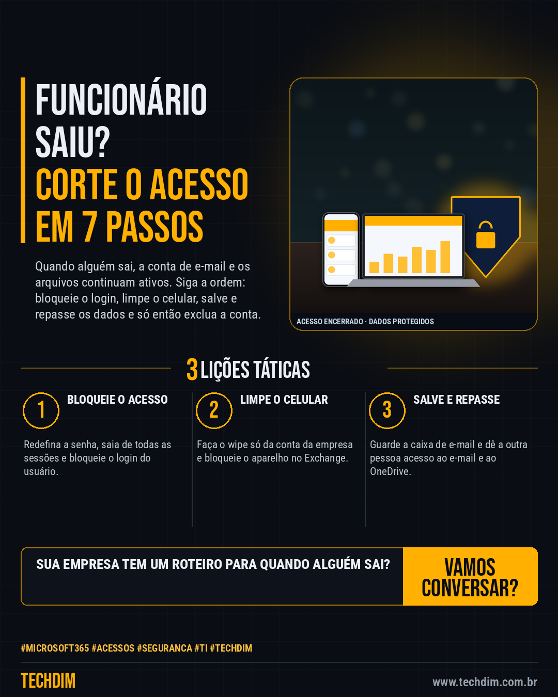

# Conhecimento — Desligar funcionário no Microsoft 365: 7 passos para cortar o acesso sem perder dados

- **Data:** 2026-10-12, 14:23 (horário de Brasília)
- **Curadoria:** Claude (Routine) — pauta do dia
- **Execução no Actions:** https://github.com/Techdimbr/Publi-midia-Techdim/actions/runs/38283822634
- **Por que esta pauta:** Roteiro oficial da Microsoft para cortar o acesso de quem saiu sem perder e-mails e arquivos que a empresa precisa guardar.

## Resultado

| Rede | Status | Link | 1º comentário |
|---|---|---|---|
| linkedin | ✅ publicado | https://www.linkedin.com/feed/update/urn:li:share:7515462138870571008/ | — |
| facebook | ✅ publicado | https://www.facebook.com/122132402349390486/posts/122135579913390486 | ✅ |
| instagram | ✅ publicado | https://www.instagram.com/p/DeZwwuyjRX6/ | ✅ |

## Fontes

- [learn.microsoft.com](https://learn.microsoft.com/en-us/microsoft-365/admin/add-users/remove-former-employee)
- [learn.microsoft.com](https://learn.microsoft.com/en-us/microsoft-365/admin/add-users/remove-former-employee-step-1)
- [learn.microsoft.com](https://learn.microsoft.com/en-us/microsoft-365/admin/add-users/remove-former-employee-step-3)

## Linkedin

```text
Desligar funcionário no Microsoft 365: 7 passos para cortar o acesso sem perder dados

01. No admin do Microsoft 365: Redefinir senha e Sign out of all sessions; depois Block sign-in (pode levar até 24 h). No Exchange, desligue também o acesso ao e-mail
02. Salve a caixa de e-mail, encaminhe as mensagens ou converta em caixa compartilhada e dê a outra pessoa acesso ao OneDrive. No celular, use Account Only Remote Wipe
03. Só então remova a licença e exclua a conta: e-mail, contatos e calendário ficam 30 dias e depois são apagados. Com Active Directory local, exclua a conta lá

Alguém saiu da empresa? Corte o acesso na ordem certa e salve os dados antes de excluir a conta.

Fontes: https://learn.microsoft.com/en-us/microsoft-365/admin/add-users/remove-former-employee · https://learn.microsoft.com/en-us/microsoft-365/admin/add-users/remove-former-employee-step-1

TECHDIM — Infraestrutura · Segurança · IA
https://www.techdim.com.br

#Microsoft365 #Acessos #Seguranca #TI #TECHDIM
```



## Facebook

```text
Desligar funcionário no Microsoft 365: 7 passos para cortar o acesso sem perder dados

• No admin do Microsoft 365: Redefinir senha e Sign out of all sessions; depois Block sign-in (pode levar até 24 h). No Exchange, desligue também o acesso ao e-mail
• Salve a caixa de e-mail, encaminhe as mensagens ou converta em caixa compartilhada e dê a outra pessoa acesso ao OneDrive. No celular, use Account Only Remote Wipe
• Só então remova a licença e exclua a conta: e-mail, contatos e calendário ficam 30 dias e depois são apagados. Com Active Directory local, exclua a conta lá

Alguém saiu da empresa? Corte o acesso na ordem certa e salve os dados antes de excluir a conta.

Fale com a TECHDIM — fontes e site no primeiro comentário 👇

#Microsoft365 #Acessos #Seguranca #TECHDIM
```

Primeiro comentário:

```text
📎 Fontes:
• learn.microsoft.com: https://learn.microsoft.com/en-us/microsoft-365/admin/add-users/remove-former-employee
• learn.microsoft.com: https://learn.microsoft.com/en-us/microsoft-365/admin/add-users/remove-former-employee-step-1
• learn.microsoft.com: https://learn.microsoft.com/en-us/microsoft-365/admin/add-users/remove-former-employee-step-3

🌐 TECHDIM — Infraestrutura · Segurança · IA: https://www.techdim.com.br
```


## Instagram

```text
Desligar funcionário no Microsoft 365: 7 passos para cortar o acesso sem perder dados

1️⃣ No admin do Microsoft 365: Redefinir senha e Sign out of all sessions; depois Block sign-in (pode levar até 24 h). No Exchange, desligue também o acesso ao e-mail
2️⃣ Salve a caixa de e-mail, encaminhe as mensagens ou converta em caixa compartilhada e dê a outra pessoa acesso ao OneDrive. No celular, use Account Only Remote Wipe
3️⃣ Só então remova a licença e exclua a conta: e-mail, contatos e calendário ficam 30 dias e depois são apagados. Com Active Directory local, exclua a conta lá

Alguém saiu da empresa? Corte o acesso na ordem certa e salve os dados antes de excluir a conta.

Saiba mais: www.techdim.com.br
Fontes no primeiro comentário 👇

#microsoft365 #acessos #seguranca #ti #techdim #conhecimento #aprendati #tecnologia
```

Primeiro comentário:

```text
📎 Fontes: learn.microsoft.com · learn.microsoft.com · learn.microsoft.com
```


