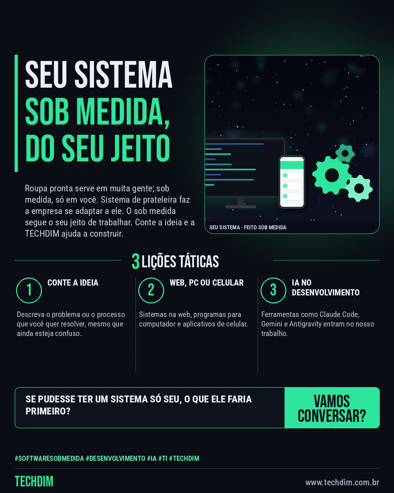

# TECHDIM · Serviços — Software sob medida: conte sua ideia e a TECHDIM ajuda a transformá-la em sistema ou app

- **Data:** 2026-10-12, 17:24 (horário de Brasília)
- **Curadoria:** Claude (Routine) — pauta do dia
- **Execução no Actions:** https://github.com/Techdimbr/Publi-midia-Techdim/actions/runs/38303884801
- **Por que esta pauta:** Apresenta o serviço de software sob medida e o uso de ferramentas de IA, com uma analogia do dia a dia e sem promessas de preço, prazo ou resultado.

## Resultado

| Rede | Status | Link | 1º comentário |
|---|---|---|---|
| linkedin | ✅ publicado | https://www.linkedin.com/feed/update/urn:li:share:7515507539585970176/ | — |
| facebook | ✅ publicado | https://www.facebook.com/122132402349390486/posts/122135626299390486 | ✅ |
| instagram | ✅ publicado | https://www.instagram.com/p/DeaFaopoKZ3/ | — |

## Linkedin

```text
Software sob medida: conte sua ideia e a TECHDIM ajuda a transformá-la em sistema ou app

01. Roupa pronta serve em muita gente; a sob medida veste você. Software é igual: em vez de adaptar a empresa ao sistema, o sistema segue o seu jeito de trabalhar
02. A TECHDIM desenvolve sistemas web, programas para computador e aplicativos de celular, usando ferramentas de IA como Claude Code, Gemini e Antigravity
03. Você conta a ideia ou o problema do dia a dia e a equipe ajuda a definir o que construir primeiro e como validar com quem vai usar

Tem uma ideia de sistema ou aplicativo? Conte para a gente: www.techdim.com.br

TECHDIM — Infraestrutura · Segurança · IA
https://www.techdim.com.br

#SoftwareSobMedida #Desenvolvimento #IA #TI #TECHDIM
```



## Facebook

```text
Software sob medida: conte sua ideia e a TECHDIM ajuda a transformá-la em sistema ou app

• Roupa pronta serve em muita gente; a sob medida veste você. Software é igual: em vez de adaptar a empresa ao sistema, o sistema segue o seu jeito de trabalhar
• A TECHDIM desenvolve sistemas web, programas para computador e aplicativos de celular, usando ferramentas de IA como Claude Code, Gemini e Antigravity
• Você conta a ideia ou o problema do dia a dia e a equipe ajuda a definir o que construir primeiro e como validar com quem vai usar

Tem uma ideia de sistema ou aplicativo? Conte para a gente: www.techdim.com.br

Fale com a TECHDIM — link no primeiro comentário 👇

#SoftwareSobMedida #Desenvolvimento #IA #TECHDIM
```

Primeiro comentário:

```text
🌐 TECHDIM — Infraestrutura · Segurança · IA: https://www.techdim.com.br
```


## Instagram

```text
Software sob medida: conte sua ideia e a TECHDIM ajuda a transformá-la em sistema ou app

1️⃣ Roupa pronta serve em muita gente; a sob medida veste você. Software é igual: em vez de adaptar a empresa ao sistema, o sistema segue o seu jeito de trabalhar
2️⃣ A TECHDIM desenvolve sistemas web, programas para computador e aplicativos de celular, usando ferramentas de IA como Claude Code, Gemini e Antigravity
3️⃣ Você conta a ideia ou o problema do dia a dia e a equipe ajuda a definir o que construir primeiro e como validar com quem vai usar

Tem uma ideia de sistema ou aplicativo? Conte para a gente: www.techdim.com.br

Saiba mais: www.techdim.com.br

#softwaresobmedida #desenvolvimento #ia #ti #techdim #suportetecnico #ciberseguranca #automacao
```


