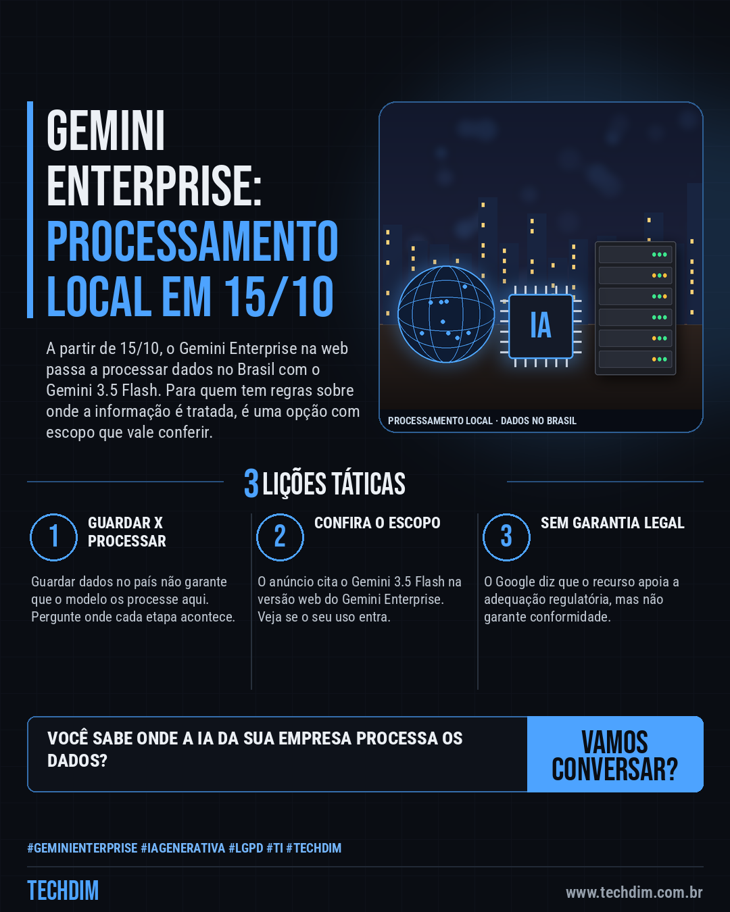

# Notícias de Tecnologia — Gemini Enterprise processará dados no Brasil a partir de 15/10 com o Gemini 3.5 Flash

- **Data:** 2026-10-13, 08:00 (horário de Brasília)
- **Curadoria:** Claude (Routine) — pauta do dia
- **Execução no Actions:** https://github.com/Techdimbr/Publi-midia-Techdim/actions/runs/38387100599
- **Por que esta pauta:** Empresas com regras sobre onde os dados são processados ganham uma opção no país, com escopo limitado que vale conferir antes de contar com ela.

## Resultado

| Rede | Status | Link | 1º comentário |
|---|---|---|---|
| linkedin | ✅ publicado | https://www.linkedin.com/feed/update/urn:li:share:7515727990455099394/ | — |
| facebook | ✅ publicado | https://www.facebook.com/122132402349390486/posts/122135752791390486 | ✅ |
| instagram | ✅ publicado | https://www.instagram.com/p/DebpqtHoOON/ | ✅ |
| Stories | ✅ publicado | https://www.instagram.com/stories/techdimbr/4006979700542866217 | — |

## Fontes

- [canaltech.com.br](https://canaltech.com.br/inteligencia-artificial/gemini-ganha-processamento-local-no-brasil-e-deve-ficar-mais-rapido/)
- [googlecloudpresscorner.com](https://www.googlecloudpresscorner.com/2026-09-24-Google-Cloud-Expands-in-Brazil-to-Power-the-Next-Generation-of-Agentic-AI)

## Linkedin

```text
Gemini Enterprise processará dados no Brasil a partir de 15/10 com o Gemini 3.5 Flash

01. A partir de 15/10, o Gemini Enterprise na web passa a ter processamento de dados no Brasil com o Gemini 3.5 Flash, anunciou o Google Cloud no Brazil Summit
02. O objetivo é atender empresas com regras sobre onde processar dados e reduzir a latência. O Google diz que apoia a adequação regulatória, sem garantir conformidade
03. Segundo o Canaltech, vale para determinadas cargas, e a latência menor é possibilidade. O armazenamento para agentes já era no país; só o 3.5 Flash foi citado

Sua empresa usa IA com dados de clientes? Pergunte ao fornecedor onde cada etapa é processada.

Fontes: https://canaltech.com.br/inteligencia-artificial/gemini-ganha-processamento-local-no-brasil-e-deve-ficar-mais-rapido/ · https://www.googlecloudpresscorner.com/2026-09-24-Google-Cloud-Expands-in-Brazil-to-Power-the-Next-Generation-of-Agentic-AI

TECHDIM — Infraestrutura · Segurança · IA
https://www.techdim.com.br

#GeminiEnterprise #IAGenerativa #Lgpd #TI #TECHDIM
```



## Facebook

```text
Gemini Enterprise processará dados no Brasil a partir de 15/10 com o Gemini 3.5 Flash

• A partir de 15/10, o Gemini Enterprise na web passa a ter processamento de dados no Brasil com o Gemini 3.5 Flash, anunciou o Google Cloud no Brazil Summit
• O objetivo é atender empresas com regras sobre onde processar dados e reduzir a latência. O Google diz que apoia a adequação regulatória, sem garantir conformidade
• Segundo o Canaltech, vale para determinadas cargas, e a latência menor é possibilidade. O armazenamento para agentes já era no país; só o 3.5 Flash foi citado

Sua empresa usa IA com dados de clientes? Pergunte ao fornecedor onde cada etapa é processada.

Fale com a TECHDIM — fontes e site no primeiro comentário 👇

#GeminiEnterprise #IAGenerativa #Lgpd #TECHDIM
```

Primeiro comentário:

```text
📎 Fontes:
• canaltech.com.br: https://canaltech.com.br/inteligencia-artificial/gemini-ganha-processamento-local-no-brasil-e-deve-ficar-mais-rapido/
• googlecloudpresscorner.com: https://www.googlecloudpresscorner.com/2026-09-24-Google-Cloud-Expands-in-Brazil-to-Power-the-Next-Generation-of-Agentic-AI

🌐 TECHDIM — Infraestrutura · Segurança · IA: https://www.techdim.com.br
```


## Instagram

```text
Gemini Enterprise processará dados no Brasil a partir de 15/10 com o Gemini 3.5 Flash

1️⃣ A partir de 15/10, o Gemini Enterprise na web passa a ter processamento de dados no Brasil com o Gemini 3.5 Flash, anunciou o Google Cloud no Brazil Summit
2️⃣ O objetivo é atender empresas com regras sobre onde processar dados e reduzir a latência. O Google diz que apoia a adequação regulatória, sem garantir conformidade
3️⃣ Segundo o Canaltech, vale para determinadas cargas, e a latência menor é possibilidade. O armazenamento para agentes já era no país; só o 3.5 Flash foi citado

Sua empresa usa IA com dados de clientes? Pergunte ao fornecedor onde cada etapa é processada.

Saiba mais: www.techdim.com.br
Fontes no primeiro comentário 👇

#geminienterprise #iagenerativa #lgpd #ti #techdim #tecnologia #inteligenciaartificial #ia
```

Primeiro comentário:

```text
📎 Fontes: canaltech.com.br · googlecloudpresscorner.com
```


## Stories


