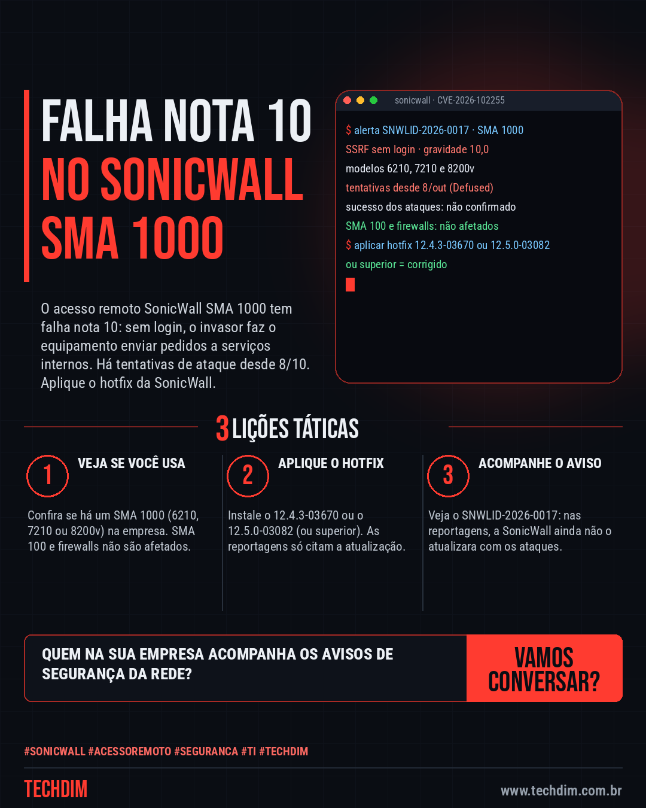
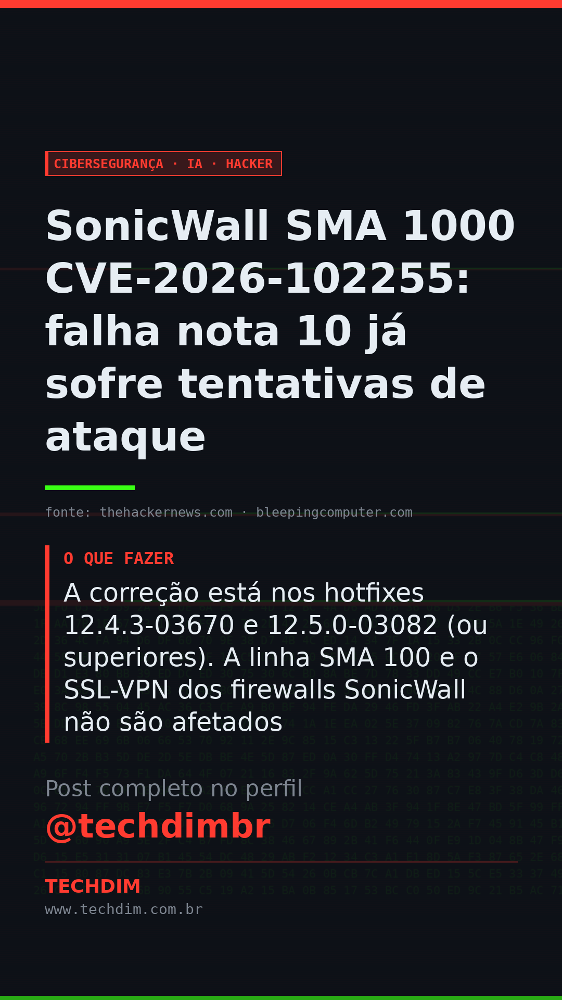

# Cibersegurança · IA · Hacker — SonicWall SMA 1000 CVE-2026-102255: falha nota 10 já sofre tentativas de ataque

- **Data:** 2026-10-13, 11:08 (horário de Brasília)
- **Curadoria:** Claude (Routine) — pauta do dia
- **Execução no Actions:** https://github.com/Techdimbr/Publi-midia-Techdim/actions/runs/38410679963
- **Por que esta pauta:** Falha de gravidade máxima em equipamento de acesso remoto, com tentativas de ataque registradas e correção disponível: vale conferir hoje se há um SMA 1000 na empresa.

## Resultado

| Rede | Status | Link | 1º comentário |
|---|---|---|---|
| linkedin | ✅ publicado | https://www.linkedin.com/feed/update/urn:li:share:7515775368759402496/ | — |
| facebook | ✅ publicado | https://www.facebook.com/122132402349390486/posts/122135793261390486 | ✅ |
| instagram | ✅ publicado | https://www.instagram.com/p/Deb_NFTjvo4/ | ✅ |
| Stories | ✅ publicado | https://www.instagram.com/stories/techdimbr/4007074391829436807 | — |

## Fontes

- [thehackernews.com](https://thehackernews.com/2026/10/critical-sonicwall-sma-1000-flaw.html)
- [bleepingcomputer.com](https://www.bleepingcomputer.com/news/security/max-severity-sonicwall-sma1000-flaw-now-exploited-in-attacks/)

## Linkedin

```text
SonicWall SMA 1000 CVE-2026-102255: falha nota 10 já sofre tentativas de ataque

01. O SonicWall SMA 1000 (modelos 6210, 7210 e 8200v) tem falha nota 10 (CVE-2026-102255): sem login, o invasor faz o equipamento enviar pedidos a serviços internos
02. Defused Cyber e Previdian viram tentativas de exploração desde 8/10. Não se sabe se alguma deu certo. Nas reportagens, o aviso da SonicWall não citava ataques
03. A correção está nos hotfixes 12.4.3-03670 e 12.5.0-03082 (ou superiores). A linha SMA 100 e o SSL-VPN dos firewalls SonicWall não são afetados

Sua empresa usa SonicWall SMA 1000? Confira o modelo e a versão e aplique o hotfix hoje.

Fontes: https://thehackernews.com/2026/10/critical-sonicwall-sma-1000-flaw.html · https://www.bleepingcomputer.com/news/security/max-severity-sonicwall-sma1000-flaw-now-exploited-in-attacks/

TECHDIM — Infraestrutura · Segurança · IA
https://www.techdim.com.br

#SonicWall #AcessoRemoto #Seguranca #TI #TECHDIM
```



## Facebook

```text
SonicWall SMA 1000 CVE-2026-102255: falha nota 10 já sofre tentativas de ataque

• O SonicWall SMA 1000 (modelos 6210, 7210 e 8200v) tem falha nota 10 (CVE-2026-102255): sem login, o invasor faz o equipamento enviar pedidos a serviços internos
• Defused Cyber e Previdian viram tentativas de exploração desde 8/10. Não se sabe se alguma deu certo. Nas reportagens, o aviso da SonicWall não citava ataques
• A correção está nos hotfixes 12.4.3-03670 e 12.5.0-03082 (ou superiores). A linha SMA 100 e o SSL-VPN dos firewalls SonicWall não são afetados

Sua empresa usa SonicWall SMA 1000? Confira o modelo e a versão e aplique o hotfix hoje.

Fale com a TECHDIM — fontes e site no primeiro comentário 👇

#SonicWall #AcessoRemoto #Seguranca #TECHDIM
```

Primeiro comentário:

```text
📎 Fontes:
• thehackernews.com: https://thehackernews.com/2026/10/critical-sonicwall-sma-1000-flaw.html
• bleepingcomputer.com: https://www.bleepingcomputer.com/news/security/max-severity-sonicwall-sma1000-flaw-now-exploited-in-attacks/

🌐 TECHDIM — Infraestrutura · Segurança · IA: https://www.techdim.com.br
```


## Instagram

```text
SonicWall SMA 1000 CVE-2026-102255: falha nota 10 já sofre tentativas de ataque

1️⃣ O SonicWall SMA 1000 (modelos 6210, 7210 e 8200v) tem falha nota 10 (CVE-2026-102255): sem login, o invasor faz o equipamento enviar pedidos a serviços internos
2️⃣ Defused Cyber e Previdian viram tentativas de exploração desde 8/10. Não se sabe se alguma deu certo. Nas reportagens, o aviso da SonicWall não citava ataques
3️⃣ A correção está nos hotfixes 12.4.3-03670 e 12.5.0-03082 (ou superiores). A linha SMA 100 e o SSL-VPN dos firewalls SonicWall não são afetados

Sua empresa usa SonicWall SMA 1000? Confira o modelo e a versão e aplique o hotfix hoje.

Saiba mais: www.techdim.com.br
Fontes no primeiro comentário 👇

#sonicwall #acessoremoto #seguranca #ti #techdim #ciberseguranca #hacker #infraestrutura
```

Primeiro comentário:

```text
📎 Fontes: thehackernews.com · bleepingcomputer.com
```


## Stories


