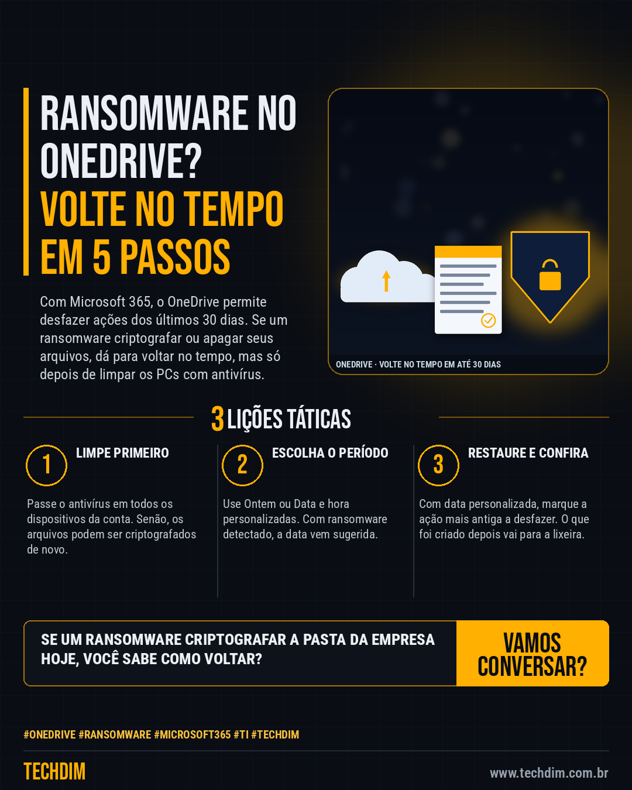

# Conhecimento — Restaurar o OneDrive: desfaça em 5 passos o estrago de ransomware ou exclusão em massa

- **Data:** 2026-10-13, 14:24 (horário de Brasília)
- **Curadoria:** Claude (Routine) — pauta do dia
- **Execução no Actions:** https://github.com/Techdimbr/Publi-midia-Techdim/actions/runs/38438224474
- **Por que esta pauta:** Passo a passo oficial da Microsoft para desfazer ransomware ou exclusão em massa no OneDrive, um caminho de recuperação que pouca empresa conhece.

## Resultado

| Rede | Status | Link | 1º comentário |
|---|---|---|---|
| linkedin | ✅ publicado | https://www.linkedin.com/feed/update/urn:li:share:7515824591458717696/ | — |
| facebook | ✅ publicado | https://www.facebook.com/122132402349390486/posts/122135820759390486 | ✅ |
| instagram | ✅ publicado | https://www.instagram.com/p/DecVmBPmLZX/ | ✅ |

## Fontes

- [support.microsoft.com](https://support.microsoft.com/pt-br/office/restaurar-o-onedrive-fa231298-759d-41cf-bcd0-25ac53eb8a15)
- [support.microsoft.com](https://support.microsoft.com/onedrive/how-to-detect-ransomware-and-recover-files-using-onedrive)

## Linkedin

```text
Restaurar o OneDrive: desfaça em 5 passos o estrago de ransomware ou exclusão em massa

01. Com Microsoft 365, o Restaurar o OneDrive desfaz alterações dos últimos 30 dias. Antes, passe o antivírus em todos os dispositivos da conta, para não criptografar de novo
02. Em onedrive.com, abra Configurações > Restaurar o OneDrive e escolha o período (ex.: Ontem) ou Data e hora personalizadas. Com ransomware detectado, a data vem sugerida
03. Veja o gráfico de atividades; em Data e hora personalizadas, marque a ação mais antiga a desfazer e clique em Restaurar. Arquivos criados depois vão para a lixeira

Seus arquivos estão no OneDrive? Aprenda o caminho de volta antes de precisar dele.

Fontes: https://support.microsoft.com/pt-br/office/restaurar-o-onedrive-fa231298-759d-41cf-bcd0-25ac53eb8a15 · https://support.microsoft.com/onedrive/how-to-detect-ransomware-and-recover-files-using-onedrive

TECHDIM — Infraestrutura · Segurança · IA
https://www.techdim.com.br

#OneDrive #Ransomware #Microsoft365 #TI #TECHDIM
```



## Facebook

```text
Restaurar o OneDrive: desfaça em 5 passos o estrago de ransomware ou exclusão em massa

• Com Microsoft 365, o Restaurar o OneDrive desfaz alterações dos últimos 30 dias. Antes, passe o antivírus em todos os dispositivos da conta, para não criptografar de novo
• Em onedrive.com, abra Configurações > Restaurar o OneDrive e escolha o período (ex.: Ontem) ou Data e hora personalizadas. Com ransomware detectado, a data vem sugerida
• Veja o gráfico de atividades; em Data e hora personalizadas, marque a ação mais antiga a desfazer e clique em Restaurar. Arquivos criados depois vão para a lixeira

Seus arquivos estão no OneDrive? Aprenda o caminho de volta antes de precisar dele.

Fale com a TECHDIM — fontes e site no primeiro comentário 👇

#OneDrive #Ransomware #Microsoft365 #TECHDIM
```

Primeiro comentário:

```text
📎 Fontes:
• support.microsoft.com: https://support.microsoft.com/pt-br/office/restaurar-o-onedrive-fa231298-759d-41cf-bcd0-25ac53eb8a15
• support.microsoft.com: https://support.microsoft.com/onedrive/how-to-detect-ransomware-and-recover-files-using-onedrive

🌐 TECHDIM — Infraestrutura · Segurança · IA: https://www.techdim.com.br
```


## Instagram

```text
Restaurar o OneDrive: desfaça em 5 passos o estrago de ransomware ou exclusão em massa

1️⃣ Com Microsoft 365, o Restaurar o OneDrive desfaz alterações dos últimos 30 dias. Antes, passe o antivírus em todos os dispositivos da conta, para não criptografar de novo
2️⃣ Em onedrive.com, abra Configurações > Restaurar o OneDrive e escolha o período (ex.: Ontem) ou Data e hora personalizadas. Com ransomware detectado, a data vem sugerida
3️⃣ Veja o gráfico de atividades; em Data e hora personalizadas, marque a ação mais antiga a desfazer e clique em Restaurar. Arquivos criados depois vão para a lixeira

Seus arquivos estão no OneDrive? Aprenda o caminho de volta antes de precisar dele.

Saiba mais: www.techdim.com.br
Fontes no primeiro comentário 👇

#onedrive #ransomware #microsoft365 #ti #techdim #conhecimento #aprendati #tecnologia
```

Primeiro comentário:

```text
📎 Fontes: support.microsoft.com · support.microsoft.com
```


