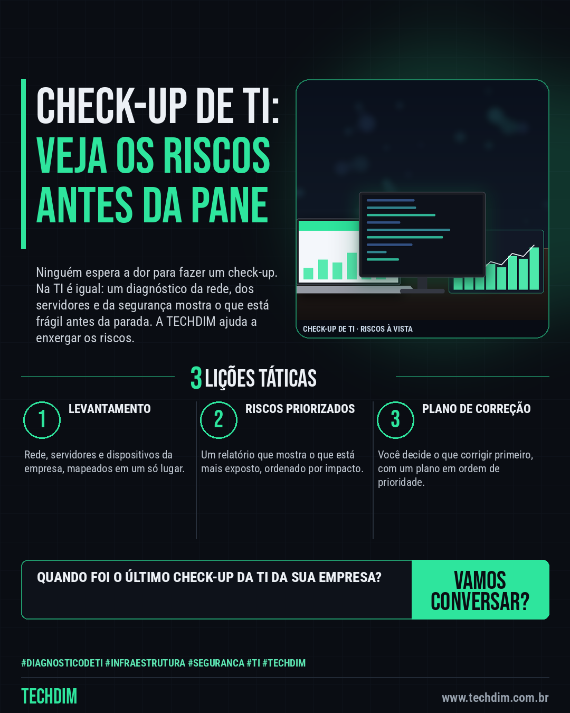

# TECHDIM · Serviços — Check-up de TI: diagnóstico da infraestrutura e da segurança antes que algo pare a empresa

- **Data:** 2026-10-13, 17:24 (horário de Brasília)
- **Curadoria:** Claude (Routine) — pauta do dia
- **Execução no Actions:** https://github.com/Techdimbr/Publi-midia-Techdim/actions/runs/38462424325
- **Por que esta pauta:** Apresenta o diagnóstico de infraestrutura e segurança com a analogia do check-up médico, sem promessas de preço, prazo ou resultado.

## Resultado

| Rede | Status | Link | 1º comentário |
|---|---|---|---|
| linkedin | ✅ publicado | https://www.linkedin.com/feed/update/urn:li:share:7515870015019970560/ | — |
| facebook | ✅ publicado | https://www.facebook.com/122132402349390486/posts/122135842749390486 | ✅ |
| instagram | ✅ publicado | https://www.instagram.com/p/DecqPmymEd1/ | — |

## Linkedin

```text
Check-up de TI: diagnóstico da infraestrutura e da segurança antes que algo pare a empresa

01. Você faz check-up antes de sentir dor? A TI também precisa: o diagnóstico mostra o que está frágil antes de virar parada, perda de dados ou invasão
02. A TECHDIM levanta a rede, os servidores e os dispositivos da empresa e entrega um relatório com os riscos ordenados por impacto
03. Com o relatório, você decide o que corrigir primeiro: o plano de correção segue a ordem de prioridade, para investir antes no que mais pesa

Quer saber onde sua TI está exposta? Fale com a TECHDIM: www.techdim.com.br

TECHDIM — Infraestrutura · Segurança · IA
https://www.techdim.com.br

#DiagnosticoDeTI #Infraestrutura #Seguranca #TI #TECHDIM
```



## Facebook

```text
Check-up de TI: diagnóstico da infraestrutura e da segurança antes que algo pare a empresa

• Você faz check-up antes de sentir dor? A TI também precisa: o diagnóstico mostra o que está frágil antes de virar parada, perda de dados ou invasão
• A TECHDIM levanta a rede, os servidores e os dispositivos da empresa e entrega um relatório com os riscos ordenados por impacto
• Com o relatório, você decide o que corrigir primeiro: o plano de correção segue a ordem de prioridade, para investir antes no que mais pesa

Quer saber onde sua TI está exposta? Fale com a TECHDIM: www.techdim.com.br

Fale com a TECHDIM — link no primeiro comentário 👇

#DiagnosticoDeTI #Infraestrutura #Seguranca #TECHDIM
```

Primeiro comentário:

```text
🌐 TECHDIM — Infraestrutura · Segurança · IA: https://www.techdim.com.br
```


## Instagram

```text
Check-up de TI: diagnóstico da infraestrutura e da segurança antes que algo pare a empresa

1️⃣ Você faz check-up antes de sentir dor? A TI também precisa: o diagnóstico mostra o que está frágil antes de virar parada, perda de dados ou invasão
2️⃣ A TECHDIM levanta a rede, os servidores e os dispositivos da empresa e entrega um relatório com os riscos ordenados por impacto
3️⃣ Com o relatório, você decide o que corrigir primeiro: o plano de correção segue a ordem de prioridade, para investir antes no que mais pesa

Quer saber onde sua TI está exposta? Fale com a TECHDIM: www.techdim.com.br

Saiba mais: www.techdim.com.br

#diagnosticodeti #infraestrutura #seguranca #ti #techdim #suportetecnico #ciberseguranca #automacao
```


