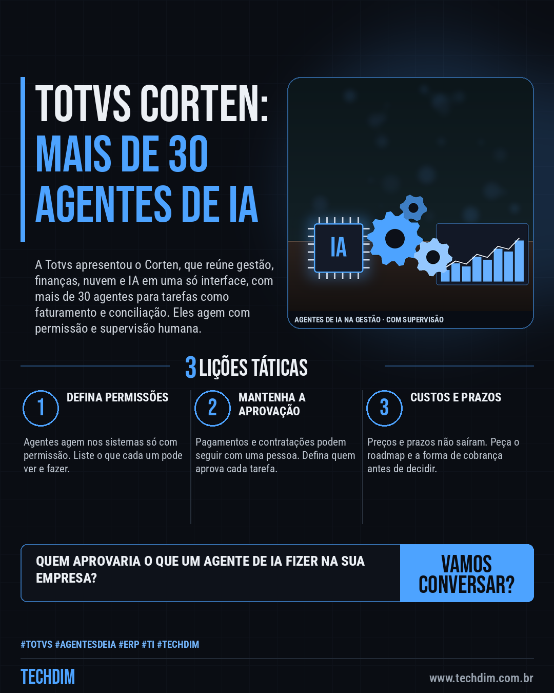

# Notícias de Tecnologia — Totvs apresenta o Corten: gestão com mais de 30 agentes de IA e supervisão humana

- **Data:** 2026-10-14, 07:59 (horário de Brasília)
- **Curadoria:** Claude (Routine) — pauta do dia
- **Execução no Actions:** https://github.com/Techdimbr/Publi-midia-Techdim/actions/runs/38553327612
- **Por que esta pauta:** Fornecedora de ERP com mais de 70 mil clientes leva agentes de IA para dentro da gestão, e vale entender permissões, aprovação humana, custos e prazos antes de adotar.

## Resultado

| Rede | Status | Link | 1º comentário |
|---|---|---|---|
| linkedin | ✅ publicado | https://www.linkedin.com/feed/update/urn:li:share:7516090231775756288/ | — |
| facebook | ✅ publicado | https://www.facebook.com/122132402349390486/posts/122135997171390486 | ✅ |
| instagram | ✅ publicado | https://www.instagram.com/p/DeeOYg_lCFK/ | ✅ |
| Stories | ✅ publicado | https://www.instagram.com/stories/techdimbr/4007704102679360619 | — |

## Fontes

- [itforum.com.br](https://itforum.com.br/noticias/totvs-corten-agentes-ia-erp/)
- [baguete.com.br](https://www.baguete.com.br/noticias/totvs-define-o-futuro-do-seu-erp)

## Linkedin

```text
Totvs apresenta o Corten: gestão com mais de 30 agentes de IA e supervisão humana

01. Na terça (13/10), a Totvs apresentou o Corten, um “sistema operacional de gestão” que reúne backoffice, clientes, serviços financeiros, nuvem e IA em uma só interface
02. São mais de 30 agentes de IA, criados sobre o Lynn, para tarefas como faturamento e conciliação. Agem nos sistemas com permissão e há supervisão humana quando necessário
03. Preços e prazos não foram detalhados: cada produto segue seu roadmap. O Totvs Pay, de pagamentos, chega em dezembro para educação e construção civil, segundo o Baguete

Usa ERP e quer agentes de IA? Pergunte quais tarefas o agente faz e quem aprova pagamentos.

Fontes: https://itforum.com.br/noticias/totvs-corten-agentes-ia-erp/ · https://www.baguete.com.br/noticias/totvs-define-o-futuro-do-seu-erp

TECHDIM — Infraestrutura · Segurança · IA
https://www.techdim.com.br

#Totvs #AgentesDeIA #ERP #TI #TECHDIM
```



## Facebook

```text
Totvs apresenta o Corten: gestão com mais de 30 agentes de IA e supervisão humana

• Na terça (13/10), a Totvs apresentou o Corten, um “sistema operacional de gestão” que reúne backoffice, clientes, serviços financeiros, nuvem e IA em uma só interface
• São mais de 30 agentes de IA, criados sobre o Lynn, para tarefas como faturamento e conciliação. Agem nos sistemas com permissão e há supervisão humana quando necessário
• Preços e prazos não foram detalhados: cada produto segue seu roadmap. O Totvs Pay, de pagamentos, chega em dezembro para educação e construção civil, segundo o Baguete

Usa ERP e quer agentes de IA? Pergunte quais tarefas o agente faz e quem aprova pagamentos.

Fale com a TECHDIM — fontes e site no primeiro comentário 👇

#Totvs #AgentesDeIA #ERP #TECHDIM
```

Primeiro comentário:

```text
📎 Fontes:
• itforum.com.br: https://itforum.com.br/noticias/totvs-corten-agentes-ia-erp/
• baguete.com.br: https://www.baguete.com.br/noticias/totvs-define-o-futuro-do-seu-erp

🌐 TECHDIM — Infraestrutura · Segurança · IA: https://www.techdim.com.br
```


## Instagram

```text
Totvs apresenta o Corten: gestão com mais de 30 agentes de IA e supervisão humana

1️⃣ Na terça (13/10), a Totvs apresentou o Corten, um “sistema operacional de gestão” que reúne backoffice, clientes, serviços financeiros, nuvem e IA em uma só interface
2️⃣ São mais de 30 agentes de IA, criados sobre o Lynn, para tarefas como faturamento e conciliação. Agem nos sistemas com permissão e há supervisão humana quando necessário
3️⃣ Preços e prazos não foram detalhados: cada produto segue seu roadmap. O Totvs Pay, de pagamentos, chega em dezembro para educação e construção civil, segundo o Baguete

Usa ERP e quer agentes de IA? Pergunte quais tarefas o agente faz e quem aprova pagamentos.

Saiba mais: www.techdim.com.br
Fontes no primeiro comentário 👇

#totvs #agentesdeia #erp #ti #techdim #tecnologia #inteligenciaartificial #ia
```

Primeiro comentário:

```text
📎 Fontes: itforum.com.br · baguete.com.br
```


## Stories


