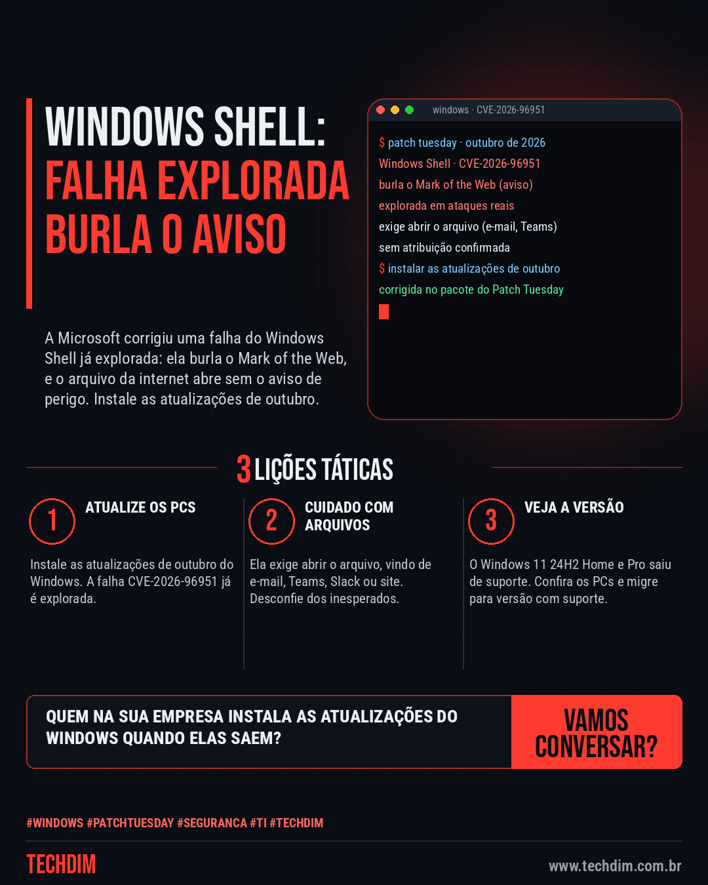

# Cibersegurança · IA · Hacker — Windows Shell CVE-2026-96951: falha explorada burla o aviso de arquivos da internet

- **Data:** 2026-10-14, 11:09 (horário de Brasília)
- **Curadoria:** Claude (Routine) — pauta do dia
- **Execução no Actions:** https://github.com/Techdimbr/Publi-midia-Techdim/actions/runs/38577785979
- **Por que esta pauta:** Falha do Windows já explorada, com correção no pacote de outubro: afeta qualquer empresa com PCs Windows e a defesa é atualizar.

## Resultado

| Rede | Status | Link | 1º comentário |
|---|---|---|---|
| linkedin | ✅ publicado | https://www.linkedin.com/feed/update/urn:li:share:7516137841622605824/ | — |
| facebook | ✅ publicado | https://www.facebook.com/122132402349390486/posts/122136033963390486 | ✅ |
| instagram | ✅ publicado | https://www.instagram.com/p/DeekCPeFAmx/ | ✅ |
| Stories | ✅ publicado | https://www.instagram.com/stories/techdimbr/4007799358594808914 | — |

## Fontes

- [bleepingcomputer.com](https://www.bleepingcomputer.com/news/microsoft/microsoft-october-2026-patch-tuesday-fixes-1-411-flaws-3-zero-days/)
- [helpnetsecurity.com](https://www.helpnetsecurity.com/2026/10/14/microsoft-patch-tuesday-cve-2026-96951-motw-bypass/)

## Linkedin

```text
Windows Shell CVE-2026-96951: falha explorada burla o aviso de arquivos da internet

01. A Microsoft corrigiu no Patch Tuesday de outubro a CVE-2026-96951, no Windows Shell, já explorada: ela burla o Mark of the Web e o arquivo abre sem o aviso de perigo
02. O ataque exige que a pessoa abra o arquivo, que pode vir por e-mail, Teams, Slack ou download. Não há atribuição confirmada nem detalhes da exploração
03. O pacote tem mais de 1.400 correções, recorde. Segundo o BleepingComputer, o Windows 11 24H2 Home e Pro encerra o suporte com esta atualização

Instale as atualizações de outubro nos PCs e confira quais ainda estão no Windows 11 24H2.

Fontes: https://www.bleepingcomputer.com/news/microsoft/microsoft-october-2026-patch-tuesday-fixes-1-411-flaws-3-zero-days/ · https://www.helpnetsecurity.com/2026/10/14/microsoft-patch-tuesday-cve-2026-96951-motw-bypass/

TECHDIM — Infraestrutura · Segurança · IA
https://www.techdim.com.br

#Windows #PatchTuesday #Seguranca #TI #TECHDIM
```



## Facebook

```text
Windows Shell CVE-2026-96951: falha explorada burla o aviso de arquivos da internet

• A Microsoft corrigiu no Patch Tuesday de outubro a CVE-2026-96951, no Windows Shell, já explorada: ela burla o Mark of the Web e o arquivo abre sem o aviso de perigo
• O ataque exige que a pessoa abra o arquivo, que pode vir por e-mail, Teams, Slack ou download. Não há atribuição confirmada nem detalhes da exploração
• O pacote tem mais de 1.400 correções, recorde. Segundo o BleepingComputer, o Windows 11 24H2 Home e Pro encerra o suporte com esta atualização

Instale as atualizações de outubro nos PCs e confira quais ainda estão no Windows 11 24H2.

Fale com a TECHDIM — fontes e site no primeiro comentário 👇

#Windows #PatchTuesday #Seguranca #TECHDIM
```

Primeiro comentário:

```text
📎 Fontes:
• bleepingcomputer.com: https://www.bleepingcomputer.com/news/microsoft/microsoft-october-2026-patch-tuesday-fixes-1-411-flaws-3-zero-days/
• helpnetsecurity.com: https://www.helpnetsecurity.com/2026/10/14/microsoft-patch-tuesday-cve-2026-96951-motw-bypass/

🌐 TECHDIM — Infraestrutura · Segurança · IA: https://www.techdim.com.br
```


## Instagram

```text
Windows Shell CVE-2026-96951: falha explorada burla o aviso de arquivos da internet

1️⃣ A Microsoft corrigiu no Patch Tuesday de outubro a CVE-2026-96951, no Windows Shell, já explorada: ela burla o Mark of the Web e o arquivo abre sem o aviso de perigo
2️⃣ O ataque exige que a pessoa abra o arquivo, que pode vir por e-mail, Teams, Slack ou download. Não há atribuição confirmada nem detalhes da exploração
3️⃣ O pacote tem mais de 1.400 correções, recorde. Segundo o BleepingComputer, o Windows 11 24H2 Home e Pro encerra o suporte com esta atualização

Instale as atualizações de outubro nos PCs e confira quais ainda estão no Windows 11 24H2.

Saiba mais: www.techdim.com.br
Fontes no primeiro comentário 👇

#windows #patchtuesday #seguranca #ti #techdim #ciberseguranca #hacker #infraestrutura
```

Primeiro comentário:

```text
📎 Fontes: bleepingcomputer.com · helpnetsecurity.com
```


## Stories


