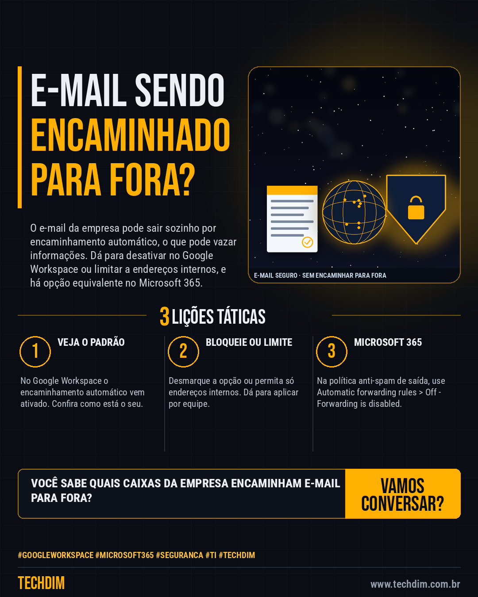

# Conhecimento — Encaminhamento automático de e-mail: como bloquear no Google Workspace e no Microsoft 365

- **Data:** 2026-10-14, 14:23 (horário de Brasília)
- **Curadoria:** Claude (Routine) — pauta do dia
- **Execução no Actions:** https://github.com/Techdimbr/Publi-midia-Techdim/actions/runs/38606154744
- **Por que esta pauta:** Passo a passo oficial para controlar o encaminhamento automático de e-mail para fora da empresa, que pode vazar informações, no Google Workspace e no Microsoft 365.

## Resultado

| Rede | Status | Link | 1º comentário |
|---|---|---|---|
| linkedin | ✅ publicado | https://www.linkedin.com/feed/update/urn:li:share:7516186894083227649/ | — |
| facebook | ✅ publicado | https://www.facebook.com/122132402349390486/posts/122136061485390486 | ✅ |
| instagram | ✅ publicado | https://www.instagram.com/p/Dee6WbkAY6o/ | ✅ |

## Fontes

- [knowledge.workspace.google.com](https://knowledge.workspace.google.com/admin/gmail/let-users-automatically-forward-their-own-gmail-emails?hl=pt-BR)
- [learn.microsoft.com](https://learn.microsoft.com/pt-br/defender-office-365/outbound-spam-policies-external-email-forwarding)

## Linkedin

```text
Encaminhamento automático de e-mail: como bloquear no Google Workspace e no Microsoft 365

01. No Google Workspace: Admin Console > Apps > Google Workspace > Gmail > Acesso do usuário final > Encaminhamento automático (exige o privilégio Configurações do Gmail)
02. Desmarque Permitir que os usuários encaminhem automaticamente e-mails recebidos, ou deixe só endereços internos, e clique em Salvar. O padrão vem ativado
03. No Microsoft 365: Defender > Email & collaboration > Policies & rules > Threat policies > Anti-spam > política de saída > Automatic forwarding rules > Off

Seu e-mail corporativo permite encaminhar para fora? Confira hoje e feche essa porta.

Fontes: https://knowledge.workspace.google.com/admin/gmail/let-users-automatically-forward-their-own-gmail-emails?hl=pt-BR · https://learn.microsoft.com/pt-br/defender-office-365/outbound-spam-policies-external-email-forwarding

TECHDIM — Infraestrutura · Segurança · IA
https://www.techdim.com.br

#GoogleWorkspace #Microsoft365 #Seguranca #TI #TECHDIM
```



## Facebook

```text
Encaminhamento automático de e-mail: como bloquear no Google Workspace e no Microsoft 365

• No Google Workspace: Admin Console > Apps > Google Workspace > Gmail > Acesso do usuário final > Encaminhamento automático (exige o privilégio Configurações do Gmail)
• Desmarque Permitir que os usuários encaminhem automaticamente e-mails recebidos, ou deixe só endereços internos, e clique em Salvar. O padrão vem ativado
• No Microsoft 365: Defender > Email & collaboration > Policies & rules > Threat policies > Anti-spam > política de saída > Automatic forwarding rules > Off

Seu e-mail corporativo permite encaminhar para fora? Confira hoje e feche essa porta.

Fale com a TECHDIM — fontes e site no primeiro comentário 👇

#GoogleWorkspace #Microsoft365 #Seguranca #TECHDIM
```

Primeiro comentário:

```text
📎 Fontes:
• knowledge.workspace.google.com: https://knowledge.workspace.google.com/admin/gmail/let-users-automatically-forward-their-own-gmail-emails?hl=pt-BR
• learn.microsoft.com: https://learn.microsoft.com/pt-br/defender-office-365/outbound-spam-policies-external-email-forwarding

🌐 TECHDIM — Infraestrutura · Segurança · IA: https://www.techdim.com.br
```


## Instagram

```text
Encaminhamento automático de e-mail: como bloquear no Google Workspace e no Microsoft 365

1️⃣ No Google Workspace: Admin Console > Apps > Google Workspace > Gmail > Acesso do usuário final > Encaminhamento automático (exige o privilégio Configurações do Gmail)
2️⃣ Desmarque Permitir que os usuários encaminhem automaticamente e-mails recebidos, ou deixe só endereços internos, e clique em Salvar. O padrão vem ativado
3️⃣ No Microsoft 365: Defender > Email & collaboration > Policies & rules > Threat policies > Anti-spam > política de saída > Automatic forwarding rules > Off

Seu e-mail corporativo permite encaminhar para fora? Confira hoje e feche essa porta.

Saiba mais: www.techdim.com.br
Fontes no primeiro comentário 👇

#googleworkspace #microsoft365 #seguranca #ti #techdim #conhecimento #aprendati #tecnologia
```

Primeiro comentário:

```text
📎 Fontes: knowledge.workspace.google.com · learn.microsoft.com
```


