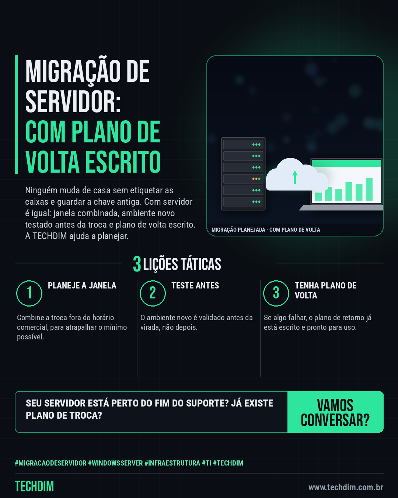

# TECHDIM · Serviços — Migração de servidor: planeje a troca antes que o suporte do Windows Server 2016 acabe

- **Data:** 2026-10-14, 17:23 (horário de Brasília)
- **Curadoria:** Claude (Routine) — pauta do dia
- **Execução no Actions:** https://github.com/Techdimbr/Publi-midia-Techdim/actions/runs/38631569004
- **Por que esta pauta:** Apresenta o serviço de migração de servidor com a analogia da mudança de casa e o fim do suporte do Windows Server 2016 (Microsoft Lifecycle), sem promessas de preço, prazo ou resultado.

## Resultado

| Rede | Status | Link | 1º comentário |
|---|---|---|---|
| linkedin | ✅ publicado | https://www.linkedin.com/feed/update/urn:li:share:7516232188246405121/ | — |
| facebook | ✅ publicado | https://www.facebook.com/122132402349390486/posts/122136086181390486 | ✅ |
| instagram | ✅ publicado | https://www.instagram.com/p/DefO8GQl-Fr/ | — |

## Linkedin

```text
Migração de servidor: planeje a troca antes que o suporte do Windows Server 2016 acabe

01. Quem muda de casa etiqueta as caixas, combina o caminhão e guarda a chave antiga. Migrar servidor é igual, e o suporte do Windows Server 2016 acaba em janeiro de 2027
02. A TECHDIM planeja a migração com janela combinada fora do horário comercial e valida o ambiente novo antes de virar a chave
03. O plano de volta fica escrito antes de começar, e a equipe acompanha os primeiros dias de uso do servidor novo

Seu servidor está ficando velho? Fale com a TECHDIM: www.techdim.com.br

TECHDIM — Infraestrutura · Segurança · IA
https://www.techdim.com.br

#MigracaoDeServidor #WindowsServer #Infraestrutura #TI #TECHDIM
```



## Facebook

```text
Migração de servidor: planeje a troca antes que o suporte do Windows Server 2016 acabe

• Quem muda de casa etiqueta as caixas, combina o caminhão e guarda a chave antiga. Migrar servidor é igual, e o suporte do Windows Server 2016 acaba em janeiro de 2027
• A TECHDIM planeja a migração com janela combinada fora do horário comercial e valida o ambiente novo antes de virar a chave
• O plano de volta fica escrito antes de começar, e a equipe acompanha os primeiros dias de uso do servidor novo

Seu servidor está ficando velho? Fale com a TECHDIM: www.techdim.com.br

Fale com a TECHDIM — link no primeiro comentário 👇

#MigracaoDeServidor #WindowsServer #Infraestrutura #TECHDIM
```

Primeiro comentário:

```text
🌐 TECHDIM — Infraestrutura · Segurança · IA: https://www.techdim.com.br
```


## Instagram

```text
Migração de servidor: planeje a troca antes que o suporte do Windows Server 2016 acabe

1️⃣ Quem muda de casa etiqueta as caixas, combina o caminhão e guarda a chave antiga. Migrar servidor é igual, e o suporte do Windows Server 2016 acaba em janeiro de 2027
2️⃣ A TECHDIM planeja a migração com janela combinada fora do horário comercial e valida o ambiente novo antes de virar a chave
3️⃣ O plano de volta fica escrito antes de começar, e a equipe acompanha os primeiros dias de uso do servidor novo

Seu servidor está ficando velho? Fale com a TECHDIM: www.techdim.com.br

Saiba mais: www.techdim.com.br

#migracaodeservidor #windowsserver #infraestrutura #ti #techdim #suportetecnico #ciberseguranca #automacao
```


