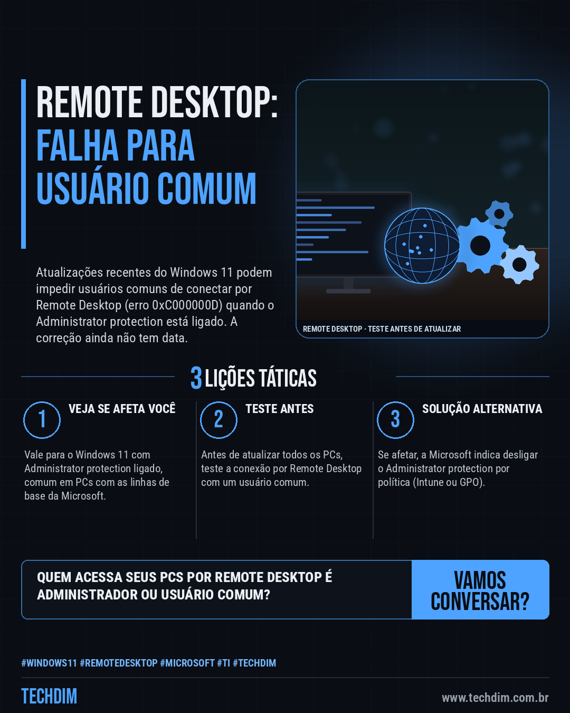
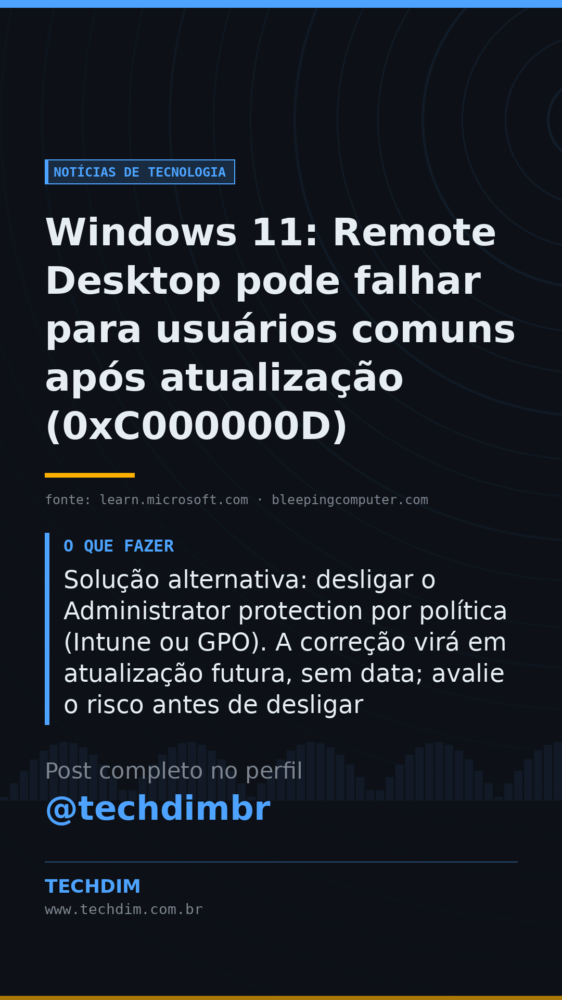

# Notícias de Tecnologia — Windows 11: Remote Desktop pode falhar para usuários comuns após atualização (0xC000000D)

- **Data:** 2026-10-15, 08:00 (horário de Brasília)
- **Curadoria:** Claude (Routine) — pauta do dia
- **Execução no Actions:** https://github.com/Techdimbr/Publi-midia-Techdim/actions/runs/38724126035
- **Por que esta pauta:** Aviso oficial da Microsoft sobre falha de acesso remoto após atualização, com solução alternativa para quem administra PCs com Windows 11.

## Resultado

| Rede | Status | Link | 1º comentário |
|---|---|---|---|
| linkedin | ✅ publicado | https://www.linkedin.com/feed/update/urn:li:share:7516452758091100161/ | — |
| facebook | ✅ publicado | https://www.facebook.com/122132402349390486/posts/122136245889390486 | ✅ |
| instagram | ✅ publicado | https://www.instagram.com/p/DegzPtkD1t2/ | ✅ |
| Stories | ✅ publicado | https://www.instagram.com/stories/techdimbr/4008429154982441202 | — |

## Fontes

- [learn.microsoft.com](https://learn.microsoft.com/en-us/windows/release-health/status-windows-11-25h2)
- [bleepingcomputer.com](https://www.bleepingcomputer.com/news/security/microsoft-recent-windows-updates-may-trigger-remote-desktop-failures/)

## Linkedin

```text
Windows 11: Remote Desktop pode falhar para usuários comuns após atualização (0xC000000D)

01. A Microsoft confirmou: após a prévia de 22/09 (KB5124010) ou atualizações seguintes, usuários comuns podem falhar ao conectar por Remote Desktop, com o erro 0xC000000D
02. Atinge o Windows 11 (24H2, 25H2, 26H1 e 26H2) com Administrator protection ligado, sobretudo PCs de empresas. As linhas de base da Microsoft já o ativam por padrão
03. Solução alternativa: desligar o Administrator protection por política (Intune ou GPO). A correção virá em atualização futura, sem data; avalie o risco antes de desligar

Usa Remote Desktop em PCs com Windows 11? Teste o acesso de um usuário comum antes de atualizar todos.

Fontes: https://learn.microsoft.com/en-us/windows/release-health/status-windows-11-25h2 · https://www.bleepingcomputer.com/news/security/microsoft-recent-windows-updates-may-trigger-remote-desktop-failures/

TECHDIM — Infraestrutura · Segurança · IA
https://www.techdim.com.br

#Windows11 #RemoteDesktop #Microsoft #TI #TECHDIM
```



## Facebook

```text
Windows 11: Remote Desktop pode falhar para usuários comuns após atualização (0xC000000D)

• A Microsoft confirmou: após a prévia de 22/09 (KB5124010) ou atualizações seguintes, usuários comuns podem falhar ao conectar por Remote Desktop, com o erro 0xC000000D
• Atinge o Windows 11 (24H2, 25H2, 26H1 e 26H2) com Administrator protection ligado, sobretudo PCs de empresas. As linhas de base da Microsoft já o ativam por padrão
• Solução alternativa: desligar o Administrator protection por política (Intune ou GPO). A correção virá em atualização futura, sem data; avalie o risco antes de desligar

Usa Remote Desktop em PCs com Windows 11? Teste o acesso de um usuário comum antes de atualizar todos.

Fale com a TECHDIM — fontes e site no primeiro comentário 👇

#Windows11 #RemoteDesktop #Microsoft #TECHDIM
```

Primeiro comentário:

```text
📎 Fontes:
• learn.microsoft.com: https://learn.microsoft.com/en-us/windows/release-health/status-windows-11-25h2
• bleepingcomputer.com: https://www.bleepingcomputer.com/news/security/microsoft-recent-windows-updates-may-trigger-remote-desktop-failures/

🌐 TECHDIM — Infraestrutura · Segurança · IA: https://www.techdim.com.br
```


## Instagram

```text
Windows 11: Remote Desktop pode falhar para usuários comuns após atualização (0xC000000D)

1️⃣ A Microsoft confirmou: após a prévia de 22/09 (KB5124010) ou atualizações seguintes, usuários comuns podem falhar ao conectar por Remote Desktop, com o erro 0xC000000D
2️⃣ Atinge o Windows 11 (24H2, 25H2, 26H1 e 26H2) com Administrator protection ligado, sobretudo PCs de empresas. As linhas de base da Microsoft já o ativam por padrão
3️⃣ Solução alternativa: desligar o Administrator protection por política (Intune ou GPO). A correção virá em atualização futura, sem data; avalie o risco antes de desligar

Usa Remote Desktop em PCs com Windows 11? Teste o acesso de um usuário comum antes de atualizar todos.

Saiba mais: www.techdim.com.br
Fontes no primeiro comentário 👇

#windows11 #remotedesktop #microsoft #ti #techdim #tecnologia #inteligenciaartificial #ia
```

Primeiro comentário:

```text
📎 Fontes: learn.microsoft.com · bleepingcomputer.com
```


## Stories


