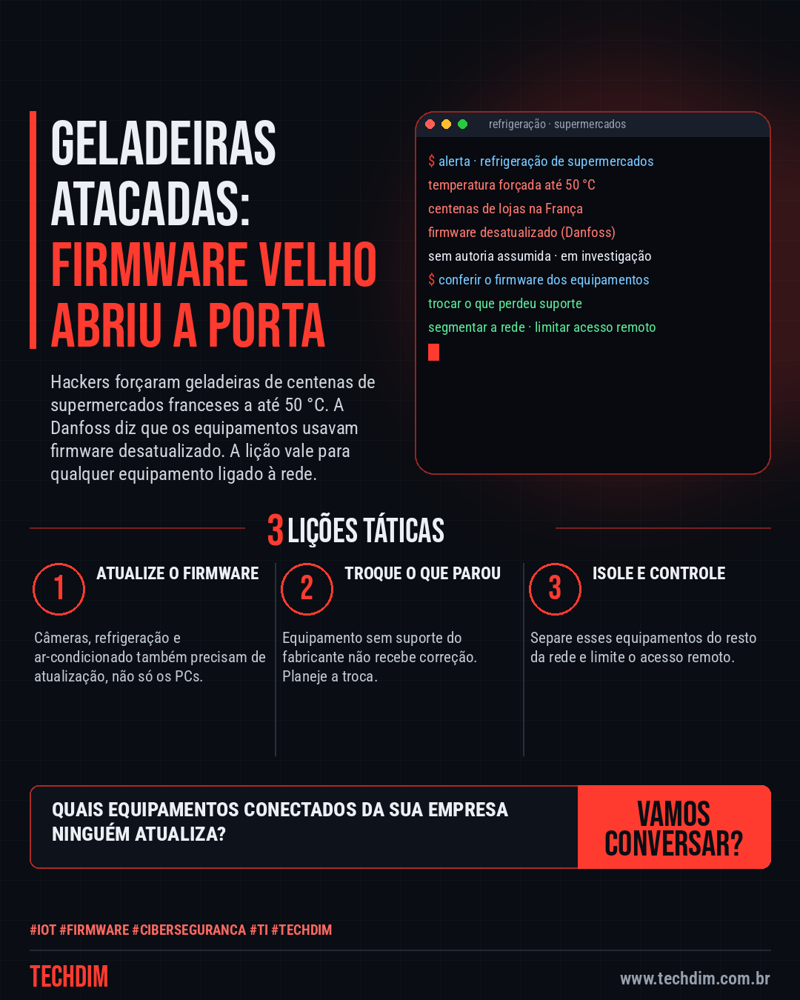

# Cibersegurança · IA · Hacker — Ataque a geladeiras de supermercados na França: firmware desatualizado abriu a porta

- **Data:** 2026-10-15, 11:09 (horário de Brasília)
- **Curadoria:** Claude (Routine) — pauta do dia
- **Execução no Actions:** https://github.com/Techdimbr/Publi-midia-Techdim/actions/runs/38748658615
- **Por que esta pauta:** Caso real de ataque a equipamentos conectados por causa de firmware desatualizado, com lições diretas para varejo, restaurantes e qualquer empresa com dispositivos na rede.

## Resultado

| Rede | Status | Link | 1º comentário |
|---|---|---|---|
| linkedin | ✅ publicado | https://www.linkedin.com/feed/update/urn:li:share:7516500236719001601/ | — |
| facebook | ✅ publicado | https://www.facebook.com/122132402349390486/posts/122136277011390486 | ✅ |
| instagram | ✅ publicado | https://www.instagram.com/p/DehI1FNF354/ | ✅ |
| Stories | ✅ publicado | https://www.instagram.com/stories/techdimbr/4008524105410657396 | — |

## Fontes

- [aljazeera.com](https://aljazeera.com/news/2026/10/13/unprecedented-cyberattack-hits-french-supermarkets-causing-food-losses)
- [convergenciadigital.com.br](https://convergenciadigital.com.br/mercado/software-desatualizado-abriu-frente-para-ataques-em-larga-escala-de-hackers-aos-supermercados-na-franca/)
- [itforum.com.br](https://itforum.com.br/noticias/ataque-cibernetico-temperatura-supermercados/)

## Linkedin

```text
Ataque a geladeiras de supermercados na França: firmware desatualizado abriu a porta

01. Hackers elevaram a temperatura de geladeiras de centenas de supermercados na França para até 50 °C, estragando alimentos e provocando incêndios em algumas lojas
02. A fabricante Danfoss diz que os equipamentos usavam firmware desatualizado. Segundo fonte do governo, a ANSSI achou falha no software; ninguém assumiu o ataque
03. A lição vale para qualquer equipamento conectado: atualize o firmware, troque o que perdeu suporte, segmente a rede e controle o acesso remoto

Sua empresa tem geladeira, câmera ou ar-condicionado na rede? Confira o firmware e quem acessa de fora.

Fontes: https://aljazeera.com/news/2026/10/13/unprecedented-cyberattack-hits-french-supermarkets-causing-food-losses · https://convergenciadigital.com.br/mercado/software-desatualizado-abriu-frente-para-ataques-em-larga-escala-de-hackers-aos-supermercados-na-franca/

TECHDIM — Infraestrutura · Segurança · IA
https://www.techdim.com.br

#IoT #Firmware #Ciberseguranca #TI #TECHDIM
```



## Facebook

```text
Ataque a geladeiras de supermercados na França: firmware desatualizado abriu a porta

• Hackers elevaram a temperatura de geladeiras de centenas de supermercados na França para até 50 °C, estragando alimentos e provocando incêndios em algumas lojas
• A fabricante Danfoss diz que os equipamentos usavam firmware desatualizado. Segundo fonte do governo, a ANSSI achou falha no software; ninguém assumiu o ataque
• A lição vale para qualquer equipamento conectado: atualize o firmware, troque o que perdeu suporte, segmente a rede e controle o acesso remoto

Sua empresa tem geladeira, câmera ou ar-condicionado na rede? Confira o firmware e quem acessa de fora.

Fale com a TECHDIM — fontes e site no primeiro comentário 👇

#IoT #Firmware #Ciberseguranca #TECHDIM
```

Primeiro comentário:

```text
📎 Fontes:
• aljazeera.com: https://aljazeera.com/news/2026/10/13/unprecedented-cyberattack-hits-french-supermarkets-causing-food-losses
• convergenciadigital.com.br: https://convergenciadigital.com.br/mercado/software-desatualizado-abriu-frente-para-ataques-em-larga-escala-de-hackers-aos-supermercados-na-franca/
• itforum.com.br: https://itforum.com.br/noticias/ataque-cibernetico-temperatura-supermercados/

🌐 TECHDIM — Infraestrutura · Segurança · IA: https://www.techdim.com.br
```


## Instagram

```text
Ataque a geladeiras de supermercados na França: firmware desatualizado abriu a porta

1️⃣ Hackers elevaram a temperatura de geladeiras de centenas de supermercados na França para até 50 °C, estragando alimentos e provocando incêndios em algumas lojas
2️⃣ A fabricante Danfoss diz que os equipamentos usavam firmware desatualizado. Segundo fonte do governo, a ANSSI achou falha no software; ninguém assumiu o ataque
3️⃣ A lição vale para qualquer equipamento conectado: atualize o firmware, troque o que perdeu suporte, segmente a rede e controle o acesso remoto

Sua empresa tem geladeira, câmera ou ar-condicionado na rede? Confira o firmware e quem acessa de fora.

Saiba mais: www.techdim.com.br
Fontes no primeiro comentário 👇

#iot #firmware #ciberseguranca #ti #techdim #seguranca #hacker #infraestrutura
```

Primeiro comentário:

```text
📎 Fontes: aljazeera.com · convergenciadigital.com.br · itforum.com.br
```


## Stories


