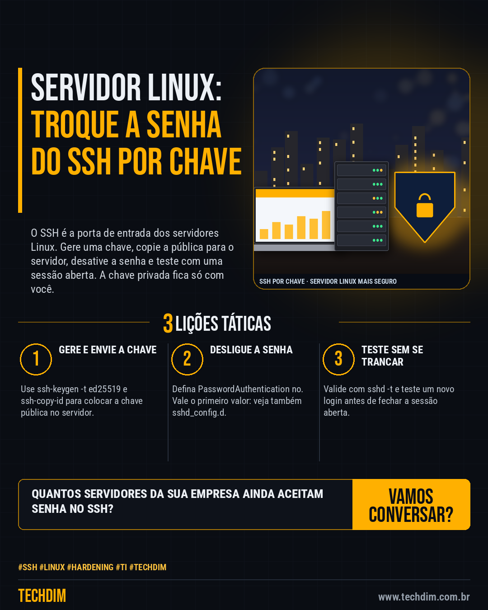

# Conhecimento — SSH com chave em vez de senha: proteja o acesso ao servidor Linux em 5 passos

- **Data:** 2026-10-15, 14:24 (horário de Brasília)
- **Curadoria:** Claude (Routine) — pauta do dia
- **Execução no Actions:** https://github.com/Techdimbr/Publi-midia-Techdim/actions/runs/38776897882
- **Por que esta pauta:** Passo a passo baseado na documentação oficial do OpenSSH e da Ubuntu para acessar servidores Linux por chave SSH, em vez de senha.

## Resultado

| Rede | Status | Link | 1º comentário |
|---|---|---|---|
| linkedin | ✅ publicado | https://www.linkedin.com/feed/update/urn:li:share:7516549363742105600/ | — |
| facebook | ✅ publicado | https://www.facebook.com/122132402349390486/posts/122136313293390486 | ✅ |
| instagram | ✅ publicado | https://www.instagram.com/p/DehfKuZFwhC/ | ✅ |

## Fontes

- [ubuntu.com](https://ubuntu.com/server/docs/how-to/security/openssh-server/)
- [man.openbsd.org](https://man.openbsd.org/sshd_config)

## Linkedin

```text
SSH com chave em vez de senha: proteja o acesso ao servidor Linux em 5 passos

01. No seu PC, gere o par de chaves com ssh-keygen -t ed25519 e envie a pública ao servidor com ssh-copy-id usuario@servidor. Confirme que o login por chave funciona
02. No servidor, use PasswordAuthentication no e KbdInteractiveAuthentication no em /etc/ssh/sshd_config. O OpenSSH vale o primeiro valor: confira sshd_config.d
03. Rode sudo sshd -t, mantenha uma sessão aberta e reinicie (Ubuntu: sudo systemctl restart ssh.service). Teste um novo login: erro de configuração pode trancar você fora

Seu servidor Linux ainda aceita senha no SSH? Troque por chave, com uma sessão aberta de segurança.

Fontes: https://ubuntu.com/server/docs/how-to/security/openssh-server/ · https://man.openbsd.org/sshd_config

TECHDIM — Infraestrutura · Segurança · IA
https://www.techdim.com.br

#SSH #Linux #Hardening #TI #TECHDIM
```



## Facebook

```text
SSH com chave em vez de senha: proteja o acesso ao servidor Linux em 5 passos

• No seu PC, gere o par de chaves com ssh-keygen -t ed25519 e envie a pública ao servidor com ssh-copy-id usuario@servidor. Confirme que o login por chave funciona
• No servidor, use PasswordAuthentication no e KbdInteractiveAuthentication no em /etc/ssh/sshd_config. O OpenSSH vale o primeiro valor: confira sshd_config.d
• Rode sudo sshd -t, mantenha uma sessão aberta e reinicie (Ubuntu: sudo systemctl restart ssh.service). Teste um novo login: erro de configuração pode trancar você fora

Seu servidor Linux ainda aceita senha no SSH? Troque por chave, com uma sessão aberta de segurança.

Fale com a TECHDIM — fontes e site no primeiro comentário 👇

#SSH #Linux #Hardening #TECHDIM
```

Primeiro comentário:

```text
📎 Fontes:
• ubuntu.com: https://ubuntu.com/server/docs/how-to/security/openssh-server/
• man.openbsd.org: https://man.openbsd.org/sshd_config

🌐 TECHDIM — Infraestrutura · Segurança · IA: https://www.techdim.com.br
```


## Instagram

```text
SSH com chave em vez de senha: proteja o acesso ao servidor Linux em 5 passos

1️⃣ No seu PC, gere o par de chaves com ssh-keygen -t ed25519 e envie a pública ao servidor com ssh-copy-id usuario@servidor. Confirme que o login por chave funciona
2️⃣ No servidor, use PasswordAuthentication no e KbdInteractiveAuthentication no em /etc/ssh/sshd_config. O OpenSSH vale o primeiro valor: confira sshd_config.d
3️⃣ Rode sudo sshd -t, mantenha uma sessão aberta e reinicie (Ubuntu: sudo systemctl restart ssh.service). Teste um novo login: erro de configuração pode trancar você fora

Seu servidor Linux ainda aceita senha no SSH? Troque por chave, com uma sessão aberta de segurança.

Saiba mais: www.techdim.com.br
Fontes no primeiro comentário 👇

#ssh #linux #hardening #ti #techdim #conhecimento #aprendati #tecnologia
```

Primeiro comentário:

```text
📎 Fontes: ubuntu.com · man.openbsd.org
```


