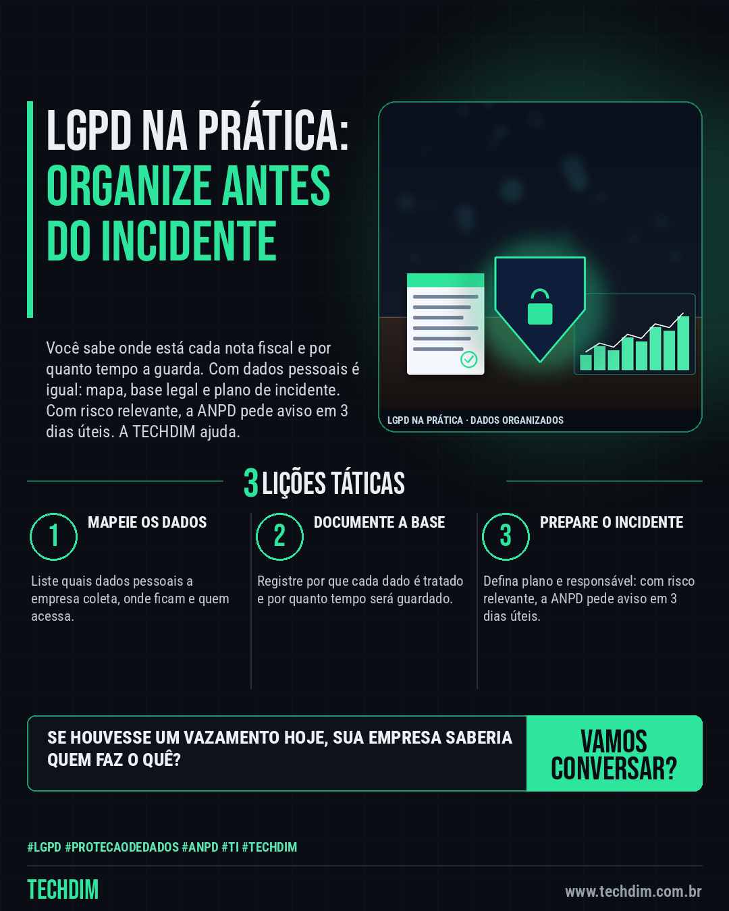

# TECHDIM · Serviços — LGPD: incidente com risco relevante pede aviso à ANPD em 3 dias úteis; tenha plano pronto

- **Data:** 2026-10-15, 17:24 (horário de Brasília)
- **Curadoria:** Claude (Routine) — pauta do dia
- **Execução no Actions:** https://github.com/Techdimbr/Publi-midia-Techdim/actions/runs/38801564449
- **Por que esta pauta:** Apresenta o serviço de adequação à LGPD com a analogia da nota fiscal e o prazo oficial de comunicação de incidente da ANPD, sem promessas de preço, prazo ou resultado.

## Resultado

| Rede | Status | Link | 1º comentário |
|---|---|---|---|
| linkedin | ✅ publicado | https://www.linkedin.com/feed/update/urn:li:share:7516594788540846080/ | — |
| facebook | ✅ publicado | https://www.facebook.com/122132402349390486/posts/122136342405390486 | ✅ |
| instagram | ✅ publicado | https://www.instagram.com/p/Dehz2xhktaX/ | — |

## Linkedin

```text
LGPD: incidente com risco relevante pede aviso à ANPD em 3 dias úteis; tenha plano pronto

01. Nota fiscal você sabe onde está, por que guarda e por quanto tempo. Com dados pessoais, a LGPD pede a mesma organização: mapa de dados, base legal e prazo de guarda
02. Se um incidente puder causar risco ou dano relevante aos titulares, o controlador comunica a ANPD em até 3 dias úteis (Resolução CD/ANPD nº 15/2024)
03. A TECHDIM ajuda a mapear os dados, documentar base legal e retenção, montar o canal do titular e o plano de resposta a incidente, e a implantar os controles técnicos

Sua empresa sabe onde estão os dados dos clientes? Fale com a TECHDIM: www.techdim.com.br

TECHDIM — Infraestrutura · Segurança · IA
https://www.techdim.com.br

#Lgpd #ProtecaoDeDados #Anpd #TI #TECHDIM
```



## Facebook

```text
LGPD: incidente com risco relevante pede aviso à ANPD em 3 dias úteis; tenha plano pronto

• Nota fiscal você sabe onde está, por que guarda e por quanto tempo. Com dados pessoais, a LGPD pede a mesma organização: mapa de dados, base legal e prazo de guarda
• Se um incidente puder causar risco ou dano relevante aos titulares, o controlador comunica a ANPD em até 3 dias úteis (Resolução CD/ANPD nº 15/2024)
• A TECHDIM ajuda a mapear os dados, documentar base legal e retenção, montar o canal do titular e o plano de resposta a incidente, e a implantar os controles técnicos

Sua empresa sabe onde estão os dados dos clientes? Fale com a TECHDIM: www.techdim.com.br

Fale com a TECHDIM — link no primeiro comentário 👇

#Lgpd #ProtecaoDeDados #Anpd #TECHDIM
```

Primeiro comentário:

```text
🌐 TECHDIM — Infraestrutura · Segurança · IA: https://www.techdim.com.br
```


## Instagram

```text
LGPD: incidente com risco relevante pede aviso à ANPD em 3 dias úteis; tenha plano pronto

1️⃣ Nota fiscal você sabe onde está, por que guarda e por quanto tempo. Com dados pessoais, a LGPD pede a mesma organização: mapa de dados, base legal e prazo de guarda
2️⃣ Se um incidente puder causar risco ou dano relevante aos titulares, o controlador comunica a ANPD em até 3 dias úteis (Resolução CD/ANPD nº 15/2024)
3️⃣ A TECHDIM ajuda a mapear os dados, documentar base legal e retenção, montar o canal do titular e o plano de resposta a incidente, e a implantar os controles técnicos

Sua empresa sabe onde estão os dados dos clientes? Fale com a TECHDIM: www.techdim.com.br

Saiba mais: www.techdim.com.br

#lgpd #protecaodedados #anpd #ti #techdim #suportetecnico #ciberseguranca #automacao
```


