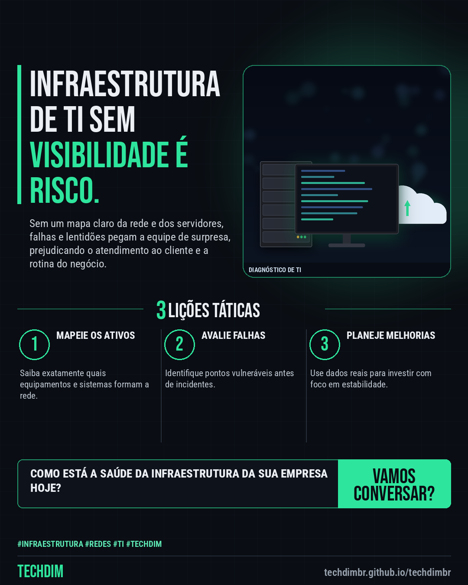

# TECHDIM + IA — Infraestrutura de TI: diagnóstico para organizar a rede e os servidores

- **Data:** 2026-10-16, 03:33 (horário de Brasília)
- **Curadoria:** publicação especial, escrita sob demanda
- **Execução no Actions:** https://github.com/Techdimbr/Publi-midia-Techdim/actions/runs/38861804032
- **Por que esta pauta:** Empresas precisam de estabilidade e segurança na infraestrutura para operar sem interrupções.

## Resultado

| Rede | Status | Link | 1º comentário |
|---|---|---|---|
| facebook | ❌ falhou — GET https://graph.facebook.com/v21.0/debug_token -> HTTP 403: {"error":{"message":"(#4) Application request limit reached","type":"OAuthException","is_transient":true,"code":4,"fbtrace_id":"AVMorpupeotg0drXEQYRp_c"}} |  | — |

## Facebook

```text
Infraestrutura de TI: diagnóstico para organizar a rede e os servidores

• Problemas na rede, lentidão e falhas em servidores afetam a produtividade e a segurança de pequenas e médias empresas.
• O diagnóstico de infraestrutura e segurança da TECHDIM mapeia o ambiente para identificar gargalos e vulnerabilidades.
• Com uma visão clara da TI, o gestor pode planejar melhorias e manter a operação estável.

Conheça o diagnóstico de infraestrutura da TECHDIM em techdimbr.github.io/techdimbr.

Fale com a TECHDIM — link no primeiro comentário 👇

#Infraestrutura #Redes #TI #TECHDIM
```

Primeiro comentário:

```text
🌐 TECHDIM — Infraestrutura · Segurança · IA: https://techdimbr.github.io/techdimbr/
```


