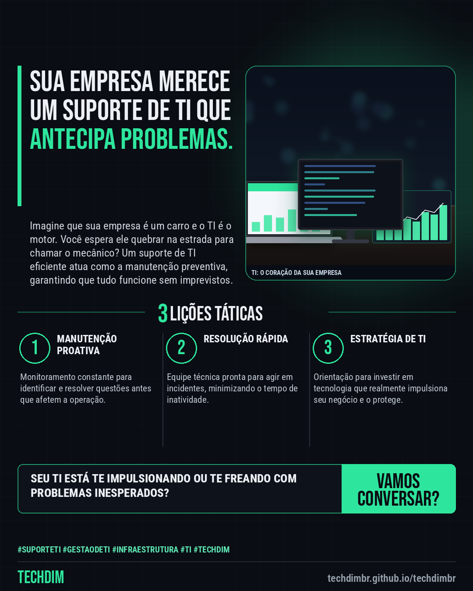

# TECHDIM · Serviços — Suporte de TI: não espere a falha para ter ajuda especializada

- **Data:** 2026-10-16, 04:04 (horário de Brasília)
- **Curadoria:** Gemini (reserva) — pauta escrita pela API do Gemini
- **Execução no Actions:** https://github.com/Techdimbr/Publi-midia-Techdim/actions/runs/38864853700
- **Por que esta pauta:** A gestão de TI é um desafio constante para PMEs e um suporte especializado é fundamental para a continuidade dos negócios.

## Resultado

| Rede | Status | Link | 1º comentário |
|---|---|---|---|
| linkedin | ✅ publicado | https://www.linkedin.com/feed/update/urn:li:share:7516755967896653824/ | — |

## Linkedin

```text
Suporte de TI: não espere a falha para ter ajuda especializada

01. A interrupção de sistemas críticos pode causar prejuízos diretos e impactar a produtividade da equipe.
02. Muitas pequenas e médias empresas não possuem um departamento de TI interno dedicado para gerenciar e resolver problemas rapidamente.
03. Um suporte de TI proativo identifica e corrige vulnerabilidades antes que se tornem incidentes que paralisam a operação.

Conte com a TECHDIM para um suporte de TI que mantém sua infraestrutura operacional e seus dados seguros, evitando surpresas.

TECHDIM — Infraestrutura · Segurança · IA
https://techdimbr.github.io/techdimbr/

#SuporteTI #GestaoDeTI #Infraestrutura #TI #TECHDIM
```


