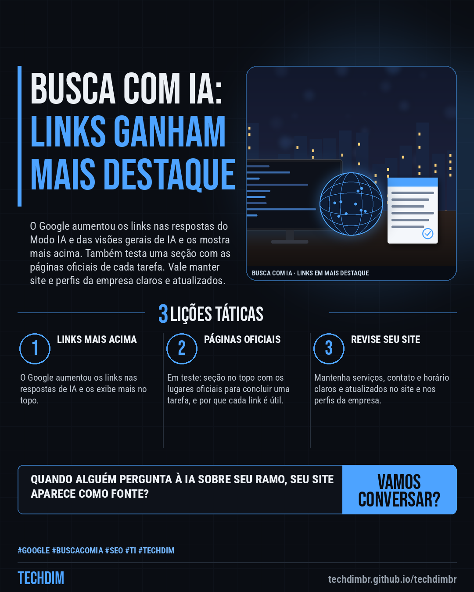
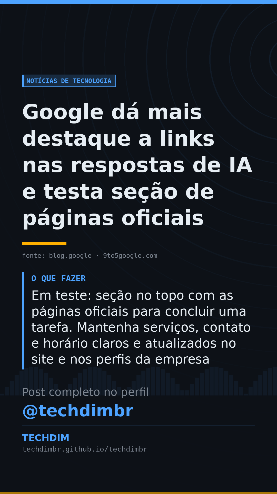

# Notícias de Tecnologia — Google dá mais destaque a links nas respostas de IA e testa seção de páginas oficiais

- **Data:** 2026-10-16, 08:14 (horário de Brasília)
- **Curadoria:** Claude (Routine) — pauta do dia
- **Execução no Actions:** https://github.com/Techdimbr/Publi-midia-Techdim/actions/runs/38892335393
- **Por que esta pauta:** Mudança anunciada pelo Google em 15/10 sobre links na busca com IA, que afeta como clientes chegam ao site da empresa, com orientação prática de revisão.

## Resultado

| Rede | Status | Link | 1º comentário |
|---|---|---|---|
| linkedin | ✅ publicado | https://www.linkedin.com/feed/update/urn:li:share:7516818681985789952/ | — |
| facebook | ✅ publicado | https://www.facebook.com/122132402349390486/posts/122136459483390486 | ✅ |
| instagram | ✅ publicado | https://www.instagram.com/p/DejZpSqj973/ | ✅ |
| Stories | ✅ publicado | https://www.instagram.com/stories/techdimbr/4009160980885777796 | — |

## Fontes

- [blog.google](https://blog.google/products-and-platforms/products/search/updates-ai-mode-overviews-explore-web/)
- [9to5google.com](https://9to5google.com/2026/10/15/google-ai-mode-overviews-links/)

## Linkedin

```text
Google dá mais destaque a links nas respostas de IA e testa seção de páginas oficiais

01. O Google diz ter aumentado de forma substancial os links no Modo IA e nas visões gerais de IA, exibindo-os mais acima, com mais frequência e, no fim, com miniaturas
02. Carrosséis de notícias, que destacam as fontes preferidas do usuário, chegam a mais países e idiomas. O uso das fontes preferidas cresceu mais de 7 vezes em 2026
03. Em teste: seção no topo com as páginas oficiais para concluir uma tarefa. Mantenha serviços, contato e horário claros e atualizados no site e nos perfis da empresa

Seu site mostra com clareza o que sua empresa faz e como falar com ela? Revise antes que o cliente pergunte à IA.

Fontes: https://blog.google/products-and-platforms/products/search/updates-ai-mode-overviews-explore-web/ · https://9to5google.com/2026/10/15/google-ai-mode-overviews-links/

TECHDIM — Infraestrutura · Segurança · IA
https://techdimbr.github.io/techdimbr/

#Google #BuscaComIA #SEO #TI #TECHDIM
```



## Facebook

```text
Google dá mais destaque a links nas respostas de IA e testa seção de páginas oficiais

• O Google diz ter aumentado de forma substancial os links no Modo IA e nas visões gerais de IA, exibindo-os mais acima, com mais frequência e, no fim, com miniaturas
• Carrosséis de notícias, que destacam as fontes preferidas do usuário, chegam a mais países e idiomas. O uso das fontes preferidas cresceu mais de 7 vezes em 2026
• Em teste: seção no topo com as páginas oficiais para concluir uma tarefa. Mantenha serviços, contato e horário claros e atualizados no site e nos perfis da empresa

Seu site mostra com clareza o que sua empresa faz e como falar com ela? Revise antes que o cliente pergunte à IA.

Fale com a TECHDIM — fontes e site no primeiro comentário 👇

#Google #BuscaComIA #SEO #TECHDIM
```

Primeiro comentário:

```text
📎 Fontes:
• blog.google: https://blog.google/products-and-platforms/products/search/updates-ai-mode-overviews-explore-web/
• 9to5google.com: https://9to5google.com/2026/10/15/google-ai-mode-overviews-links/

🌐 TECHDIM — Infraestrutura · Segurança · IA: https://techdimbr.github.io/techdimbr/
```


## Instagram

```text
Google dá mais destaque a links nas respostas de IA e testa seção de páginas oficiais

1️⃣ O Google diz ter aumentado de forma substancial os links no Modo IA e nas visões gerais de IA, exibindo-os mais acima, com mais frequência e, no fim, com miniaturas
2️⃣ Carrosséis de notícias, que destacam as fontes preferidas do usuário, chegam a mais países e idiomas. O uso das fontes preferidas cresceu mais de 7 vezes em 2026
3️⃣ Em teste: seção no topo com as páginas oficiais para concluir uma tarefa. Mantenha serviços, contato e horário claros e atualizados no site e nos perfis da empresa

Seu site mostra com clareza o que sua empresa faz e como falar com ela? Revise antes que o cliente pergunte à IA.

🔗 Link na bio: techdimbr.github.io/techdimbr
Fontes no primeiro comentário 👇

#google #buscacomia #seo #ti #techdim #tecnologia #inteligenciaartificial #ia
```

Primeiro comentário:

```text
📎 Fontes: blog.google · 9to5google.com
```


## Stories


