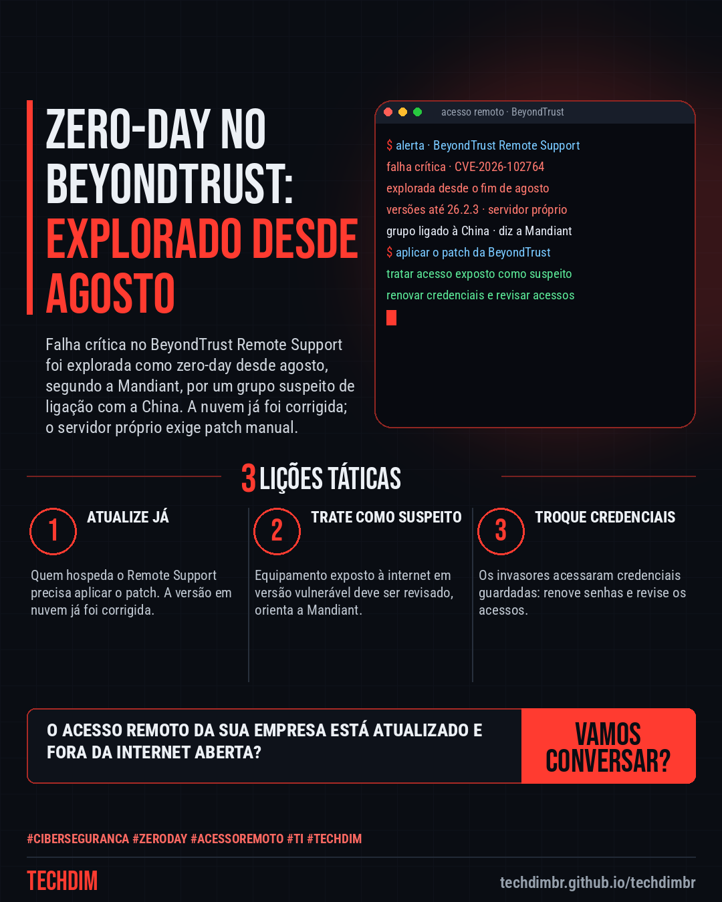

# Cibersegurança · IA · Hacker — Zero-day no BeyondTrust Remote Support: falha foi explorada desde o fim de agosto

- **Data:** 2026-10-16, 11:11 (horário de Brasília)
- **Curadoria:** Claude (Routine) — pauta do dia
- **Execução no Actions:** https://github.com/Techdimbr/Publi-midia-Techdim/actions/runs/38913550099
- **Por que esta pauta:** Falha crítica em ferramenta de suporte remoto usada por equipes de TI, explorada como zero-day e divulgada hoje (16/10), com ações práticas para quem administra o produto.

## Resultado

| Rede | Status | Link | 1º comentário |
|---|---|---|---|
| linkedin | ✅ publicado | https://www.linkedin.com/feed/update/urn:li:share:7516863107156103168/ | — |
| facebook | ✅ publicado | https://www.facebook.com/122132402349390486/posts/122136487629390486 | ✅ |
| instagram | ✅ publicado | https://www.instagram.com/p/Dejt5L-l5R8/ | ✅ |
| Stories | ✅ publicado | https://www.instagram.com/stories/techdimbr/4009250061679061767 | — |

## Fontes

- [bleepingcomputer.com](https://www.bleepingcomputer.com/news/security/beyondtrust-patches-zero-day-exploited-in-attacks-since-august/)
- [thehackernews.com](https://thehackernews.com/2026/10/china-linked-hackers-exploited.html)

## Linkedin

```text
Zero-day no BeyondTrust Remote Support: falha foi explorada desde o fim de agosto

01. A BeyondTrust avisou que o Remote Support (até a versão 26.2.3) tem uma falha crítica, a CVE-2026-102764, explorada como zero-day desde o fim de agosto
02. A Mandiant (Google) atribui os ataques a um grupo suspeito de ligação com a China. Os invasores viraram root, acessaram credenciais guardadas e se moveram pela rede
03. A versão em nuvem já foi corrigida. Quem hospeda o servidor precisa aplicar o patch manualmente e tratar o equipamento exposto à internet como possivelmente comprometido

Sua empresa ou seu fornecedor usa BeyondTrust no próprio servidor? Confirme a versão e aplique o patch hoje.

Fontes: https://www.bleepingcomputer.com/news/security/beyondtrust-patches-zero-day-exploited-in-attacks-since-august/ · https://thehackernews.com/2026/10/china-linked-hackers-exploited.html

TECHDIM — Infraestrutura · Segurança · IA
https://techdimbr.github.io/techdimbr/

#Ciberseguranca #ZeroDay #AcessoRemoto #TI #TECHDIM
```



## Facebook

```text
Zero-day no BeyondTrust Remote Support: falha foi explorada desde o fim de agosto

• A BeyondTrust avisou que o Remote Support (até a versão 26.2.3) tem uma falha crítica, a CVE-2026-102764, explorada como zero-day desde o fim de agosto
• A Mandiant (Google) atribui os ataques a um grupo suspeito de ligação com a China. Os invasores viraram root, acessaram credenciais guardadas e se moveram pela rede
• A versão em nuvem já foi corrigida. Quem hospeda o servidor precisa aplicar o patch manualmente e tratar o equipamento exposto à internet como possivelmente comprometido

Sua empresa ou seu fornecedor usa BeyondTrust no próprio servidor? Confirme a versão e aplique o patch hoje.

Fale com a TECHDIM — fontes e site no primeiro comentário 👇

#Ciberseguranca #ZeroDay #AcessoRemoto #TECHDIM
```

Primeiro comentário:

```text
📎 Fontes:
• bleepingcomputer.com: https://www.bleepingcomputer.com/news/security/beyondtrust-patches-zero-day-exploited-in-attacks-since-august/
• thehackernews.com: https://thehackernews.com/2026/10/china-linked-hackers-exploited.html

🌐 TECHDIM — Infraestrutura · Segurança · IA: https://techdimbr.github.io/techdimbr/
```


## Instagram

```text
Zero-day no BeyondTrust Remote Support: falha foi explorada desde o fim de agosto

1️⃣ A BeyondTrust avisou que o Remote Support (até a versão 26.2.3) tem uma falha crítica, a CVE-2026-102764, explorada como zero-day desde o fim de agosto
2️⃣ A Mandiant (Google) atribui os ataques a um grupo suspeito de ligação com a China. Os invasores viraram root, acessaram credenciais guardadas e se moveram pela rede
3️⃣ A versão em nuvem já foi corrigida. Quem hospeda o servidor precisa aplicar o patch manualmente e tratar o equipamento exposto à internet como possivelmente comprometido

Sua empresa ou seu fornecedor usa BeyondTrust no próprio servidor? Confirme a versão e aplique o patch hoje.

🔗 Link na bio: techdimbr.github.io/techdimbr
Fontes no primeiro comentário 👇

#ciberseguranca #zeroday #acessoremoto #ti #techdim #seguranca #hacker #infraestrutura
```

Primeiro comentário:

```text
📎 Fontes: bleepingcomputer.com · thehackernews.com
```


## Stories


