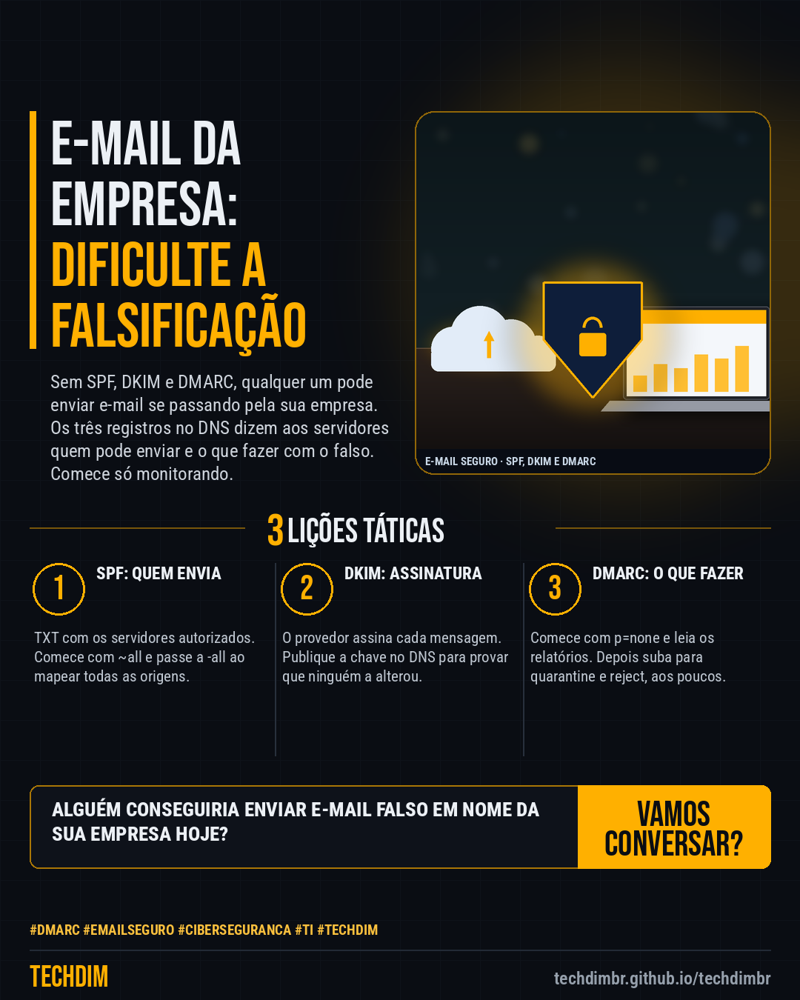

# Conhecimento — SPF, DKIM e DMARC: dificulte a falsificação do e-mail da sua empresa em 5 passos

- **Data:** 2026-10-16, 14:23 (horário de Brasília)
- **Curadoria:** Claude (Routine) — pauta do dia
- **Execução no Actions:** https://github.com/Techdimbr/Publi-midia-Techdim/actions/runs/38939259802
- **Por que esta pauta:** Passo a passo baseado nas documentações da Microsoft e do Google Workspace para dificultar a falsificação do e-mail do domínio da empresa, em ordem segura de implantação.

## Resultado

| Rede | Status | Link | 1º comentário |
|---|---|---|---|
| linkedin | ✅ publicado | https://www.linkedin.com/feed/update/urn:li:share:7516911715758993410/ | — |
| facebook | ✅ publicado | https://www.facebook.com/122132402349390486/posts/122136515895390486 | ✅ |
| instagram | ✅ publicado | https://www.instagram.com/p/DekD9djIFxQ/ | ✅ |

## Fontes

- [learn.microsoft.com](https://learn.microsoft.com/en-us/defender-office-365/email-authentication-about)
- [knowledge.workspace.google.com](https://knowledge.workspace.google.com/admin/security/set-up-dmarc)

## Linkedin

```text
SPF, DKIM e DMARC: dificulte a falsificação do e-mail da sua empresa em 5 passos

01. 1) Liste tudo que envia e-mail pelo seu domínio. 2) Publique o SPF em TXT no DNS (v=spf1 include:seu-provedor ~all) e troque por -all quando mapear todas as origens
02. 3) Ative o DKIM no provedor e publique a chave no DNS. Aguarde cerca de 48 h. 4) Crie o TXT _dmarc.seudominio com v=DMARC1; p=none; rua=mailto:caixa@seudominio
03. 5) Leia os relatórios (rua) e, quando todo o e-mail legítimo passar, suba o DMARC para p=quarantine e depois p=reject, aplicando aos poucos com pct

O e-mail do seu domínio já tem SPF, DKIM e DMARC? Comece pelo DMARC em p=none e leia os relatórios.

Fontes: https://learn.microsoft.com/en-us/defender-office-365/email-authentication-about · https://knowledge.workspace.google.com/admin/security/set-up-dmarc

TECHDIM — Infraestrutura · Segurança · IA
https://techdimbr.github.io/techdimbr/

#Dmarc #EmailSeguro #Ciberseguranca #TI #TECHDIM
```



## Facebook

```text
SPF, DKIM e DMARC: dificulte a falsificação do e-mail da sua empresa em 5 passos

• 1) Liste tudo que envia e-mail pelo seu domínio. 2) Publique o SPF em TXT no DNS (v=spf1 include:seu-provedor ~all) e troque por -all quando mapear todas as origens
• 3) Ative o DKIM no provedor e publique a chave no DNS. Aguarde cerca de 48 h. 4) Crie o TXT _dmarc.seudominio com v=DMARC1; p=none; rua=mailto:caixa@seudominio
• 5) Leia os relatórios (rua) e, quando todo o e-mail legítimo passar, suba o DMARC para p=quarantine e depois p=reject, aplicando aos poucos com pct

O e-mail do seu domínio já tem SPF, DKIM e DMARC? Comece pelo DMARC em p=none e leia os relatórios.

Fale com a TECHDIM — fontes e site no primeiro comentário 👇

#Dmarc #EmailSeguro #Ciberseguranca #TECHDIM
```

Primeiro comentário:

```text
📎 Fontes:
• learn.microsoft.com: https://learn.microsoft.com/en-us/defender-office-365/email-authentication-about
• knowledge.workspace.google.com: https://knowledge.workspace.google.com/admin/security/set-up-dmarc

🌐 TECHDIM — Infraestrutura · Segurança · IA: https://techdimbr.github.io/techdimbr/
```


## Instagram

```text
SPF, DKIM e DMARC: dificulte a falsificação do e-mail da sua empresa em 5 passos

1️⃣ 1) Liste tudo que envia e-mail pelo seu domínio. 2) Publique o SPF em TXT no DNS (v=spf1 include:seu-provedor ~all) e troque por -all quando mapear todas as origens
2️⃣ 3) Ative o DKIM no provedor e publique a chave no DNS. Aguarde cerca de 48 h. 4) Crie o TXT _dmarc.seudominio com v=DMARC1; p=none; rua=mailto:caixa@seudominio
3️⃣ 5) Leia os relatórios (rua) e, quando todo o e-mail legítimo passar, suba o DMARC para p=quarantine e depois p=reject, aplicando aos poucos com pct

O e-mail do seu domínio já tem SPF, DKIM e DMARC? Comece pelo DMARC em p=none e leia os relatórios.

🔗 Link na bio: techdimbr.github.io/techdimbr
Fontes no primeiro comentário 👇

#dmarc #emailseguro #ciberseguranca #ti #techdim #conhecimento #aprendati #tecnologia
```

Primeiro comentário:

```text
📎 Fontes: learn.microsoft.com · knowledge.workspace.google.com
```


