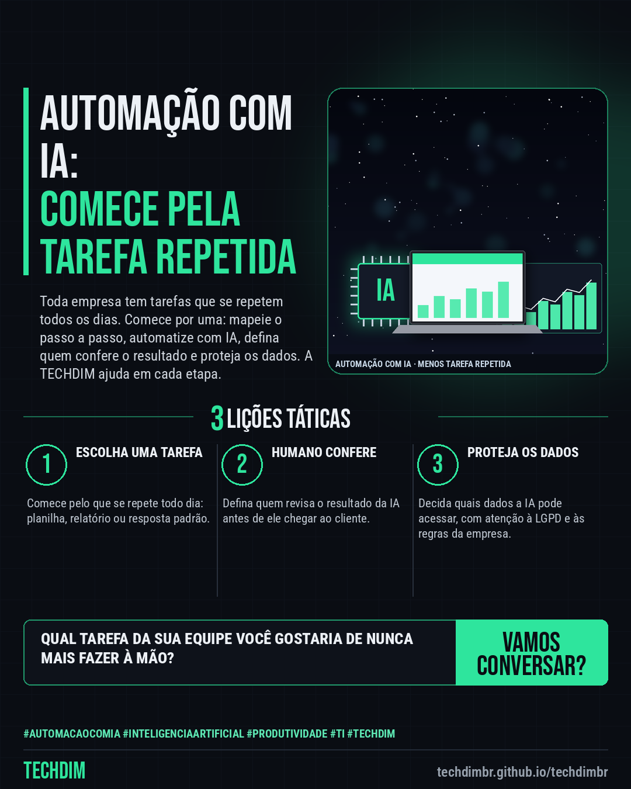

# TECHDIM · Serviços — Automação com IA: comece pela tarefa que sua equipe repete todo dia

- **Data:** 2026-10-16, 17:24 (horário de Brasília)
- **Curadoria:** Claude (Routine) — pauta do dia
- **Execução no Actions:** https://github.com/Techdimbr/Publi-midia-Techdim/actions/runs/38961895736
- **Por que esta pauta:** Apresenta o serviço de automação e IA aplicada ao processo, partindo da tarefa repetida e com revisão humana, sem promessas de preço, prazo ou resultado.

## Resultado

| Rede | Status | Link | 1º comentário |
|---|---|---|---|
| facebook | ✅ publicado | https://www.facebook.com/122132402349390486/posts/122136545337390486 | ✅ |
| instagram | ✅ publicado | https://www.instagram.com/p/DekYm7ZjPZp/ | — |

## Facebook

```text
Automação com IA: comece pela tarefa que sua equipe repete todo dia

• Toda empresa tem tarefas repetidas: copiar dados entre planilhas, montar o mesmo relatório, responder as mesmas dúvidas. IA e automação ajudam, com revisão humana
• A TECHDIM mapeia o que consome tempo da sua equipe, automatiza atendimento, relatório e tarefa repetitiva, e integra com as ferramentas que você já usa
• Você define quem confere o resultado e quais dados a IA pode acessar, com atenção à segurança e à LGPD. O time é treinado para operar sem depender de nós

Qual tarefa repetida consome horas da sua equipe? Fale com a TECHDIM: techdimbr.github.io/techdimbr

Fale com a TECHDIM — link no primeiro comentário 👇

#AutomacaoComIA #InteligenciaArtificial #Produtividade #TECHDIM
```

Primeiro comentário:

```text
🌐 TECHDIM — Infraestrutura · Segurança · IA: https://techdimbr.github.io/techdimbr/
```



## Instagram

```text
Automação com IA: comece pela tarefa que sua equipe repete todo dia

1️⃣ Toda empresa tem tarefas repetidas: copiar dados entre planilhas, montar o mesmo relatório, responder as mesmas dúvidas. IA e automação ajudam, com revisão humana
2️⃣ A TECHDIM mapeia o que consome tempo da sua equipe, automatiza atendimento, relatório e tarefa repetitiva, e integra com as ferramentas que você já usa
3️⃣ Você define quem confere o resultado e quais dados a IA pode acessar, com atenção à segurança e à LGPD. O time é treinado para operar sem depender de nós

Qual tarefa repetida consome horas da sua equipe? Fale com a TECHDIM: techdimbr.github.io/techdimbr

🔗 Link na bio: techdimbr.github.io/techdimbr

#automacaocomia #inteligenciaartificial #produtividade #ti #techdim #suportetecnico #ciberseguranca #automacao
```


