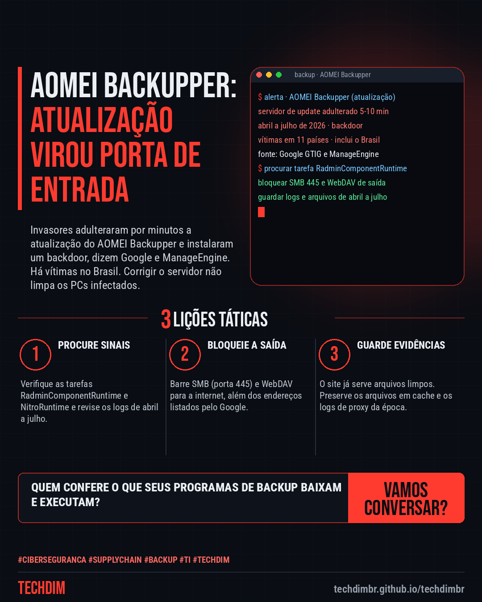

# Cibersegurança · IA · Hacker — AOMEI Backupper: servidores de atualização foram adulterados e instalaram backdoor

- **Data:** 2026-10-17, 11:09 (horário de Brasília)
- **Curadoria:** Claude (Routine) — pauta do dia
- **Execução no Actions:** https://github.com/Techdimbr/Publi-midia-Techdim/actions/runs/39039476266
- **Por que esta pauta:** Ataque à cadeia de atualização de um programa de backup usado em empresas, com vítimas no Brasil segundo o Google, e passos práticos de verificação para quem usa o produto.

## Resultado

| Rede | Status | Link | 1º comentário |
|---|---|---|---|
| linkedin | ✅ publicado | https://www.linkedin.com/feed/update/urn:li:share:7517225123813343232/ | — |
| facebook | ✅ publicado | https://www.facebook.com/122132402349390486/posts/122136691809390486 | ✅ |
| instagram | ✅ publicado | https://www.instagram.com/p/DemSefjgYPk/ | ✅ |
| Stories | ✅ publicado | https://www.instagram.com/stories/techdimbr/4009973921473464351 | — |

## Fontes

- [cloud.google.com](https://cloud.google.com/blog/topics/threat-intelligence/investigating-ephemeral-supply-chain-tampering)
- [manageengine.com](https://www.manageengine.com/threat-analysis-lab/aomei-backupper-supply-chain-compromise.html)
- [thehackernews.com](https://thehackernews.com/2026/10/attackers-tampered-with-aomei.html)

## Linkedin

```text
AOMEI Backupper: servidores de atualização foram adulterados e instalaram backdoor

01. Google (GTIG/Mandiant) e ManageEngine relatam: de abril a julho, invasores adulteraram por 5 a 10 minutos a atualização do AOMEI Backupper e instalaram um backdoor
02. Há vítimas em TI, telecom e universidades de 11 países, incluindo o Brasil. O programa não verificava a autenticidade dos arquivos de configuração baixados
03. A AOMEI diz ter corrigido os servidores, mas PCs infectados seguem comprometidos. Busque as tarefas RadminComponentRuntime e NitroRuntime e bloqueie SMB e WebDAV de saída

Sua empresa usa o AOMEI Backupper? Peça à TI para verificar tarefas suspeitas e bloquear SMB e WebDAV de saída.

Fontes: https://cloud.google.com/blog/topics/threat-intelligence/investigating-ephemeral-supply-chain-tampering · https://www.manageengine.com/threat-analysis-lab/aomei-backupper-supply-chain-compromise.html

TECHDIM — Infraestrutura · Segurança · IA
https://techdimbr.github.io/techdimbr/

#Ciberseguranca #SupplyChain #Backup #TI #TECHDIM
```



## Facebook

```text
AOMEI Backupper: servidores de atualização foram adulterados e instalaram backdoor

• Google (GTIG/Mandiant) e ManageEngine relatam: de abril a julho, invasores adulteraram por 5 a 10 minutos a atualização do AOMEI Backupper e instalaram um backdoor
• Há vítimas em TI, telecom e universidades de 11 países, incluindo o Brasil. O programa não verificava a autenticidade dos arquivos de configuração baixados
• A AOMEI diz ter corrigido os servidores, mas PCs infectados seguem comprometidos. Busque as tarefas RadminComponentRuntime e NitroRuntime e bloqueie SMB e WebDAV de saída

Sua empresa usa o AOMEI Backupper? Peça à TI para verificar tarefas suspeitas e bloquear SMB e WebDAV de saída.

Fale com a TECHDIM — fontes e site no primeiro comentário 👇

#Ciberseguranca #SupplyChain #Backup #TECHDIM
```

Primeiro comentário:

```text
📎 Fontes:
• cloud.google.com: https://cloud.google.com/blog/topics/threat-intelligence/investigating-ephemeral-supply-chain-tampering
• manageengine.com: https://www.manageengine.com/threat-analysis-lab/aomei-backupper-supply-chain-compromise.html
• thehackernews.com: https://thehackernews.com/2026/10/attackers-tampered-with-aomei.html

🌐 TECHDIM — Infraestrutura · Segurança · IA: https://techdimbr.github.io/techdimbr/
```


## Instagram

```text
AOMEI Backupper: servidores de atualização foram adulterados e instalaram backdoor

1️⃣ Google (GTIG/Mandiant) e ManageEngine relatam: de abril a julho, invasores adulteraram por 5 a 10 minutos a atualização do AOMEI Backupper e instalaram um backdoor
2️⃣ Há vítimas em TI, telecom e universidades de 11 países, incluindo o Brasil. O programa não verificava a autenticidade dos arquivos de configuração baixados
3️⃣ A AOMEI diz ter corrigido os servidores, mas PCs infectados seguem comprometidos. Busque as tarefas RadminComponentRuntime e NitroRuntime e bloqueie SMB e WebDAV de saída

Sua empresa usa o AOMEI Backupper? Peça à TI para verificar tarefas suspeitas e bloquear SMB e WebDAV de saída.

🔗 Link na bio: techdimbr.github.io/techdimbr
Fontes no primeiro comentário 👇

#ciberseguranca #supplychain #backup #ti #techdim #seguranca #hacker #infraestrutura
```

Primeiro comentário:

```text
📎 Fontes: cloud.google.com · manageengine.com · thehackernews.com
```


## Stories


