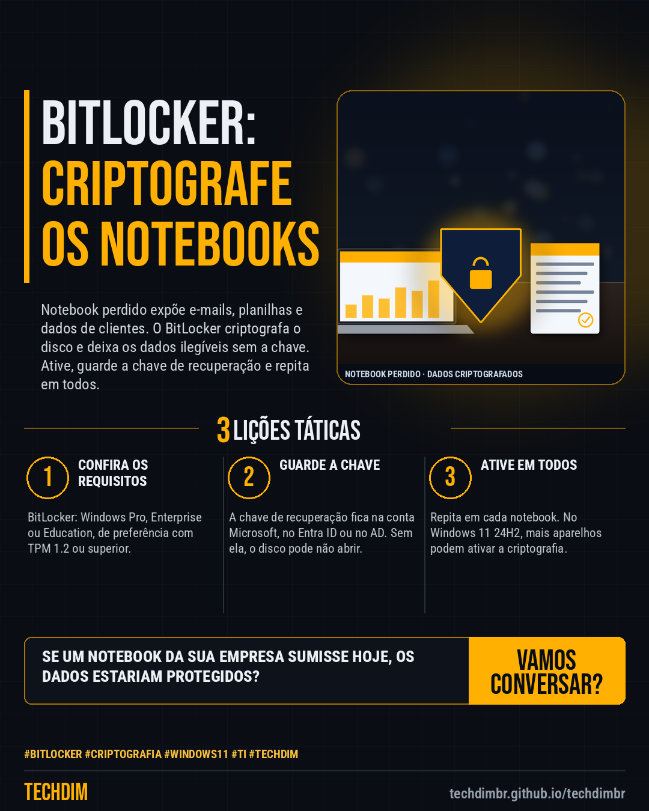

# Conhecimento — BitLocker nos notebooks da empresa: criptografe o disco em 5 passos contra perda e roubo

- **Data:** 2026-10-17, 14:24 (horário de Brasília)
- **Curadoria:** Claude (Routine) — pauta do dia
- **Execução no Actions:** https://github.com/Techdimbr/Publi-midia-Techdim/actions/runs/39053540940
- **Por que esta pauta:** Passo a passo baseado na documentação da Microsoft para criptografar os discos dos notebooks da empresa com BitLocker e proteger os dados em caso de perda ou roubo.

## Resultado

| Rede | Status | Link | 1º comentário |
|---|---|---|---|
| linkedin | ✅ publicado | https://www.linkedin.com/feed/update/urn:li:share:7517274213217394688/ | — |
| facebook | ✅ publicado | https://www.facebook.com/122132402349390486/posts/122136720243390486 | ✅ |
| instagram | ✅ publicado | https://www.instagram.com/p/DemozUSIIBi/ | ✅ |

## Fontes

- [learn.microsoft.com](https://learn.microsoft.com/en-us/windows/security/operating-system-security/data-protection/bitlocker/)
- [support.microsoft.com](https://support.microsoft.com/en-us/windows/turn-on-device-encryption-0c453637-bc88-5f74-5105-741561aae838)

## Linkedin

```text
BitLocker nos notebooks da empresa: criptografe o disco em 5 passos contra perda e roubo

01. 1) Confira a edição: BitLocker está no Windows Pro, Enterprise e Education. 2) Abra msinfo32 e veja se a criptografia de dispositivo atende aos pré-requisitos (TPM 1.2+)
02. 3) Entre como administrador com a conta da empresa ou Microsoft: ela guarda a chave de recuperação. 4) Em Privacidade e segurança, ative Criptografia do dispositivo
03. 5) Confirme que a chave de recuperação foi salva e aguarde concluir; só então aparece ativado. Sem a chave, o disco pode não abrir. Repita em cada notebook

Se um notebook da empresa fosse perdido hoje, os dados estariam criptografados? Ative e guarde a chave.

Fontes: https://learn.microsoft.com/en-us/windows/security/operating-system-security/data-protection/bitlocker/ · https://support.microsoft.com/en-us/windows/turn-on-device-encryption-0c453637-bc88-5f74-5105-741561aae838

TECHDIM — Infraestrutura · Segurança · IA
https://techdimbr.github.io/techdimbr/

#BitLocker #Criptografia #Windows11 #TI #TECHDIM
```



## Facebook

```text
BitLocker nos notebooks da empresa: criptografe o disco em 5 passos contra perda e roubo

• 1) Confira a edição: BitLocker está no Windows Pro, Enterprise e Education. 2) Abra msinfo32 e veja se a criptografia de dispositivo atende aos pré-requisitos (TPM 1.2+)
• 3) Entre como administrador com a conta da empresa ou Microsoft: ela guarda a chave de recuperação. 4) Em Privacidade e segurança, ative Criptografia do dispositivo
• 5) Confirme que a chave de recuperação foi salva e aguarde concluir; só então aparece ativado. Sem a chave, o disco pode não abrir. Repita em cada notebook

Se um notebook da empresa fosse perdido hoje, os dados estariam criptografados? Ative e guarde a chave.

Fale com a TECHDIM — fontes e site no primeiro comentário 👇

#BitLocker #Criptografia #Windows11 #TECHDIM
```

Primeiro comentário:

```text
📎 Fontes:
• learn.microsoft.com: https://learn.microsoft.com/en-us/windows/security/operating-system-security/data-protection/bitlocker/
• support.microsoft.com: https://support.microsoft.com/en-us/windows/turn-on-device-encryption-0c453637-bc88-5f74-5105-741561aae838

🌐 TECHDIM — Infraestrutura · Segurança · IA: https://techdimbr.github.io/techdimbr/
```


## Instagram

```text
BitLocker nos notebooks da empresa: criptografe o disco em 5 passos contra perda e roubo

1️⃣ 1) Confira a edição: BitLocker está no Windows Pro, Enterprise e Education. 2) Abra msinfo32 e veja se a criptografia de dispositivo atende aos pré-requisitos (TPM 1.2+)
2️⃣ 3) Entre como administrador com a conta da empresa ou Microsoft: ela guarda a chave de recuperação. 4) Em Privacidade e segurança, ative Criptografia do dispositivo
3️⃣ 5) Confirme que a chave de recuperação foi salva e aguarde concluir; só então aparece ativado. Sem a chave, o disco pode não abrir. Repita em cada notebook

Se um notebook da empresa fosse perdido hoje, os dados estariam criptografados? Ative e guarde a chave.

🔗 Link na bio: techdimbr.github.io/techdimbr
Fontes no primeiro comentário 👇

#bitlocker #criptografia #windows11 #ti #techdim #conhecimento #aprendati #tecnologia
```

Primeiro comentário:

```text
📎 Fontes: learn.microsoft.com · support.microsoft.com
```


