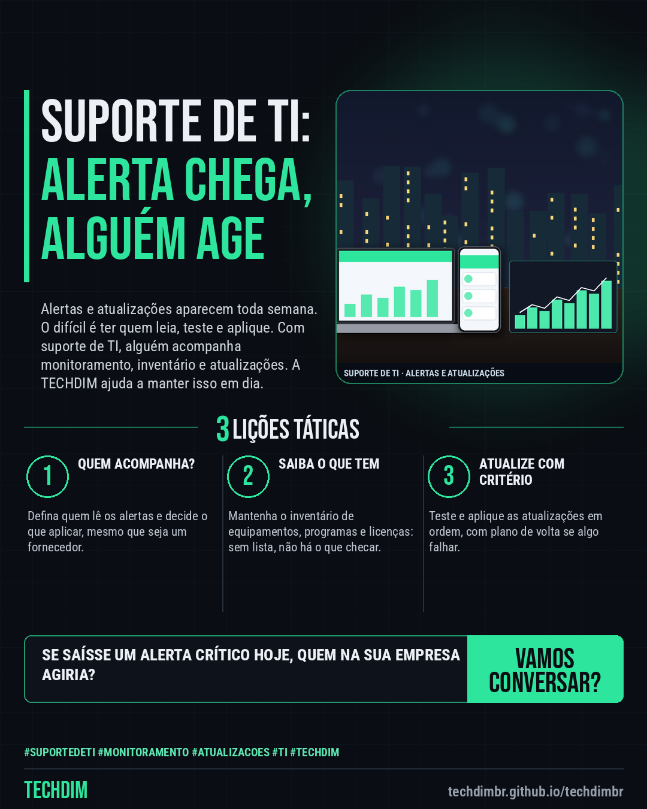

# TECHDIM · Serviços — Suporte de TI: alguém acompanhando alertas e atualizações antes que virem problema

- **Data:** 2026-10-17, 17:24 (horário de Brasília)
- **Curadoria:** Claude (Routine) — pauta do dia
- **Execução no Actions:** https://github.com/Techdimbr/Publi-midia-Techdim/actions/runs/39066477280
- **Por que esta pauta:** Apresenta o serviço de suporte de TI com monitoramento proativo, inventário e atualizações, ligando os alertas da semana ao cuidado contínuo, sem promessa de preço, prazo ou resultado.

## Resultado

| Rede | Status | Link | 1º comentário |
|---|---|---|---|
| linkedin | ✅ publicado | https://www.linkedin.com/feed/update/urn:li:share:7517319405249347584/ | — |
| facebook | ✅ publicado | https://www.facebook.com/122132402349390486/posts/122136745587390486 | ✅ |
| instagram | ✅ publicado | https://www.instagram.com/p/Dem9XEOmMSG/ | — |

## Linkedin

```text
Suporte de TI: alguém acompanhando alertas e atualizações antes que virem problema

01. Toda semana surgem alertas e atualizações importantes. Em muitas empresas ninguém tem tempo de ler, testar e aplicar: o aviso chega, mas a ação não
02. A TECHDIM presta suporte de TI a pequenas e médias empresas: monitoramento proativo, inventário de equipamentos e licenças, atualizações e um ponto de contato
03. Você sabe o que mudou e o que ainda precisa de decisão da sua empresa, em linguagem simples, sem depender de alguém da equipe para acompanhar tudo

Quem cuida dos alertas e das atualizações de TI da sua empresa hoje? Fale com a TECHDIM: techdimbr.github.io/techdimbr

TECHDIM — Infraestrutura · Segurança · IA
https://techdimbr.github.io/techdimbr/

#SuporteDeTI #Monitoramento #Atualizacoes #TI #TECHDIM
```



## Facebook

```text
Suporte de TI: alguém acompanhando alertas e atualizações antes que virem problema

• Toda semana surgem alertas e atualizações importantes. Em muitas empresas ninguém tem tempo de ler, testar e aplicar: o aviso chega, mas a ação não
• A TECHDIM presta suporte de TI a pequenas e médias empresas: monitoramento proativo, inventário de equipamentos e licenças, atualizações e um ponto de contato
• Você sabe o que mudou e o que ainda precisa de decisão da sua empresa, em linguagem simples, sem depender de alguém da equipe para acompanhar tudo

Quem cuida dos alertas e das atualizações de TI da sua empresa hoje? Fale com a TECHDIM: techdimbr.github.io/techdimbr

Fale com a TECHDIM — link no primeiro comentário 👇

#SuporteDeTI #Monitoramento #Atualizacoes #TECHDIM
```

Primeiro comentário:

```text
🌐 TECHDIM — Infraestrutura · Segurança · IA: https://techdimbr.github.io/techdimbr/
```


## Instagram

```text
Suporte de TI: alguém acompanhando alertas e atualizações antes que virem problema

1️⃣ Toda semana surgem alertas e atualizações importantes. Em muitas empresas ninguém tem tempo de ler, testar e aplicar: o aviso chega, mas a ação não
2️⃣ A TECHDIM presta suporte de TI a pequenas e médias empresas: monitoramento proativo, inventário de equipamentos e licenças, atualizações e um ponto de contato
3️⃣ Você sabe o que mudou e o que ainda precisa de decisão da sua empresa, em linguagem simples, sem depender de alguém da equipe para acompanhar tudo

Quem cuida dos alertas e das atualizações de TI da sua empresa hoje? Fale com a TECHDIM: techdimbr.github.io/techdimbr

🔗 Link na bio: techdimbr.github.io/techdimbr

#suportedeti #monitoramento #atualizacoes #ti #techdim #suportetecnico #ciberseguranca #automacao
```


