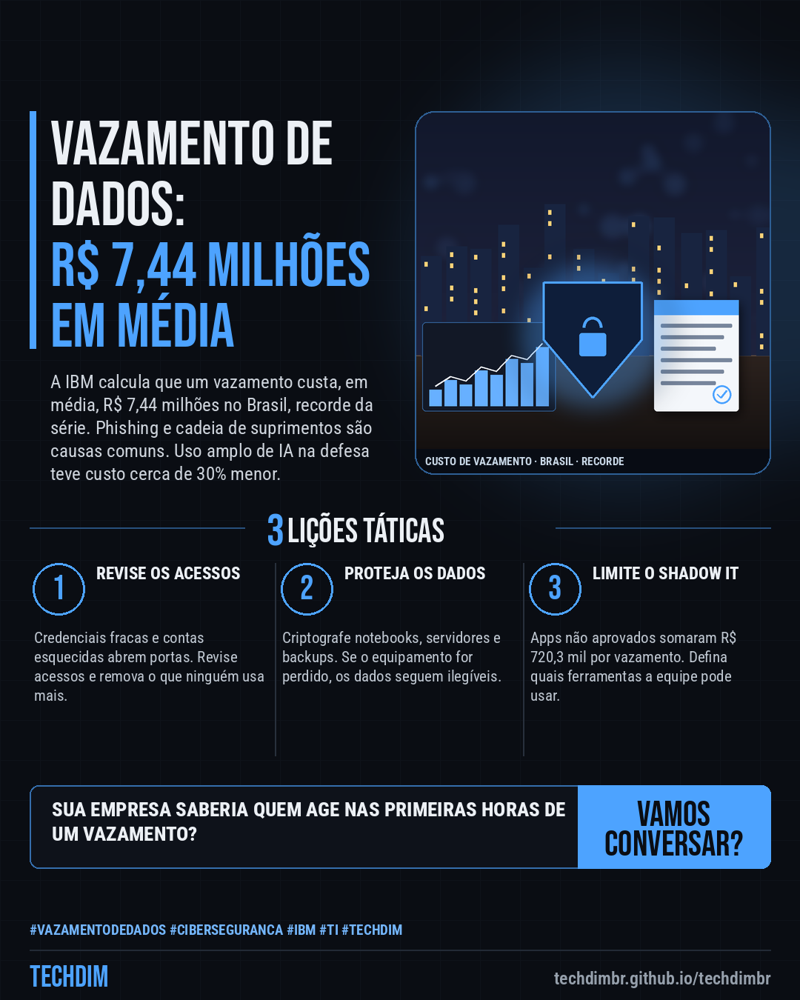
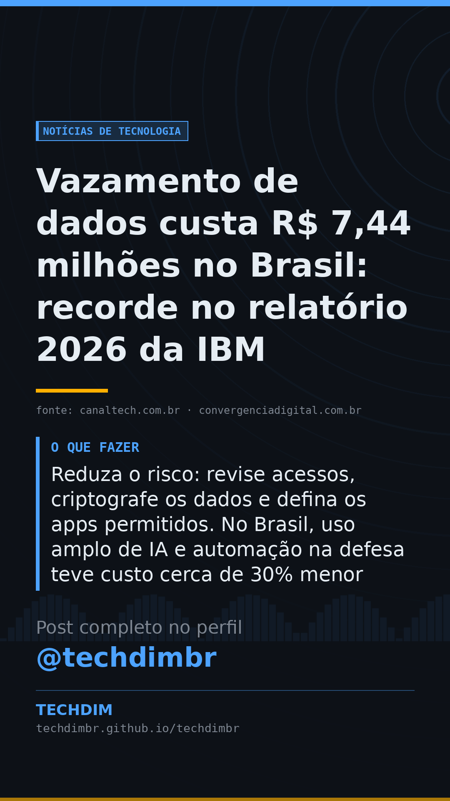

# Notícias de Tecnologia — Vazamento de dados custa R$ 7,44 milhões no Brasil: recorde no relatório 2026 da IBM

- **Data:** 2026-10-18, 11:18 (horário de Brasília)
- **Curadoria:** Claude (Routine) — pauta do dia
- **Execução no Actions:** https://github.com/Techdimbr/Publi-midia-Techdim/actions/runs/39135333443
- **Por que esta pauta:** Dado novo e brasileiro sobre o custo de incidentes de segurança, com números que ajudam pequenas e médias empresas a priorizar proteção.

## Resultado

| Rede | Status | Link | 1º comentário |
|---|---|---|---|
| linkedin | ✅ publicado | https://www.linkedin.com/feed/update/urn:li:share:7517589830126714881/ | — |
| facebook | ✅ publicado | https://www.facebook.com/122132402349390486/posts/122136894717390486 | ✅ |
| instagram | ✅ publicado | https://www.instagram.com/p/Deo4Ul7HWiq/ | ✅ |
| Stories | ✅ publicado | https://www.instagram.com/stories/techdimbr/4010703285052332087 | — |

## Fontes

- [canaltech.com.br](https://canaltech.com.br/seguranca/custo-de-violacao-de-dados-bate-recorde-no-brasil-e-chega-a-r-744-milhoes/)
- [convergenciadigital.com.br](https://convergenciadigital.com.br/mercado/custo-medio-de-uma-violacao-de-dados-no-brasil-bate-recorde-e-chega-a-r-744-milhoes/)
- [ibm.com](https://www.ibm.com/reports/data-breach)

## Linkedin

```text
Vazamento de dados custa R$ 7,44 milhões no Brasil: recorde no relatório 2026 da IBM

01. O relatório Cost of a Data Breach 2026, da IBM, aponta que o custo médio de um vazamento no Brasil chegou a R$ 7,44 milhões, recorde da série e 3,5% acima de 2025
02. Phishing e ataques à cadeia de suprimentos responderam por 16% dos casos cada um. O shadow IT, uso de apps sem aprovação da empresa, somou R$ 720,3 mil por vazamento
03. Reduza o risco: revise acessos, criptografe os dados e defina os apps permitidos. No Brasil, uso amplo de IA e automação na defesa teve custo cerca de 30% menor

Sua empresa sabe quanto custaria um vazamento e quem agiria nas primeiras horas? Revise acessos, dados e apps antes.

Fontes: https://canaltech.com.br/seguranca/custo-de-violacao-de-dados-bate-recorde-no-brasil-e-chega-a-r-744-milhoes/ · https://convergenciadigital.com.br/mercado/custo-medio-de-uma-violacao-de-dados-no-brasil-bate-recorde-e-chega-a-r-744-milhoes/

TECHDIM — Infraestrutura · Segurança · IA
https://techdimbr.github.io/techdimbr/

#VazamentoDeDados #Ciberseguranca #IBM #TI #TECHDIM
```



## Facebook

```text
Vazamento de dados custa R$ 7,44 milhões no Brasil: recorde no relatório 2026 da IBM

• O relatório Cost of a Data Breach 2026, da IBM, aponta que o custo médio de um vazamento no Brasil chegou a R$ 7,44 milhões, recorde da série e 3,5% acima de 2025
• Phishing e ataques à cadeia de suprimentos responderam por 16% dos casos cada um. O shadow IT, uso de apps sem aprovação da empresa, somou R$ 720,3 mil por vazamento
• Reduza o risco: revise acessos, criptografe os dados e defina os apps permitidos. No Brasil, uso amplo de IA e automação na defesa teve custo cerca de 30% menor

Sua empresa sabe quanto custaria um vazamento e quem agiria nas primeiras horas? Revise acessos, dados e apps antes.

Fale com a TECHDIM — fontes e site no primeiro comentário 👇

#VazamentoDeDados #Ciberseguranca #IBM #TECHDIM
```

Primeiro comentário:

```text
📎 Fontes:
• canaltech.com.br: https://canaltech.com.br/seguranca/custo-de-violacao-de-dados-bate-recorde-no-brasil-e-chega-a-r-744-milhoes/
• convergenciadigital.com.br: https://convergenciadigital.com.br/mercado/custo-medio-de-uma-violacao-de-dados-no-brasil-bate-recorde-e-chega-a-r-744-milhoes/
• ibm.com: https://www.ibm.com/reports/data-breach

🌐 TECHDIM — Infraestrutura · Segurança · IA: https://techdimbr.github.io/techdimbr/
```


## Instagram

```text
Vazamento de dados custa R$ 7,44 milhões no Brasil: recorde no relatório 2026 da IBM

1️⃣ O relatório Cost of a Data Breach 2026, da IBM, aponta que o custo médio de um vazamento no Brasil chegou a R$ 7,44 milhões, recorde da série e 3,5% acima de 2025
2️⃣ Phishing e ataques à cadeia de suprimentos responderam por 16% dos casos cada um. O shadow IT, uso de apps sem aprovação da empresa, somou R$ 720,3 mil por vazamento
3️⃣ Reduza o risco: revise acessos, criptografe os dados e defina os apps permitidos. No Brasil, uso amplo de IA e automação na defesa teve custo cerca de 30% menor

Sua empresa sabe quanto custaria um vazamento e quem agiria nas primeiras horas? Revise acessos, dados e apps antes.

🔗 Link na bio: techdimbr.github.io/techdimbr
Fontes no primeiro comentário 👇

#vazamentodedados #ciberseguranca #ibm #ti #techdim #tecnologia #inteligenciaartificial #ia
```

Primeiro comentário:

```text
📎 Fontes: canaltech.com.br · convergenciadigital.com.br · ibm.com
```


## Stories


