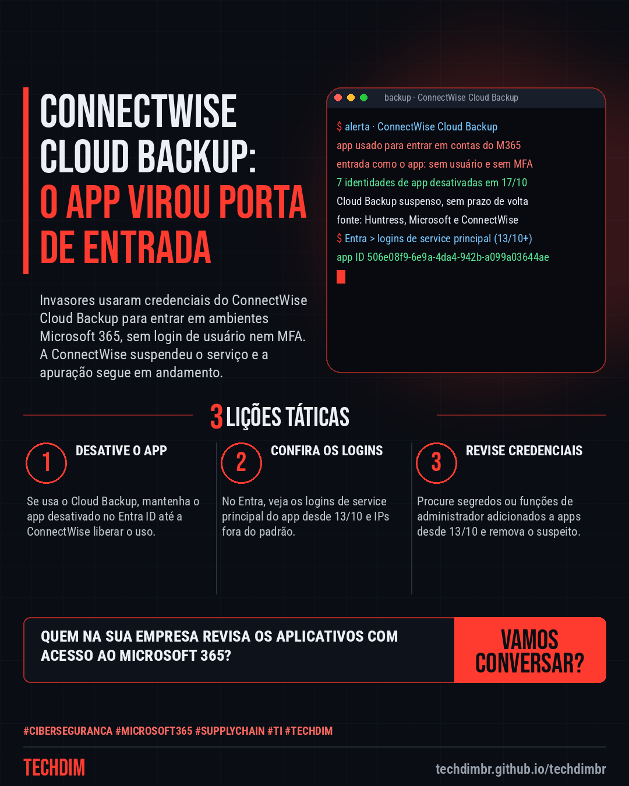
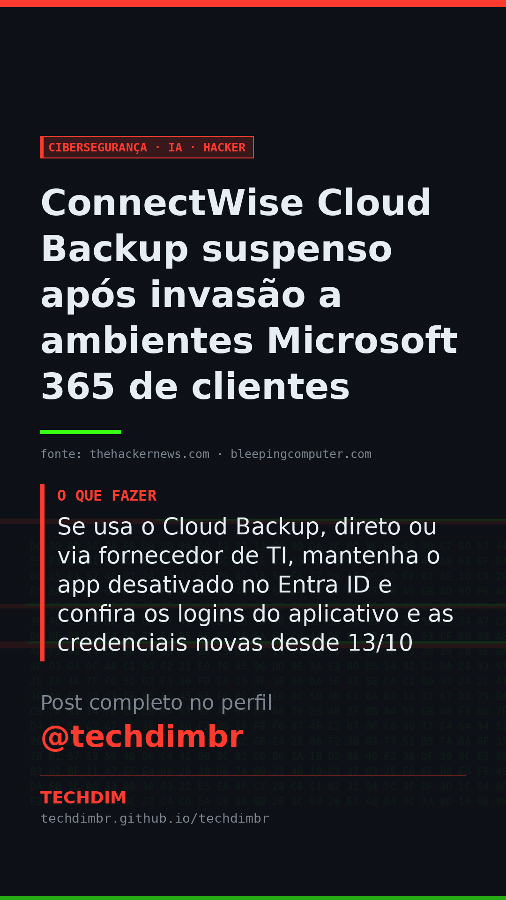

# Cibersegurança · IA · Hacker — ConnectWise Cloud Backup suspenso após invasão a ambientes Microsoft 365 de clientes

- **Data:** 2026-10-18, 11:20 (horário de Brasília)
- **Curadoria:** Claude (Routine) — pauta do dia
- **Execução no Actions:** https://github.com/Techdimbr/Publi-midia-Techdim/actions/runs/39135439192
- **Por que esta pauta:** Ataque à cadeia de suprimentos de um serviço de backup usado por provedores de TI, com passos práticos de verificação no Microsoft Entra para empresas e prestadores.

## Resultado

| Rede | Status | Link | 1º comentário |
|---|---|---|---|
| linkedin | ✅ publicado | https://www.linkedin.com/feed/update/urn:li:share:7517590175582109696/ | — |
| facebook | ✅ publicado | https://www.facebook.com/122132402349390486/posts/122136895089390486 | ✅ |
| instagram | ✅ publicado | https://www.instagram.com/p/Deo4et8FrHf/ | ✅ |
| Stories | ✅ publicado | https://www.instagram.com/stories/techdimbr/4010703999074713195 | — |

## Fontes

- [thehackernews.com](https://thehackernews.com/2026/10/connectwise-suspends-cloud-backup-after.html)
- [bleepingcomputer.com](https://www.bleepingcomputer.com/news/security/hackers-breach-microsoft-365-tenants-via-connectwise-supply-chain-attack/)

## Linkedin

```text
ConnectWise Cloud Backup suspenso após invasão a ambientes Microsoft 365 de clientes

01. A ConnectWise suspendeu o Cloud Backup (antigo SkyKick) após invasores usarem credenciais do aplicativo para entrar em ambientes Microsoft 365 de clientes e parceiros
02. Entraram como o próprio app, sem login de usuário e sem MFA. A Huntress confirmou mais de 160 ambientes. A ConnectWise não vê indício de acesso aos backups
03. Se usa o Cloud Backup, direto ou via fornecedor de TI, mantenha o app desativado no Entra ID e confira os logins do aplicativo e as credenciais novas desde 13/10

Seu backup do Microsoft 365 passa por um fornecedor? Peça à TI para conferir os logins do aplicativo e as credenciais adicionadas.

Fontes: https://thehackernews.com/2026/10/connectwise-suspends-cloud-backup-after.html · https://www.bleepingcomputer.com/news/security/hackers-breach-microsoft-365-tenants-via-connectwise-supply-chain-attack/

TECHDIM — Infraestrutura · Segurança · IA
https://techdimbr.github.io/techdimbr/

#Ciberseguranca #Microsoft365 #SupplyChain #TI #TECHDIM
```



## Facebook

```text
ConnectWise Cloud Backup suspenso após invasão a ambientes Microsoft 365 de clientes

• A ConnectWise suspendeu o Cloud Backup (antigo SkyKick) após invasores usarem credenciais do aplicativo para entrar em ambientes Microsoft 365 de clientes e parceiros
• Entraram como o próprio app, sem login de usuário e sem MFA. A Huntress confirmou mais de 160 ambientes. A ConnectWise não vê indício de acesso aos backups
• Se usa o Cloud Backup, direto ou via fornecedor de TI, mantenha o app desativado no Entra ID e confira os logins do aplicativo e as credenciais novas desde 13/10

Seu backup do Microsoft 365 passa por um fornecedor? Peça à TI para conferir os logins do aplicativo e as credenciais adicionadas.

Fale com a TECHDIM — fontes e site no primeiro comentário 👇

#Ciberseguranca #Microsoft365 #SupplyChain #TECHDIM
```

Primeiro comentário:

```text
📎 Fontes:
• thehackernews.com: https://thehackernews.com/2026/10/connectwise-suspends-cloud-backup-after.html
• bleepingcomputer.com: https://www.bleepingcomputer.com/news/security/hackers-breach-microsoft-365-tenants-via-connectwise-supply-chain-attack/

🌐 TECHDIM — Infraestrutura · Segurança · IA: https://techdimbr.github.io/techdimbr/
```


## Instagram

```text
ConnectWise Cloud Backup suspenso após invasão a ambientes Microsoft 365 de clientes

1️⃣ A ConnectWise suspendeu o Cloud Backup (antigo SkyKick) após invasores usarem credenciais do aplicativo para entrar em ambientes Microsoft 365 de clientes e parceiros
2️⃣ Entraram como o próprio app, sem login de usuário e sem MFA. A Huntress confirmou mais de 160 ambientes. A ConnectWise não vê indício de acesso aos backups
3️⃣ Se usa o Cloud Backup, direto ou via fornecedor de TI, mantenha o app desativado no Entra ID e confira os logins do aplicativo e as credenciais novas desde 13/10

Seu backup do Microsoft 365 passa por um fornecedor? Peça à TI para conferir os logins do aplicativo e as credenciais adicionadas.

🔗 Link na bio: techdimbr.github.io/techdimbr
Fontes no primeiro comentário 👇

#ciberseguranca #microsoft365 #supplychain #ti #techdim #seguranca #hacker #infraestrutura
```

Primeiro comentário:

```text
📎 Fontes: thehackernews.com · bleepingcomputer.com
```


## Stories


