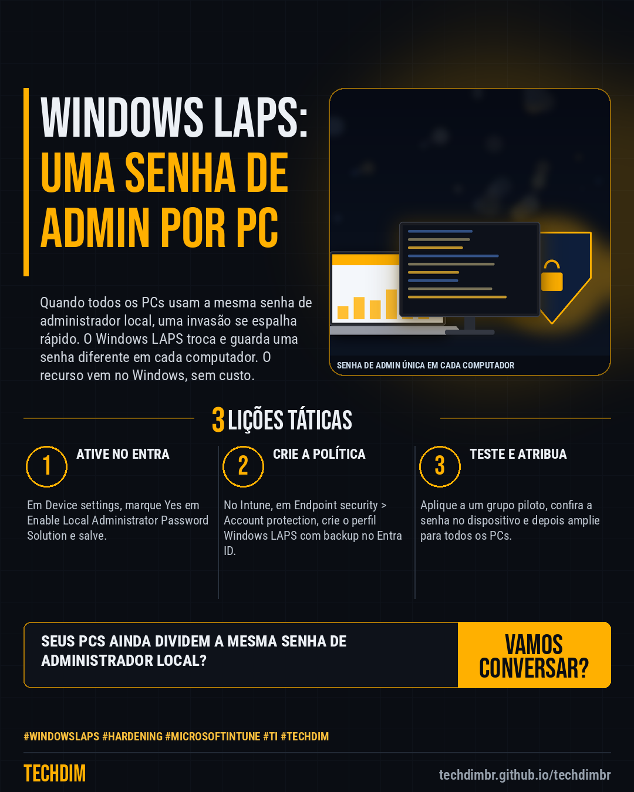

# Conhecimento — Windows LAPS: senha de administrador local diferente em cada computador, em 5 passos

- **Data:** 2026-10-18, 14:23 (horário de Brasília)
- **Curadoria:** Claude (Routine) — pauta do dia
- **Execução no Actions:** https://github.com/Techdimbr/Publi-midia-Techdim/actions/runs/39149298933
- **Por que esta pauta:** Passo a passo baseado na documentação da Microsoft para trocar a senha de administrador local repetida por uma senha única e rotacionada em cada PC, reduzindo o risco de movimentação lateral.

## Resultado

| Rede | Status | Link | 1º comentário |
|---|---|---|---|
| linkedin | ✅ publicado | https://www.linkedin.com/feed/update/urn:li:share:7517636425253752832/ | — |
| facebook | ✅ publicado | https://www.facebook.com/122132402349390486/posts/122136921879390486 | ✅ |
| instagram | ✅ publicado | https://www.instagram.com/p/DepNhNlHWKp/ | ✅ |

## Fontes

- [learn.microsoft.com/windows-server](https://learn.microsoft.com/en-us/windows-server/identity/laps/laps-overview)
- [learn.microsoft.com/entra](https://learn.microsoft.com/en-us/entra/identity/devices/howto-manage-local-admin-passwords)
- [learn.microsoft.com/intune](https://learn.microsoft.com/en-us/intune/device-configuration/endpoint-security/account-protection)

## Linkedin

```text
Windows LAPS: senha de administrador local diferente em cada computador, em 5 passos

01. 1) Use Windows 11 (ou 10 atualizado) em PCs ingressados no Entra ID. 2) No Entra: Devices > Device settings > Enable Local Administrator Password Solution (LAPS) = Yes
02. 3) No Intune: Endpoint security > Account protection > Create policy > Windows > Local admin password solution (Windows LAPS). Backup no Entra ID e regras da senha
03. 4) Atribua a um grupo piloto e confira em Devices > Local administrator password recovery. 5) Só funções como Cloud Device Administrator veem a senha. Depois, amplie

Seus PCs ainda compartilham a mesma senha de administrador local? Troque por uma senha única por computador e limite quem a vê.

Fontes: https://learn.microsoft.com/en-us/windows-server/identity/laps/laps-overview · https://learn.microsoft.com/en-us/entra/identity/devices/howto-manage-local-admin-passwords

TECHDIM — Infraestrutura · Segurança · IA
https://techdimbr.github.io/techdimbr/

#WindowsLAPS #Hardening #MicrosoftIntune #TI #TECHDIM
```



## Facebook

```text
Windows LAPS: senha de administrador local diferente em cada computador, em 5 passos

• 1) Use Windows 11 (ou 10 atualizado) em PCs ingressados no Entra ID. 2) No Entra: Devices > Device settings > Enable Local Administrator Password Solution (LAPS) = Yes
• 3) No Intune: Endpoint security > Account protection > Create policy > Windows > Local admin password solution (Windows LAPS). Backup no Entra ID e regras da senha
• 4) Atribua a um grupo piloto e confira em Devices > Local administrator password recovery. 5) Só funções como Cloud Device Administrator veem a senha. Depois, amplie

Seus PCs ainda compartilham a mesma senha de administrador local? Troque por uma senha única por computador e limite quem a vê.

Fale com a TECHDIM — fontes e site no primeiro comentário 👇

#WindowsLAPS #Hardening #MicrosoftIntune #TECHDIM
```

Primeiro comentário:

```text
📎 Fontes:
• learn.microsoft.com/windows-server: https://learn.microsoft.com/en-us/windows-server/identity/laps/laps-overview
• learn.microsoft.com/entra: https://learn.microsoft.com/en-us/entra/identity/devices/howto-manage-local-admin-passwords
• learn.microsoft.com/intune: https://learn.microsoft.com/en-us/intune/device-configuration/endpoint-security/account-protection

🌐 TECHDIM — Infraestrutura · Segurança · IA: https://techdimbr.github.io/techdimbr/
```


## Instagram

```text
Windows LAPS: senha de administrador local diferente em cada computador, em 5 passos

1️⃣ 1) Use Windows 11 (ou 10 atualizado) em PCs ingressados no Entra ID. 2) No Entra: Devices > Device settings > Enable Local Administrator Password Solution (LAPS) = Yes
2️⃣ 3) No Intune: Endpoint security > Account protection > Create policy > Windows > Local admin password solution (Windows LAPS). Backup no Entra ID e regras da senha
3️⃣ 4) Atribua a um grupo piloto e confira em Devices > Local administrator password recovery. 5) Só funções como Cloud Device Administrator veem a senha. Depois, amplie

Seus PCs ainda compartilham a mesma senha de administrador local? Troque por uma senha única por computador e limite quem a vê.

🔗 Link na bio: techdimbr.github.io/techdimbr
Fontes no primeiro comentário 👇

#windowslaps #hardening #microsoftintune #ti #techdim #conhecimento #aprendati #tecnologia
```

Primeiro comentário:

```text
📎 Fontes: learn.microsoft.com/windows-server · learn.microsoft.com/entra · learn.microsoft.com/intune
```


