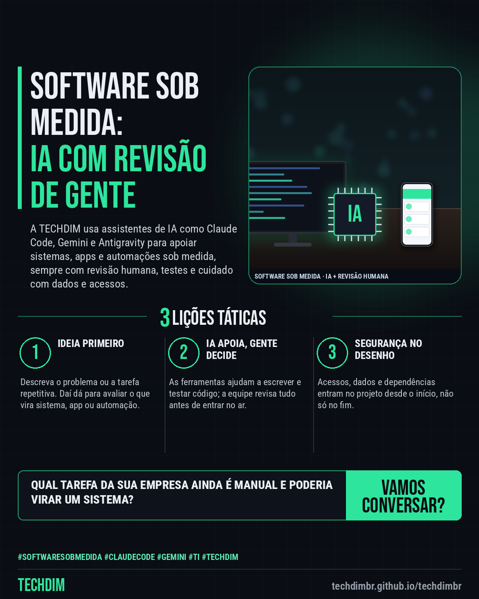

# TECHDIM · Serviços — Software sob medida com IA: Claude Code, Gemini e Antigravity, sempre com revisão humana

- **Data:** 2026-10-18, 17:24 (horário de Brasília)
- **Curadoria:** Claude (Routine) — pauta do dia
- **Execução no Actions:** https://github.com/Techdimbr/Publi-midia-Techdim/actions/runs/39163064726
- **Por que esta pauta:** Apresenta o serviço de desenvolvimento sob medida e automações com assistentes de IA (Claude Code, Gemini e Antigravity), com revisão humana, sem promessa de preço, prazo ou resultado.

## Resultado

| Rede | Status | Link | 1º comentário |
|---|---|---|---|
| linkedin | ✅ publicado | https://www.linkedin.com/feed/update/urn:li:share:7517681836563718144/ | — |
| facebook | ✅ publicado | https://www.facebook.com/122132402349390486/posts/122136945105390486 | ✅ |
| instagram | ✅ publicado | https://www.instagram.com/p/DepiK-akvKf/ | — |

## Linkedin

```text
Software sob medida com IA: Claude Code, Gemini e Antigravity, sempre com revisão humana

01. Assistentes de programação com IA, como Claude Code, Gemini e Antigravity, ajudam a escrever e testar código. O que entra no sistema continua sendo decidido por pessoas
02. A TECHDIM usa essas ferramentas em sistemas, apps e automações sob medida para web, desktop e celular, com revisão humana, testes e cuidado com dados e acessos
03. Conte a sua ideia ou o processo que hoje é manual. A TECHDIM avalia se faz sentido virar sistema, app ou automação e propõe os próximos passos, sem compromisso

Tem uma ideia de sistema, app ou automação? Conte para a TECHDIM: techdimbr.github.io/techdimbr

TECHDIM — Infraestrutura · Segurança · IA
https://techdimbr.github.io/techdimbr/

#SoftwareSobMedida #ClaudeCode #Gemini #TI #TECHDIM
```



## Facebook

```text
Software sob medida com IA: Claude Code, Gemini e Antigravity, sempre com revisão humana

• Assistentes de programação com IA, como Claude Code, Gemini e Antigravity, ajudam a escrever e testar código. O que entra no sistema continua sendo decidido por pessoas
• A TECHDIM usa essas ferramentas em sistemas, apps e automações sob medida para web, desktop e celular, com revisão humana, testes e cuidado com dados e acessos
• Conte a sua ideia ou o processo que hoje é manual. A TECHDIM avalia se faz sentido virar sistema, app ou automação e propõe os próximos passos, sem compromisso

Tem uma ideia de sistema, app ou automação? Conte para a TECHDIM: techdimbr.github.io/techdimbr

Fale com a TECHDIM — link no primeiro comentário 👇

#SoftwareSobMedida #ClaudeCode #Gemini #TECHDIM
```

Primeiro comentário:

```text
🌐 TECHDIM — Infraestrutura · Segurança · IA: https://techdimbr.github.io/techdimbr/
```


## Instagram

```text
Software sob medida com IA: Claude Code, Gemini e Antigravity, sempre com revisão humana

1️⃣ Assistentes de programação com IA, como Claude Code, Gemini e Antigravity, ajudam a escrever e testar código. O que entra no sistema continua sendo decidido por pessoas
2️⃣ A TECHDIM usa essas ferramentas em sistemas, apps e automações sob medida para web, desktop e celular, com revisão humana, testes e cuidado com dados e acessos
3️⃣ Conte a sua ideia ou o processo que hoje é manual. A TECHDIM avalia se faz sentido virar sistema, app ou automação e propõe os próximos passos, sem compromisso

Tem uma ideia de sistema, app ou automação? Conte para a TECHDIM: techdimbr.github.io/techdimbr

🔗 Link na bio: techdimbr.github.io/techdimbr

#softwaresobmedida #claudecode #gemini #ti #techdim #suportetecnico #ciberseguranca #automacao
```


