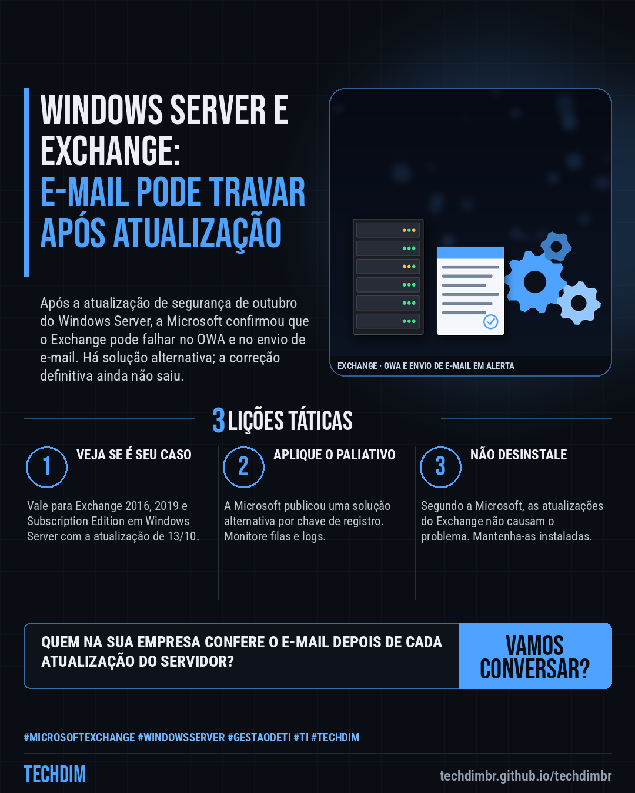

# Notícias de Tecnologia — Exchange: atualização de outubro do Windows Server pode travar o OWA e o envio de e-mail

- **Data:** 2026-10-19, 08:00 (horário de Brasília)
- **Curadoria:** Claude (Routine) — pauta do dia
- **Execução no Actions:** https://github.com/Techdimbr/Publi-midia-Techdim/actions/runs/39241301813
- **Por que esta pauta:** Problema confirmado pela Microsoft que afeta servidores Exchange locais após a atualização de outubro do Windows Server, com solução alternativa disponível.

## Resultado

| Rede | Status | Link | 1º comentário |
|---|---|---|---|
| linkedin | ✅ publicado | https://www.linkedin.com/feed/update/urn:li:share:7517902212984074241/ | — |
| facebook | ✅ publicado | https://www.facebook.com/122132402349390486/posts/122137053285390486 | ✅ |
| instagram | ✅ publicado | https://www.instagram.com/p/DerGYRll9Mc/ | ✅ |
| Stories | ✅ publicado | https://www.instagram.com/stories/techdimbr/4011328084087606633 | — |

## Fontes

- [bleepingcomputer.com](https://www.bleepingcomputer.com/news/microsoft/microsoft-october-windows-server-updates-cause-exchange-issues/)
- [learn.microsoft.com](https://learn.microsoft.com/en-us/windows/release-health/status-windows-server-2022)

## Linkedin

```text
Exchange: atualização de outubro do Windows Server pode travar o OWA e o envio de e-mail

01. A Microsoft confirmou que a atualização de 13/10 do Windows Server pode causar falha no login do OWA e no envio de e-mail em Exchange 2016, 2019 e Subscription Edition
02. A causa é um novo limite de 512 consultas simultâneas no Endpoint Mapper, curto para um Exchange com carga alta. Nem todo servidor é afetado, e o efeito varia com a carga
03. Com Exchange próprio: confira filas e OWA e aplique a solução alternativa de registro da Microsoft. Falta a correção definitiva. Não remova as atualizações do Exchange

Sua empresa mantém um servidor Exchange próprio? Peça à TI para conferir filas de e-mail e OWA depois das atualizações.

Fontes: https://www.bleepingcomputer.com/news/microsoft/microsoft-october-windows-server-updates-cause-exchange-issues/ · https://learn.microsoft.com/en-us/windows/release-health/status-windows-server-2022

TECHDIM — Infraestrutura · Segurança · IA
https://techdimbr.github.io/techdimbr/

#MicrosoftExchange #WindowsServer #GestaoDeTI #TI #TECHDIM
```



## Facebook

```text
Exchange: atualização de outubro do Windows Server pode travar o OWA e o envio de e-mail

• A Microsoft confirmou que a atualização de 13/10 do Windows Server pode causar falha no login do OWA e no envio de e-mail em Exchange 2016, 2019 e Subscription Edition
• A causa é um novo limite de 512 consultas simultâneas no Endpoint Mapper, curto para um Exchange com carga alta. Nem todo servidor é afetado, e o efeito varia com a carga
• Com Exchange próprio: confira filas e OWA e aplique a solução alternativa de registro da Microsoft. Falta a correção definitiva. Não remova as atualizações do Exchange

Sua empresa mantém um servidor Exchange próprio? Peça à TI para conferir filas de e-mail e OWA depois das atualizações.

Fale com a TECHDIM — fontes e site no primeiro comentário 👇

#MicrosoftExchange #WindowsServer #GestaoDeTI #TECHDIM
```

Primeiro comentário:

```text
📎 Fontes:
• bleepingcomputer.com: https://www.bleepingcomputer.com/news/microsoft/microsoft-october-windows-server-updates-cause-exchange-issues/
• learn.microsoft.com: https://learn.microsoft.com/en-us/windows/release-health/status-windows-server-2022

🌐 TECHDIM — Infraestrutura · Segurança · IA: https://techdimbr.github.io/techdimbr/
```


## Instagram

```text
Exchange: atualização de outubro do Windows Server pode travar o OWA e o envio de e-mail

1️⃣ A Microsoft confirmou que a atualização de 13/10 do Windows Server pode causar falha no login do OWA e no envio de e-mail em Exchange 2016, 2019 e Subscription Edition
2️⃣ A causa é um novo limite de 512 consultas simultâneas no Endpoint Mapper, curto para um Exchange com carga alta. Nem todo servidor é afetado, e o efeito varia com a carga
3️⃣ Com Exchange próprio: confira filas e OWA e aplique a solução alternativa de registro da Microsoft. Falta a correção definitiva. Não remova as atualizações do Exchange

Sua empresa mantém um servidor Exchange próprio? Peça à TI para conferir filas de e-mail e OWA depois das atualizações.

🔗 Link na bio: techdimbr.github.io/techdimbr
Fontes no primeiro comentário 👇

#microsoftexchange #windowsserver #gestaodeti #ti #techdim #tecnologia #inteligenciaartificial #ia
```

Primeiro comentário:

```text
📎 Fontes: bleepingcomputer.com · learn.microsoft.com
```


## Stories


