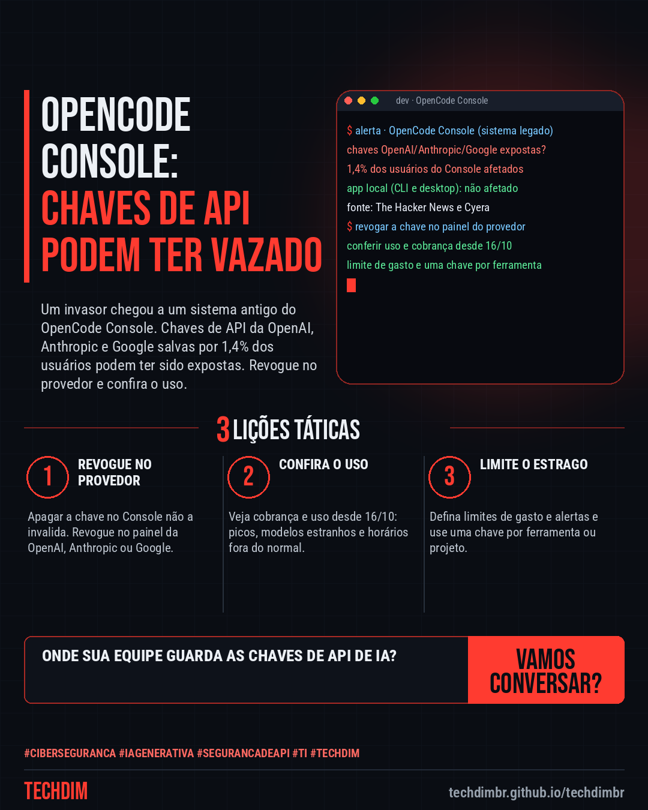
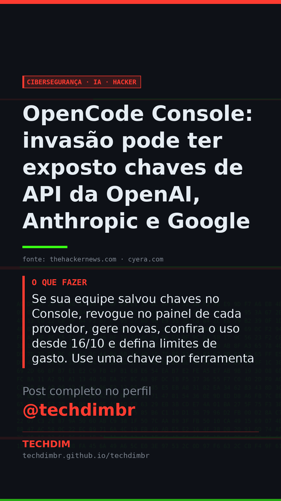

# Cibersegurança · IA · Hacker — OpenCode Console: invasão pode ter exposto chaves de API da OpenAI, Anthropic e Google

- **Data:** 2026-10-19, 11:09 (horário de Brasília)
- **Curadoria:** Claude (Routine) — pauta do dia
- **Execução no Actions:** https://github.com/Techdimbr/Publi-midia-Techdim/actions/runs/39266177054
- **Por que esta pauta:** Incidente em ferramenta de IA para desenvolvedores com risco para chaves de API de provedores, com passos práticos de revogação e conferência de uso.

## Resultado

| Rede | Status | Link | 1º comentário |
|---|---|---|---|
| linkedin | ✅ publicado | https://www.linkedin.com/feed/update/urn:li:share:7517949804631633920/ | — |
| facebook | ✅ publicado | https://www.facebook.com/122132402349390486/posts/122137083579390486 | ✅ |
| instagram | ✅ publicado | https://www.instagram.com/p/DercBhZmA2z/ | ✅ |
| Stories | ✅ publicado | https://www.instagram.com/stories/techdimbr/4011423325708903450 | — |

## Fontes

- [thehackernews.com](https://thehackernews.com/2026/10/opencode-console-breach-may-have.html)
- [cyera.com](https://www.cyera.com/research/opencode-breach-what-happened-and-how-to-rotate-exposed-ai-api-keys)

## Linkedin

```text
OpenCode Console: invasão pode ter exposto chaves de API da OpenAI, Anthropic e Google

01. O OpenCode, agente de código aberto para programar com IA, diz que uma invasão ao Console pode ter exposto chaves de API da OpenAI, Anthropic e Google salvas por usuários
02. A empresa diz que 1,4% dos usuários do Console foram afetados e avisados por e-mail. O app local (CLI e desktop) não foi atingido. Há relatos de cobranças indevidas
03. Se sua equipe salvou chaves no Console, revogue no painel de cada provedor, gere novas, confira o uso desde 16/10 e defina limites de gasto. Use uma chave por ferramenta

Sua equipe guarda chaves de API de IA em ferramentas de terceiros? Gire as chaves e defina limites de gasto.

Fontes: https://thehackernews.com/2026/10/opencode-console-breach-may-have.html · https://www.cyera.com/research/opencode-breach-what-happened-and-how-to-rotate-exposed-ai-api-keys

TECHDIM — Infraestrutura · Segurança · IA
https://techdimbr.github.io/techdimbr/

#Ciberseguranca #IAGenerativa #SegurancaDeAPI #TI #TECHDIM
```



## Facebook

```text
OpenCode Console: invasão pode ter exposto chaves de API da OpenAI, Anthropic e Google

• O OpenCode, agente de código aberto para programar com IA, diz que uma invasão ao Console pode ter exposto chaves de API da OpenAI, Anthropic e Google salvas por usuários
• A empresa diz que 1,4% dos usuários do Console foram afetados e avisados por e-mail. O app local (CLI e desktop) não foi atingido. Há relatos de cobranças indevidas
• Se sua equipe salvou chaves no Console, revogue no painel de cada provedor, gere novas, confira o uso desde 16/10 e defina limites de gasto. Use uma chave por ferramenta

Sua equipe guarda chaves de API de IA em ferramentas de terceiros? Gire as chaves e defina limites de gasto.

Fale com a TECHDIM — fontes e site no primeiro comentário 👇

#Ciberseguranca #IAGenerativa #SegurancaDeAPI #TECHDIM
```

Primeiro comentário:

```text
📎 Fontes:
• thehackernews.com: https://thehackernews.com/2026/10/opencode-console-breach-may-have.html
• cyera.com: https://www.cyera.com/research/opencode-breach-what-happened-and-how-to-rotate-exposed-ai-api-keys

🌐 TECHDIM — Infraestrutura · Segurança · IA: https://techdimbr.github.io/techdimbr/
```


## Instagram

```text
OpenCode Console: invasão pode ter exposto chaves de API da OpenAI, Anthropic e Google

1️⃣ O OpenCode, agente de código aberto para programar com IA, diz que uma invasão ao Console pode ter exposto chaves de API da OpenAI, Anthropic e Google salvas por usuários
2️⃣ A empresa diz que 1,4% dos usuários do Console foram afetados e avisados por e-mail. O app local (CLI e desktop) não foi atingido. Há relatos de cobranças indevidas
3️⃣ Se sua equipe salvou chaves no Console, revogue no painel de cada provedor, gere novas, confira o uso desde 16/10 e defina limites de gasto. Use uma chave por ferramenta

Sua equipe guarda chaves de API de IA em ferramentas de terceiros? Gire as chaves e defina limites de gasto.

🔗 Link na bio: techdimbr.github.io/techdimbr
Fontes no primeiro comentário 👇

#ciberseguranca #iagenerativa #segurancadeapi #ti #techdim #seguranca #hacker #infraestrutura
```

Primeiro comentário:

```text
📎 Fontes: thehackernews.com · cyera.com
```


## Stories


