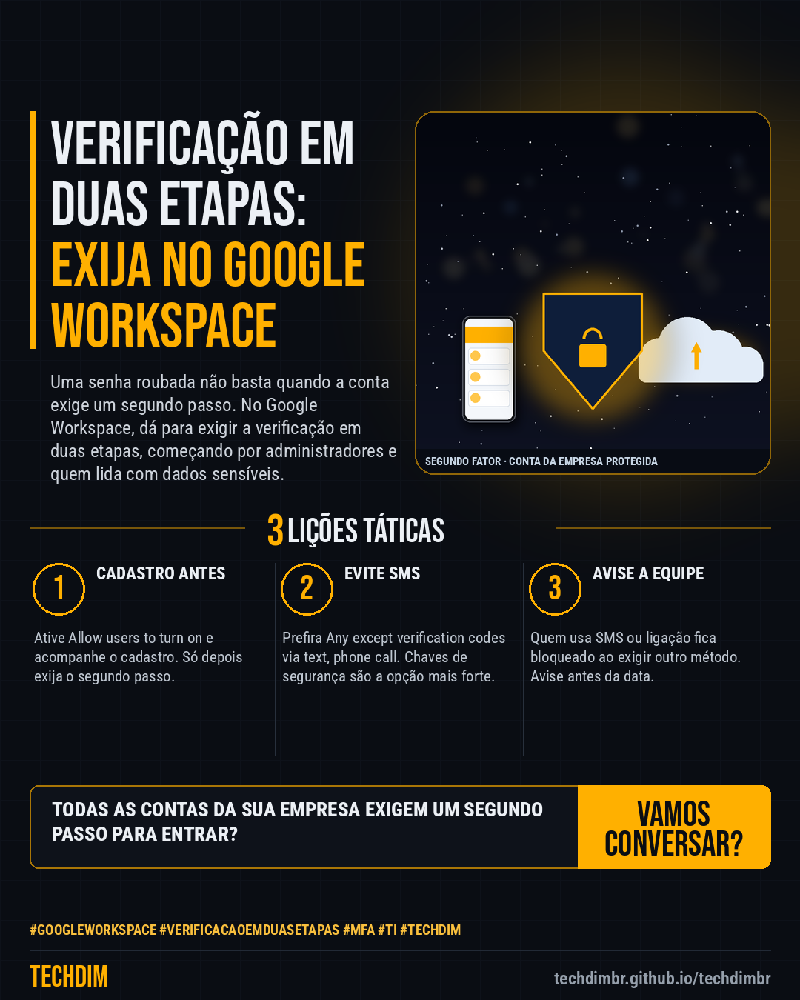

# Conhecimento — Verificação em duas etapas no Google Workspace: exija para todos em 5 passos

- **Data:** 2026-10-19, 14:24 (horário de Brasília)
- **Curadoria:** Claude (Routine) — pauta do dia
- **Execução no Actions:** https://github.com/Techdimbr/Publi-midia-Techdim/actions/runs/39293626025
- **Por que esta pauta:** Passo a passo baseado na documentação do Google Workspace para ativar e exigir a verificação em duas etapas, reduzindo o risco de invasão por senha roubada.

## Resultado

| Rede | Status | Link | 1º comentário |
|---|---|---|---|
| linkedin | ✅ publicado | https://www.linkedin.com/feed/update/urn:li:share:7517998859856465921/ | — |
| facebook | ✅ publicado | https://www.facebook.com/122132402349390486/posts/122137113885390486 | ✅ |
| instagram | ✅ publicado | https://www.instagram.com/p/DeryVkXF8om/ | ✅ |

## Fontes

- [knowledge.workspace.google.com/deploy-2sv](https://knowledge.workspace.google.com/admin/security/deploy-2-step-verification)
- [knowledge.workspace.google.com/protect-2sv](https://knowledge.workspace.google.com/admin/security/protect-your-business-with-2-step-verification)

## Linkedin

```text
Verificação em duas etapas no Google Workspace: exija para todos em 5 passos

01. 1) Como superadmin, abra Menu > Security > Authentication > 2-step verification. 2) Marque Allow users to turn on 2-Step Verification, deixe Enforcement em Off e salve
02. 3) Avise a equipe e acompanhe quem já cadastrou em Reporting > User Reports > Security. 4) Quando todos estiverem prontos, mude Enforcement para On ou para uma data
03. 5) Em Methods, prefira Any except verification codes via text, phone call; para administradores, use chave de segurança. Evite Allow user to trust the device

As contas da sua empresa exigem um segundo passo para entrar? Comece pelos administradores e por quem lida com dados sensíveis.

Fontes: https://knowledge.workspace.google.com/admin/security/deploy-2-step-verification · https://knowledge.workspace.google.com/admin/security/protect-your-business-with-2-step-verification

TECHDIM — Infraestrutura · Segurança · IA
https://techdimbr.github.io/techdimbr/

#GoogleWorkspace #VerificacaoEmDuasEtapas #MFA #TI #TECHDIM
```



## Facebook

```text
Verificação em duas etapas no Google Workspace: exija para todos em 5 passos

• 1) Como superadmin, abra Menu > Security > Authentication > 2-step verification. 2) Marque Allow users to turn on 2-Step Verification, deixe Enforcement em Off e salve
• 3) Avise a equipe e acompanhe quem já cadastrou em Reporting > User Reports > Security. 4) Quando todos estiverem prontos, mude Enforcement para On ou para uma data
• 5) Em Methods, prefira Any except verification codes via text, phone call; para administradores, use chave de segurança. Evite Allow user to trust the device

As contas da sua empresa exigem um segundo passo para entrar? Comece pelos administradores e por quem lida com dados sensíveis.

Fale com a TECHDIM — fontes e site no primeiro comentário 👇

#GoogleWorkspace #VerificacaoEmDuasEtapas #MFA #TECHDIM
```

Primeiro comentário:

```text
📎 Fontes:
• knowledge.workspace.google.com/deploy-2sv: https://knowledge.workspace.google.com/admin/security/deploy-2-step-verification
• knowledge.workspace.google.com/protect-2sv: https://knowledge.workspace.google.com/admin/security/protect-your-business-with-2-step-verification

🌐 TECHDIM — Infraestrutura · Segurança · IA: https://techdimbr.github.io/techdimbr/
```


## Instagram

```text
Verificação em duas etapas no Google Workspace: exija para todos em 5 passos

1️⃣ 1) Como superadmin, abra Menu > Security > Authentication > 2-step verification. 2) Marque Allow users to turn on 2-Step Verification, deixe Enforcement em Off e salve
2️⃣ 3) Avise a equipe e acompanhe quem já cadastrou em Reporting > User Reports > Security. 4) Quando todos estiverem prontos, mude Enforcement para On ou para uma data
3️⃣ 5) Em Methods, prefira Any except verification codes via text, phone call; para administradores, use chave de segurança. Evite Allow user to trust the device

As contas da sua empresa exigem um segundo passo para entrar? Comece pelos administradores e por quem lida com dados sensíveis.

🔗 Link na bio: techdimbr.github.io/techdimbr
Fontes no primeiro comentário 👇

#googleworkspace #verificacaoemduasetapas #mfa #ti #techdim #conhecimento #aprendati #tecnologia
```

Primeiro comentário:

```text
📎 Fontes: knowledge.workspace.google.com/deploy-2sv · knowledge.workspace.google.com/protect-2sv
```


