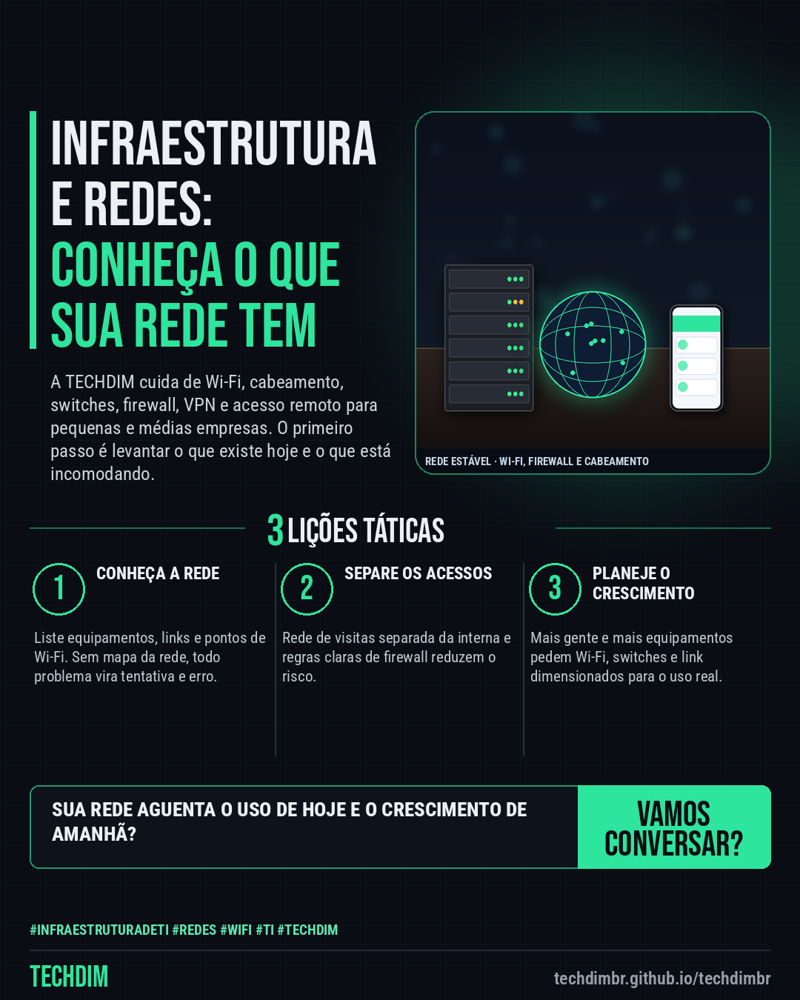

# TECHDIM · Serviços — Infraestrutura e redes: Wi-Fi, firewall e cabeamento organizados para a empresa funcionar

- **Data:** 2026-10-19, 17:24 (horário de Brasília)
- **Curadoria:** Claude (Routine) — pauta do dia
- **Execução no Actions:** https://github.com/Techdimbr/Publi-midia-Techdim/actions/runs/39318934604
- **Por que esta pauta:** Apresenta o serviço de infraestrutura e redes (Wi-Fi, cabeamento, switches, firewall, VPN e acesso remoto), convidando o leitor a descrever a rede atual, sem promessa de preço, prazo ou resultado.

## Resultado

| Rede | Status | Link | 1º comentário |
|---|---|---|---|
| linkedin | ✅ publicado | https://www.linkedin.com/feed/update/urn:li:share:7518044360496644097/ | — |
| facebook | ✅ publicado | https://www.facebook.com/122132402349390486/posts/122137221747390486 | ✅ |
| instagram | ✅ publicado | https://www.instagram.com/p/DesHBCejMvS/ | — |

## Linkedin

```text
Infraestrutura e redes: Wi-Fi, firewall e cabeamento organizados para a empresa funcionar

01. Rede lenta, Wi-Fi que cai e acesso remoto instável costumam vir de equipamento mal dimensionado ou configuração antiga. O primeiro passo é saber o que existe hoje
02. A TECHDIM cuida de infraestrutura e redes de PMEs: Wi-Fi, cabeamento, switches, firewall, VPN e acesso remoto, com levantamento do que existe e registro das mudanças
03. Conte como é a rede hoje e o que incomoda. A TECHDIM faz o levantamento e propõe o que ajustar, sem compromisso

Como está a rede da sua empresa hoje? Fale com a TECHDIM: techdimbr.github.io/techdimbr

TECHDIM — Infraestrutura · Segurança · IA
https://techdimbr.github.io/techdimbr/

#InfraestruturaDeTI #Redes #WiFi #TI #TECHDIM
```



## Facebook

```text
Infraestrutura e redes: Wi-Fi, firewall e cabeamento organizados para a empresa funcionar

• Rede lenta, Wi-Fi que cai e acesso remoto instável costumam vir de equipamento mal dimensionado ou configuração antiga. O primeiro passo é saber o que existe hoje
• A TECHDIM cuida de infraestrutura e redes de PMEs: Wi-Fi, cabeamento, switches, firewall, VPN e acesso remoto, com levantamento do que existe e registro das mudanças
• Conte como é a rede hoje e o que incomoda. A TECHDIM faz o levantamento e propõe o que ajustar, sem compromisso

Como está a rede da sua empresa hoje? Fale com a TECHDIM: techdimbr.github.io/techdimbr

Fale com a TECHDIM — link no primeiro comentário 👇

#InfraestruturaDeTI #Redes #WiFi #TECHDIM
```

Primeiro comentário:

```text
🌐 TECHDIM — Infraestrutura · Segurança · IA: https://techdimbr.github.io/techdimbr/
```


## Instagram

```text
Infraestrutura e redes: Wi-Fi, firewall e cabeamento organizados para a empresa funcionar

1️⃣ Rede lenta, Wi-Fi que cai e acesso remoto instável costumam vir de equipamento mal dimensionado ou configuração antiga. O primeiro passo é saber o que existe hoje
2️⃣ A TECHDIM cuida de infraestrutura e redes de PMEs: Wi-Fi, cabeamento, switches, firewall, VPN e acesso remoto, com levantamento do que existe e registro das mudanças
3️⃣ Conte como é a rede hoje e o que incomoda. A TECHDIM faz o levantamento e propõe o que ajustar, sem compromisso

Como está a rede da sua empresa hoje? Fale com a TECHDIM: techdimbr.github.io/techdimbr

🔗 Link na bio: techdimbr.github.io/techdimbr

#infraestruturadeti #redes #wifi #ti #techdim #suportetecnico #ciberseguranca #automacao
```


