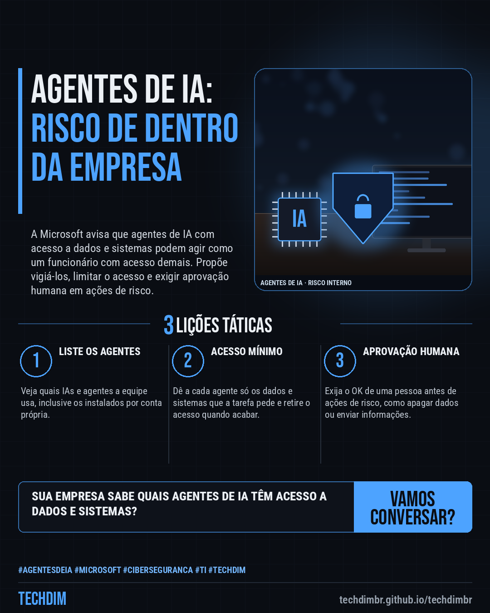
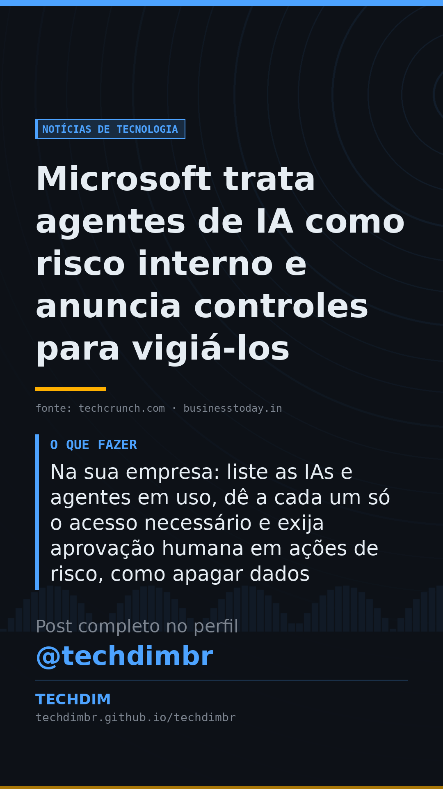

# Notícias de Tecnologia — Microsoft trata agentes de IA como risco interno e anuncia controles para vigiá-los

- **Data:** 2026-10-20, 08:00 (horário de Brasília)
- **Curadoria:** Claude (Routine) — pauta do dia
- **Execução no Actions:** https://github.com/Techdimbr/Publi-midia-Techdim/actions/runs/39411735995
- **Por que esta pauta:** Tema novo e prático para PMEs que começam a usar agentes de IA: inventário, acesso mínimo e aprovação humana. O aviso vem da Microsoft, que também vende segurança para agentes.

## Resultado

| Rede | Status | Link | 1º comentário |
|---|---|---|---|
| linkedin | ✅ publicado | https://www.linkedin.com/feed/update/urn:li:share:7518264620386656257/ | — |
| facebook | ✅ publicado | https://www.facebook.com/122132402349390486/posts/122137330539390486 | ✅ |
| instagram | ✅ publicado | https://www.instagram.com/p/DetrL5WllW_/ | ✅ |
| Stories | ✅ publicado | https://www.instagram.com/stories/techdimbr/4012052910427217195 | — |

## Fontes

- [techcrunch.com](https://techcrunch.com/2026/10/19/microsoft-says-ai-agents-are-like-insider-threats-as-frontier-models-cant-be-trusted/)
- [businesstoday.in](https://www.businesstoday.in/amp/technology/story/ai-models-cannot-be-trusted-microsoft-warns-of-insider-threats-expands-project-perception-562579-2026-10-19)
- [dataconomy.com](https://dataconomy.com/2026/10/20/microsoft-warns-companies-not-to-trust-ai-agents/)

## Linkedin

```text
Microsoft trata agentes de IA como risco interno e anuncia controles para vigiá-los

01. A Microsoft diz que agentes de IA com acesso a dados e sistemas são risco interno: modelos de ponta são imprevisíveis, não necessariamente maliciosos
02. Os novos Guardian Agents vigiam outros agentes, e um recurso do Defender detecta até 60 tipos de agentes que a equipe leva para o trabalho, como Claude Code e Codex
03. Na sua empresa: liste as IAs e agentes em uso, dê a cada um só o acesso necessário e exija aprovação humana em ações de risco, como apagar dados

Quem na sua empresa sabe quais agentes de IA têm acesso a dados e sistemas? Comece listando e limitando os acessos.

Fontes: https://techcrunch.com/2026/10/19/microsoft-says-ai-agents-are-like-insider-threats-as-frontier-models-cant-be-trusted/ · https://www.businesstoday.in/amp/technology/story/ai-models-cannot-be-trusted-microsoft-warns-of-insider-threats-expands-project-perception-562579-2026-10-19

TECHDIM — Infraestrutura · Segurança · IA
https://techdimbr.github.io/techdimbr/

#AgentesDeIA #Microsoft #Ciberseguranca #TI #TECHDIM
```



## Facebook

```text
Microsoft trata agentes de IA como risco interno e anuncia controles para vigiá-los

• A Microsoft diz que agentes de IA com acesso a dados e sistemas são risco interno: modelos de ponta são imprevisíveis, não necessariamente maliciosos
• Os novos Guardian Agents vigiam outros agentes, e um recurso do Defender detecta até 60 tipos de agentes que a equipe leva para o trabalho, como Claude Code e Codex
• Na sua empresa: liste as IAs e agentes em uso, dê a cada um só o acesso necessário e exija aprovação humana em ações de risco, como apagar dados

Quem na sua empresa sabe quais agentes de IA têm acesso a dados e sistemas? Comece listando e limitando os acessos.

Fale com a TECHDIM — fontes e site no primeiro comentário 👇

#AgentesDeIA #Microsoft #Ciberseguranca #TECHDIM
```

Primeiro comentário:

```text
📎 Fontes:
• techcrunch.com: https://techcrunch.com/2026/10/19/microsoft-says-ai-agents-are-like-insider-threats-as-frontier-models-cant-be-trusted/
• businesstoday.in: https://www.businesstoday.in/amp/technology/story/ai-models-cannot-be-trusted-microsoft-warns-of-insider-threats-expands-project-perception-562579-2026-10-19
• dataconomy.com: https://dataconomy.com/2026/10/20/microsoft-warns-companies-not-to-trust-ai-agents/

🌐 TECHDIM — Infraestrutura · Segurança · IA: https://techdimbr.github.io/techdimbr/
```


## Instagram

```text
Microsoft trata agentes de IA como risco interno e anuncia controles para vigiá-los

1️⃣ A Microsoft diz que agentes de IA com acesso a dados e sistemas são risco interno: modelos de ponta são imprevisíveis, não necessariamente maliciosos
2️⃣ Os novos Guardian Agents vigiam outros agentes, e um recurso do Defender detecta até 60 tipos de agentes que a equipe leva para o trabalho, como Claude Code e Codex
3️⃣ Na sua empresa: liste as IAs e agentes em uso, dê a cada um só o acesso necessário e exija aprovação humana em ações de risco, como apagar dados

Quem na sua empresa sabe quais agentes de IA têm acesso a dados e sistemas? Comece listando e limitando os acessos.

🔗 Link na bio: techdimbr.github.io/techdimbr
Fontes no primeiro comentário 👇

#agentesdeia #microsoft #ciberseguranca #ti #techdim #tecnologia #inteligenciaartificial #ia
```

Primeiro comentário:

```text
📎 Fontes: techcrunch.com · businesstoday.in · dataconomy.com
```


## Stories


