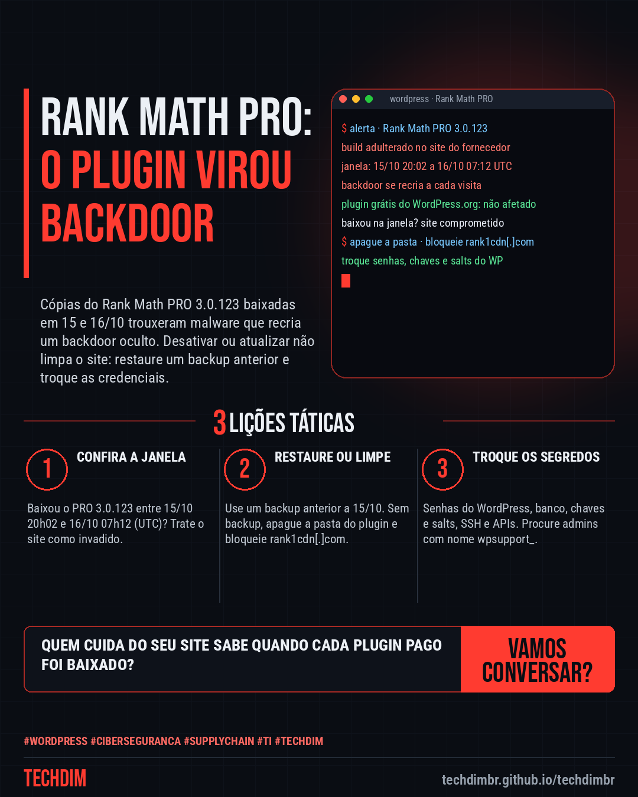
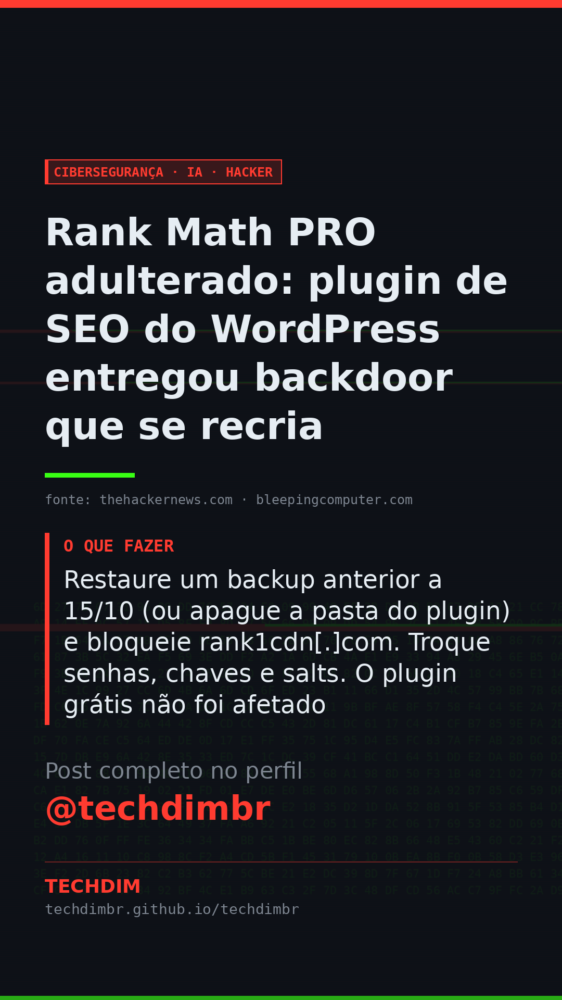

# Cibersegurança · IA · Hacker — Rank Math PRO adulterado: plugin de SEO do WordPress entregou backdoor que se recria

- **Data:** 2026-10-20, 11:09 (horário de Brasília)
- **Curadoria:** Claude (Routine) — pauta do dia
- **Execução no Actions:** https://github.com/Techdimbr/Publi-midia-Techdim/actions/runs/39436482709
- **Por que esta pauta:** Ataque à cadeia de suprimentos de um plugin pago de WordPress, com janela exata e passos de resposta confirmados pelo aviso do fornecedor e por duas fontes.

## Resultado

| Rede | Status | Link | 1º comentário |
|---|---|---|---|
| linkedin | ✅ publicado | https://www.linkedin.com/feed/update/urn:li:share:7518312191452848128/ | — |
| facebook | ✅ publicado | https://www.facebook.com/122132402349390486/posts/122137366137390486 | ✅ |
| instagram | ✅ publicado | https://www.instagram.com/p/DeuA0JpiVcx/ | ✅ |
| Stories | ✅ publicado | https://www.instagram.com/stories/techdimbr/4012148077071212451 | — |

## Fontes

- [thehackernews.com](https://thehackernews.com/2026/10/popular-wordpress-seo-plugin-rank-math.html)
- [bleepingcomputer.com](https://www.bleepingcomputer.com/news/security/wordpress-seo-plugin-rank-math-compromised-to-backdoor-websites/)

## Linkedin

```text
Rank Math PRO adulterado: plugin de SEO do WordPress entregou backdoor que se recria

01. O Rank Math PRO 3.0.123, plugin pago de SEO, saiu adulterado do site do próprio fornecedor para quem baixou entre 20h02 de 15/10 e 07h12 de 16/10 (UTC)
02. O malware recria o backdoor a cada visita e pode criar admins falsos. Quem ativou essa cópia deve tratar o site como invadido, mesmo após atualizar para a 3.0.124
03. Restaure um backup anterior a 15/10 (ou apague a pasta do plugin) e bloqueie rank1cdn[.]com. Troque senhas, chaves e salts. O plugin grátis não foi afetado

Seu site usa Rank Math PRO? Peça a quem cuida dele para conferir a data do download e restaurar um backup limpo.

Fontes: https://thehackernews.com/2026/10/popular-wordpress-seo-plugin-rank-math.html · https://www.bleepingcomputer.com/news/security/wordpress-seo-plugin-rank-math-compromised-to-backdoor-websites/

TECHDIM — Infraestrutura · Segurança · IA
https://techdimbr.github.io/techdimbr/

#WordPress #Ciberseguranca #SupplyChain #TI #TECHDIM
```



## Facebook

```text
Rank Math PRO adulterado: plugin de SEO do WordPress entregou backdoor que se recria

• O Rank Math PRO 3.0.123, plugin pago de SEO, saiu adulterado do site do próprio fornecedor para quem baixou entre 20h02 de 15/10 e 07h12 de 16/10 (UTC)
• O malware recria o backdoor a cada visita e pode criar admins falsos. Quem ativou essa cópia deve tratar o site como invadido, mesmo após atualizar para a 3.0.124
• Restaure um backup anterior a 15/10 (ou apague a pasta do plugin) e bloqueie rank1cdn[.]com. Troque senhas, chaves e salts. O plugin grátis não foi afetado

Seu site usa Rank Math PRO? Peça a quem cuida dele para conferir a data do download e restaurar um backup limpo.

Fale com a TECHDIM — fontes e site no primeiro comentário 👇

#WordPress #Ciberseguranca #SupplyChain #TECHDIM
```

Primeiro comentário:

```text
📎 Fontes:
• thehackernews.com: https://thehackernews.com/2026/10/popular-wordpress-seo-plugin-rank-math.html
• bleepingcomputer.com: https://www.bleepingcomputer.com/news/security/wordpress-seo-plugin-rank-math-compromised-to-backdoor-websites/

🌐 TECHDIM — Infraestrutura · Segurança · IA: https://techdimbr.github.io/techdimbr/
```


## Instagram

```text
Rank Math PRO adulterado: plugin de SEO do WordPress entregou backdoor que se recria

1️⃣ O Rank Math PRO 3.0.123, plugin pago de SEO, saiu adulterado do site do próprio fornecedor para quem baixou entre 20h02 de 15/10 e 07h12 de 16/10 (UTC)
2️⃣ O malware recria o backdoor a cada visita e pode criar admins falsos. Quem ativou essa cópia deve tratar o site como invadido, mesmo após atualizar para a 3.0.124
3️⃣ Restaure um backup anterior a 15/10 (ou apague a pasta do plugin) e bloqueie rank1cdn[.]com. Troque senhas, chaves e salts. O plugin grátis não foi afetado

Seu site usa Rank Math PRO? Peça a quem cuida dele para conferir a data do download e restaurar um backup limpo.

🔗 Link na bio: techdimbr.github.io/techdimbr
Fontes no primeiro comentário 👇

#wordpress #ciberseguranca #supplychain #ti #techdim #seguranca #hacker #infraestrutura
```

Primeiro comentário:

```text
📎 Fontes: thehackernews.com · bleepingcomputer.com
```


## Stories


