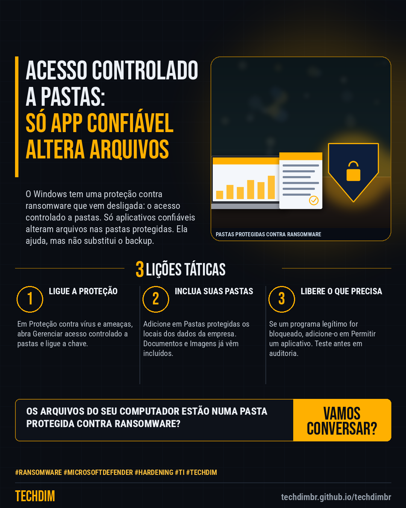

# Conhecimento — Acesso controlado a pastas do Windows: proteja arquivos contra ransomware em 5 passos

- **Data:** 2026-10-20, 14:24 (horário de Brasília)
- **Curadoria:** Claude (Routine) — pauta do dia
- **Execução no Actions:** https://github.com/Techdimbr/Publi-midia-Techdim/actions/runs/39465649874
- **Por que esta pauta:** Passo a passo baseado na documentação da Microsoft para ligar uma proteção nativa do Windows que impede programas não confiáveis de alterar arquivos, reduzindo o estrago de um ransomware.

## Resultado

| Rede | Status | Link | 1º comentário |
|---|---|---|---|
| linkedin | ✅ publicado | https://www.linkedin.com/feed/update/urn:li:share:7518361371441328129/ | — |
| facebook | ✅ publicado | https://www.facebook.com/122132402349390486/posts/122137400709390486 | ✅ |
| instagram | ✅ publicado | https://www.instagram.com/p/DeuXL1fl4_S/ | ✅ |

## Fontes

- [learn.microsoft.com/defender (visão geral)](https://learn.microsoft.com/en-us/defender-endpoint/controlled-folder-access-overview)
- [learn.microsoft.com/defender (configurar)](https://learn.microsoft.com/pt-br/defender-endpoint/controlled-folder-access-configure)

## Linkedin

```text
Acesso controlado a pastas do Windows: proteja arquivos contra ransomware em 5 passos

01. 1) Segurança do Windows > Proteção contra vírus e ameaças > Gerenciar configurações > Gerenciar acesso controlado a pastas. 2) Ative a chave e confirme com Sim
02. 3) Em Pastas protegidas, adicione as pastas de dados (ex.: C:\Dados). Documentos, Imagens, Vídeos e Música já vêm protegidos. Exige o antivírus do Defender ativo
03. 4) Programa legítimo bloqueado: Permitir um aplicativo > Adicionar um aplicativo permitido. 5) Em várias máquinas, teste antes em Modo de Auditoria (Intune ou GPO)

Seus PCs estão com o acesso controlado a pastas ligado? Ative, teste em modo de auditoria e inclua as pastas de dados da empresa.

Fontes: https://learn.microsoft.com/en-us/defender-endpoint/controlled-folder-access-overview · https://learn.microsoft.com/pt-br/defender-endpoint/controlled-folder-access-configure

TECHDIM — Infraestrutura · Segurança · IA
https://techdimbr.github.io/techdimbr/

#Ransomware #MicrosoftDefender #Hardening #TI #TECHDIM
```



## Facebook

```text
Acesso controlado a pastas do Windows: proteja arquivos contra ransomware em 5 passos

• 1) Segurança do Windows > Proteção contra vírus e ameaças > Gerenciar configurações > Gerenciar acesso controlado a pastas. 2) Ative a chave e confirme com Sim
• 3) Em Pastas protegidas, adicione as pastas de dados (ex.: C:\Dados). Documentos, Imagens, Vídeos e Música já vêm protegidos. Exige o antivírus do Defender ativo
• 4) Programa legítimo bloqueado: Permitir um aplicativo > Adicionar um aplicativo permitido. 5) Em várias máquinas, teste antes em Modo de Auditoria (Intune ou GPO)

Seus PCs estão com o acesso controlado a pastas ligado? Ative, teste em modo de auditoria e inclua as pastas de dados da empresa.

Fale com a TECHDIM — fontes e site no primeiro comentário 👇

#Ransomware #MicrosoftDefender #Hardening #TECHDIM
```

Primeiro comentário:

```text
📎 Fontes:
• learn.microsoft.com/defender (visão geral): https://learn.microsoft.com/en-us/defender-endpoint/controlled-folder-access-overview
• learn.microsoft.com/defender (configurar): https://learn.microsoft.com/pt-br/defender-endpoint/controlled-folder-access-configure

🌐 TECHDIM — Infraestrutura · Segurança · IA: https://techdimbr.github.io/techdimbr/
```


## Instagram

```text
Acesso controlado a pastas do Windows: proteja arquivos contra ransomware em 5 passos

1️⃣ 1) Segurança do Windows > Proteção contra vírus e ameaças > Gerenciar configurações > Gerenciar acesso controlado a pastas. 2) Ative a chave e confirme com Sim
2️⃣ 3) Em Pastas protegidas, adicione as pastas de dados (ex.: C:\Dados). Documentos, Imagens, Vídeos e Música já vêm protegidos. Exige o antivírus do Defender ativo
3️⃣ 4) Programa legítimo bloqueado: Permitir um aplicativo > Adicionar um aplicativo permitido. 5) Em várias máquinas, teste antes em Modo de Auditoria (Intune ou GPO)

Seus PCs estão com o acesso controlado a pastas ligado? Ative, teste em modo de auditoria e inclua as pastas de dados da empresa.

🔗 Link na bio: techdimbr.github.io/techdimbr
Fontes no primeiro comentário 👇

#ransomware #microsoftdefender #hardening #ti #techdim #conhecimento #aprendati #tecnologia
```

Primeiro comentário:

```text
📎 Fontes: learn.microsoft.com/defender (visão geral) · learn.microsoft.com/defender (configurar)
```


