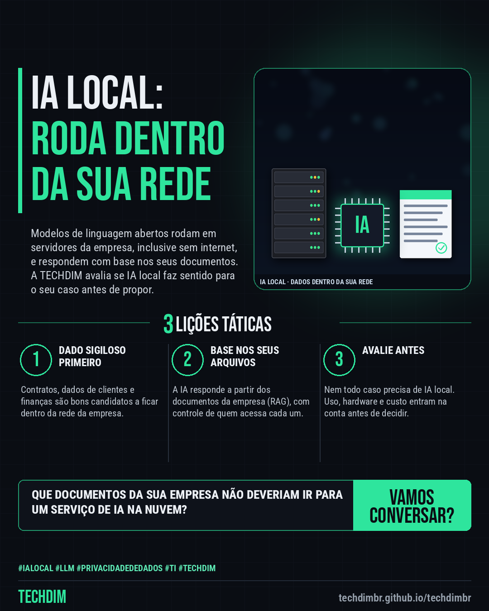

# TECHDIM · Serviços — IA local: modelos de linguagem na sua rede para analisar documentos sem enviá-los à nuvem

- **Data:** 2026-10-20, 17:24 (horário de Brasília)
- **Curadoria:** Claude (Routine) — pauta do dia
- **Execução no Actions:** https://github.com/Techdimbr/Publi-midia-Techdim/actions/runs/39491511435
- **Por que esta pauta:** Apresenta o serviço de IA local (on-premise) da TECHDIM para empresas com dados sigilosos, sem promessa de preço, prazo, desempenho ou segurança absoluta.

## Resultado

| Rede | Status | Link | 1º comentário |
|---|---|---|---|
| linkedin | ✅ publicado | https://www.linkedin.com/feed/update/urn:li:share:7518406618473226240/ | — |
| facebook | ✅ publicado | https://www.facebook.com/122132402349390486/posts/122137423953390486 | ✅ |
| instagram | ✅ publicado | https://www.instagram.com/p/DeurwH_jYjE/ | — |

## Linkedin

```text
IA local: modelos de linguagem na sua rede para analisar documentos sem enviá-los à nuvem

01. Contratos, dados de clientes e planilhas financeiras nem sempre podem ir para um serviço de IA na nuvem. A IA local roda os modelos dentro da sua própria rede
02. A TECHDIM implanta modelos de linguagem abertos em servidores da empresa, até isolados da internet, e monta a consulta aos seus documentos (RAG) com controle de acesso
03. Conte qual dado precisa ficar dentro de casa. A TECHDIM avalia se IA local faz sentido (uso, hardware e custo) e propõe os próximos passos, sem compromisso

Quer usar IA com documentos sigilosos sem mandá-los para fora? Conte seu caso para a TECHDIM: techdimbr.github.io/techdimbr

TECHDIM — Infraestrutura · Segurança · IA
https://techdimbr.github.io/techdimbr/

#IALocal #LLM #PrivacidadeDeDados #TI #TECHDIM
```



## Facebook

```text
IA local: modelos de linguagem na sua rede para analisar documentos sem enviá-los à nuvem

• Contratos, dados de clientes e planilhas financeiras nem sempre podem ir para um serviço de IA na nuvem. A IA local roda os modelos dentro da sua própria rede
• A TECHDIM implanta modelos de linguagem abertos em servidores da empresa, até isolados da internet, e monta a consulta aos seus documentos (RAG) com controle de acesso
• Conte qual dado precisa ficar dentro de casa. A TECHDIM avalia se IA local faz sentido (uso, hardware e custo) e propõe os próximos passos, sem compromisso

Quer usar IA com documentos sigilosos sem mandá-los para fora? Conte seu caso para a TECHDIM: techdimbr.github.io/techdimbr

Fale com a TECHDIM — link no primeiro comentário 👇

#IALocal #LLM #PrivacidadeDeDados #TECHDIM
```

Primeiro comentário:

```text
🌐 TECHDIM — Infraestrutura · Segurança · IA: https://techdimbr.github.io/techdimbr/
```


## Instagram

```text
IA local: modelos de linguagem na sua rede para analisar documentos sem enviá-los à nuvem

1️⃣ Contratos, dados de clientes e planilhas financeiras nem sempre podem ir para um serviço de IA na nuvem. A IA local roda os modelos dentro da sua própria rede
2️⃣ A TECHDIM implanta modelos de linguagem abertos em servidores da empresa, até isolados da internet, e monta a consulta aos seus documentos (RAG) com controle de acesso
3️⃣ Conte qual dado precisa ficar dentro de casa. A TECHDIM avalia se IA local faz sentido (uso, hardware e custo) e propõe os próximos passos, sem compromisso

Quer usar IA com documentos sigilosos sem mandá-los para fora? Conte seu caso para a TECHDIM: techdimbr.github.io/techdimbr

🔗 Link na bio: techdimbr.github.io/techdimbr

#ialocal #llm #privacidadededados #ti #techdim #suportetecnico #ciberseguranca #automacao
```


