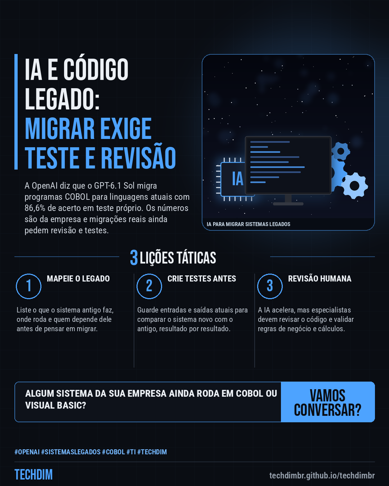
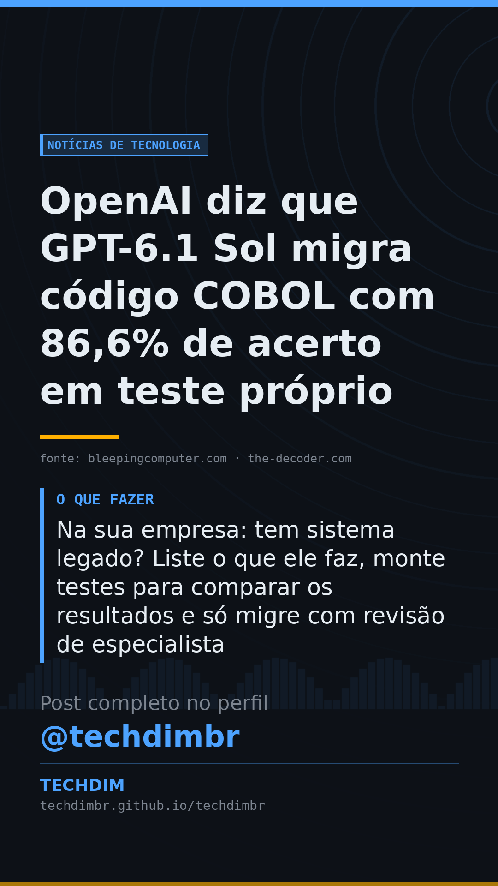

# Notícias de Tecnologia — OpenAI diz que GPT-6.1 Sol migra código COBOL com 86,6% de acerto em teste próprio

- **Data:** 2026-10-21, 08:00 (horário de Brasília)
- **Curadoria:** Claude (Routine) — pauta do dia
- **Execução no Actions:** https://github.com/Techdimbr/Publi-midia-Techdim/actions/runs/39588556467
- **Por que esta pauta:** Notícia de IA com aplicação direta a empresas que mantêm sistemas legados: os números são da própria OpenAI e a ressalva de que migrações reais exigem revisão e testes foi preservada.

## Resultado

| Rede | Status | Link | 1º comentário |
|---|---|---|---|
| linkedin | ✅ publicado | https://www.linkedin.com/feed/update/urn:li:share:7518627016993353728/ | — |
| facebook | ✅ publicado | https://www.facebook.com/122132402349390486/posts/122137548141390486 | ✅ |
| instagram | ✅ publicado | https://www.instagram.com/p/DewP-y5F_4K/ | ✅ |
| Stories | ✅ publicado | https://www.instagram.com/stories/techdimbr/4012777710326110818 | — |

## Fontes

- [bleepingcomputer.com](https://www.bleepingcomputer.com/news/artificial-intelligence/openai-says-gpt-61-sol-is-dramatically-better-at-migrating-legacy-code/)
- [the-decoder.com](https://the-decoder.com/openai-says-gpt-6-is-much-better-with-legacy-programming-languages-such-as-cobol-and-fortran/)

## Linkedin

```text
OpenAI diz que GPT-6.1 Sol migra código COBOL com 86,6% de acerto em teste próprio

01. A OpenAI diz que o GPT-6.1 Sol melhorou muito em linguagens antigas, como COBOL, Fortran e Visual Basic, que têm pouco material para treinar modelos
02. Em teste próprio, migrou COBOL para Java, Python e outras linguagens com 86,6% de acerto (5,4% no GPT-5.6 Sol). Os números são da OpenAI; migração real pede revisão
03. Na sua empresa: tem sistema legado? Liste o que ele faz, monte testes para comparar os resultados e só migre com revisão de especialista

Algum sistema da sua empresa ainda depende de COBOL ou Visual Basic? Comece mapeando o que ele faz e quem o usa.

Fontes: https://www.bleepingcomputer.com/news/artificial-intelligence/openai-says-gpt-61-sol-is-dramatically-better-at-migrating-legacy-code/ · https://the-decoder.com/openai-says-gpt-6-is-much-better-with-legacy-programming-languages-such-as-cobol-and-fortran/

TECHDIM — Infraestrutura · Segurança · IA
https://techdimbr.github.io/techdimbr/

#OpenAI #SistemasLegados #Cobol #TI #TECHDIM
```



## Facebook

```text
OpenAI diz que GPT-6.1 Sol migra código COBOL com 86,6% de acerto em teste próprio

• A OpenAI diz que o GPT-6.1 Sol melhorou muito em linguagens antigas, como COBOL, Fortran e Visual Basic, que têm pouco material para treinar modelos
• Em teste próprio, migrou COBOL para Java, Python e outras linguagens com 86,6% de acerto (5,4% no GPT-5.6 Sol). Os números são da OpenAI; migração real pede revisão
• Na sua empresa: tem sistema legado? Liste o que ele faz, monte testes para comparar os resultados e só migre com revisão de especialista

Algum sistema da sua empresa ainda depende de COBOL ou Visual Basic? Comece mapeando o que ele faz e quem o usa.

Fale com a TECHDIM — fontes e site no primeiro comentário 👇

#OpenAI #SistemasLegados #Cobol #TECHDIM
```

Primeiro comentário:

```text
📎 Fontes:
• bleepingcomputer.com: https://www.bleepingcomputer.com/news/artificial-intelligence/openai-says-gpt-61-sol-is-dramatically-better-at-migrating-legacy-code/
• the-decoder.com: https://the-decoder.com/openai-says-gpt-6-is-much-better-with-legacy-programming-languages-such-as-cobol-and-fortran/

🌐 TECHDIM — Infraestrutura · Segurança · IA: https://techdimbr.github.io/techdimbr/
```


## Instagram

```text
OpenAI diz que GPT-6.1 Sol migra código COBOL com 86,6% de acerto em teste próprio

1️⃣ A OpenAI diz que o GPT-6.1 Sol melhorou muito em linguagens antigas, como COBOL, Fortran e Visual Basic, que têm pouco material para treinar modelos
2️⃣ Em teste próprio, migrou COBOL para Java, Python e outras linguagens com 86,6% de acerto (5,4% no GPT-5.6 Sol). Os números são da OpenAI; migração real pede revisão
3️⃣ Na sua empresa: tem sistema legado? Liste o que ele faz, monte testes para comparar os resultados e só migre com revisão de especialista

Algum sistema da sua empresa ainda depende de COBOL ou Visual Basic? Comece mapeando o que ele faz e quem o usa.

🔗 Link na bio: techdimbr.github.io/techdimbr
Fontes no primeiro comentário 👇

#openai #sistemaslegados #cobol #ti #techdim #tecnologia #inteligenciaartificial #ia
```

Primeiro comentário:

```text
📎 Fontes: bleepingcomputer.com · the-decoder.com
```


## Stories


