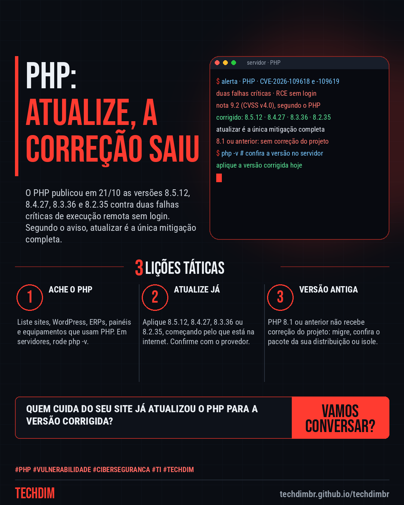
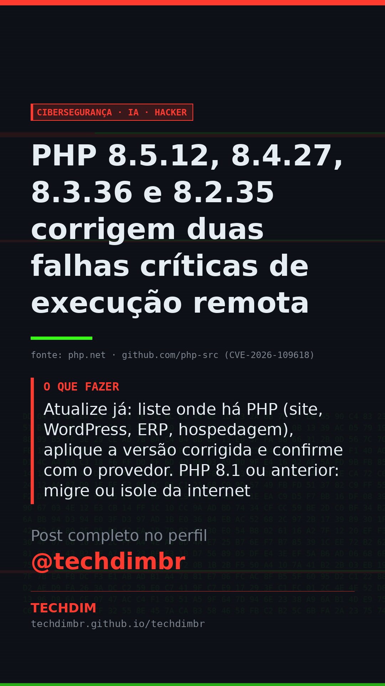

# Cibersegurança · IA · Hacker — PHP 8.5.12, 8.4.27, 8.3.36 e 8.2.35 corrigem duas falhas críticas de execução remota

- **Data:** 2026-10-21, 11:12 (horário de Brasília)
- **Curadoria:** Claude (Routine) — pauta do dia
- **Execução no Actions:** https://github.com/Techdimbr/Publi-midia-Techdim/actions/runs/39614674104
- **Por que esta pauta:** Falha crítica em tecnologia muito usada em sites e sistemas de pequenas empresas, com correção oficial publicada pelo PHP em 21/10; a pauta foi atualizada com os avisos oficiais antes da publicação.

## Resultado

| Rede | Status | Link | 1º comentário |
|---|---|---|---|
| linkedin | ✅ publicado | https://www.linkedin.com/feed/update/urn:li:share:7518675485099356162/ | — |
| facebook | ✅ publicado | https://www.facebook.com/122132402349390486/posts/122137576413390486 | ✅ |
| instagram | ✅ publicado | https://www.instagram.com/p/DewmBg9HQT8/ | ✅ |
| Stories | ✅ publicado | https://www.instagram.com/stories/techdimbr/4012874611382129075 | — |

## Fontes

- [php.net](https://www.php.net/archive/2026.php)
- [github.com/php-src (CVE-2026-109618)](https://github.com/php/php-src/security/advisories/GHSA-w8hw-w9fx-j79w)
- [github.com/php-src (CVE-2026-109619)](https://github.com/php/php-src/security/advisories/GHSA-6wmf-4rv5-p3rp)

## Linkedin

```text
PHP 8.5.12, 8.4.27, 8.3.36 e 8.2.35 corrigem duas falhas críticas de execução remota

01. O PHP publicou em 21/10 as versões 8.5.12, 8.4.27, 8.3.36 e 8.2.35, que corrigem duas falhas críticas (CVE-2026-109618 e -109619, nota 9.2) de execução remota sem login
02. O aviso do PHP diz que atualizar é a única mitigação completa. Versões anteriores às corrigidas são afetadas e o 8.1 e anteriores não recebem correção do projeto
03. Atualize já: liste onde há PHP (site, WordPress, ERP, hospedagem), aplique a versão corrigida e confirme com o provedor. PHP 8.1 ou anterior: migre ou isole da internet

Seu site ou sistema roda em PHP? Peça a quem cuida dele a versão em uso e a atualização para a versão corrigida hoje.

Fontes: https://www.php.net/archive/2026.php · https://github.com/php/php-src/security/advisories/GHSA-w8hw-w9fx-j79w

TECHDIM — Infraestrutura · Segurança · IA
https://techdimbr.github.io/techdimbr/

#PHP #Vulnerabilidade #Ciberseguranca #TI #TECHDIM
```



## Facebook

```text
PHP 8.5.12, 8.4.27, 8.3.36 e 8.2.35 corrigem duas falhas críticas de execução remota

• O PHP publicou em 21/10 as versões 8.5.12, 8.4.27, 8.3.36 e 8.2.35, que corrigem duas falhas críticas (CVE-2026-109618 e -109619, nota 9.2) de execução remota sem login
• O aviso do PHP diz que atualizar é a única mitigação completa. Versões anteriores às corrigidas são afetadas e o 8.1 e anteriores não recebem correção do projeto
• Atualize já: liste onde há PHP (site, WordPress, ERP, hospedagem), aplique a versão corrigida e confirme com o provedor. PHP 8.1 ou anterior: migre ou isole da internet

Seu site ou sistema roda em PHP? Peça a quem cuida dele a versão em uso e a atualização para a versão corrigida hoje.

Fale com a TECHDIM — fontes e site no primeiro comentário 👇

#PHP #Vulnerabilidade #Ciberseguranca #TECHDIM
```

Primeiro comentário:

```text
📎 Fontes:
• php.net: https://www.php.net/archive/2026.php
• github.com/php-src (CVE-2026-109618): https://github.com/php/php-src/security/advisories/GHSA-w8hw-w9fx-j79w
• github.com/php-src (CVE-2026-109619): https://github.com/php/php-src/security/advisories/GHSA-6wmf-4rv5-p3rp

🌐 TECHDIM — Infraestrutura · Segurança · IA: https://techdimbr.github.io/techdimbr/
```


## Instagram

```text
PHP 8.5.12, 8.4.27, 8.3.36 e 8.2.35 corrigem duas falhas críticas de execução remota

1️⃣ O PHP publicou em 21/10 as versões 8.5.12, 8.4.27, 8.3.36 e 8.2.35, que corrigem duas falhas críticas (CVE-2026-109618 e -109619, nota 9.2) de execução remota sem login
2️⃣ O aviso do PHP diz que atualizar é a única mitigação completa. Versões anteriores às corrigidas são afetadas e o 8.1 e anteriores não recebem correção do projeto
3️⃣ Atualize já: liste onde há PHP (site, WordPress, ERP, hospedagem), aplique a versão corrigida e confirme com o provedor. PHP 8.1 ou anterior: migre ou isole da internet

Seu site ou sistema roda em PHP? Peça a quem cuida dele a versão em uso e a atualização para a versão corrigida hoje.

🔗 Link na bio: techdimbr.github.io/techdimbr
Fontes no primeiro comentário 👇

#php #vulnerabilidade #ciberseguranca #ti #techdim #seguranca #hacker #infraestrutura
```

Primeiro comentário:

```text
📎 Fontes: php.net · github.com/php-src (CVE-2026-109618) · github.com/php-src (CVE-2026-109619)
```


## Stories


