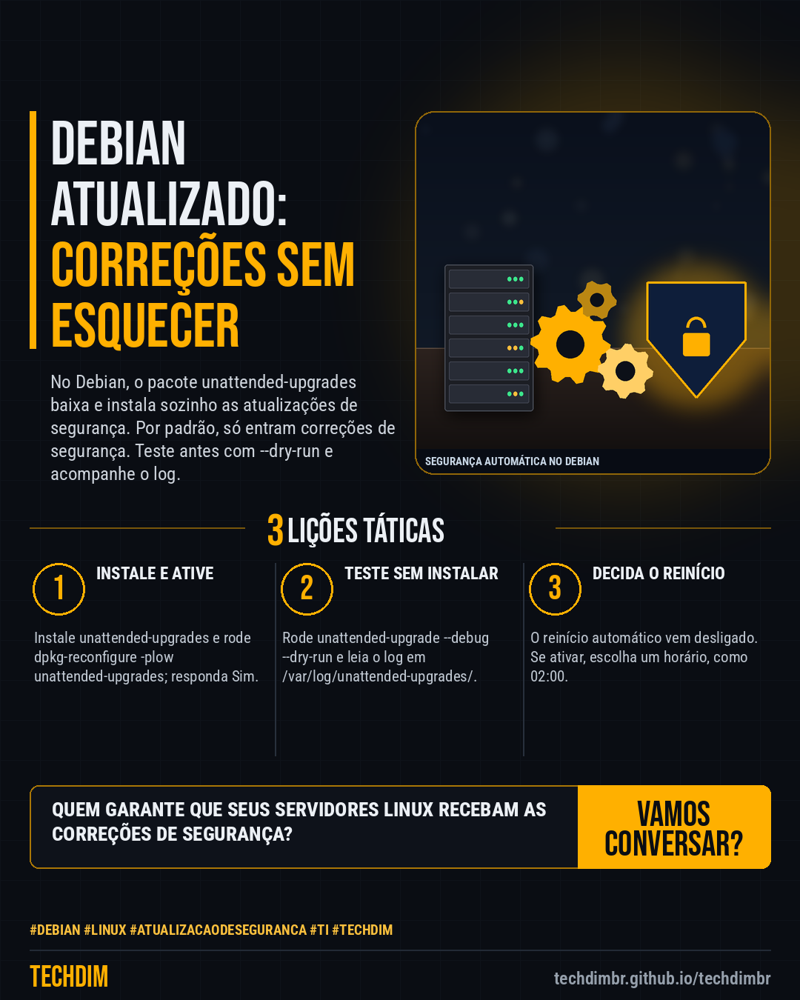

# Conhecimento — unattended-upgrades no Debian: atualizações de segurança automáticas em 5 passos

- **Data:** 2026-10-21, 14:24 (horário de Brasília)
- **Curadoria:** Claude (Routine) — pauta do dia
- **Execução no Actions:** https://github.com/Techdimbr/Publi-midia-Techdim/actions/runs/39643313503
- **Por que esta pauta:** Passo a passo baseado na documentação do Debian e do projeto unattended-upgrades para instalar correções de segurança automaticamente em servidores Linux, com teste antes e log para conferir.

## Resultado

| Rede | Status | Link | 1º comentário |
|---|---|---|---|
| linkedin | ✅ publicado | https://www.linkedin.com/feed/update/urn:li:share:7518723699919855616/ | — |
| facebook | ✅ publicado | https://www.facebook.com/122132402349390486/posts/122137607955390486 | ✅ |
| instagram | ✅ publicado | https://www.instagram.com/p/Dew78qwjei_/ | ✅ |

## Fontes

- [wiki.debian.org/UnattendedUpgrades](https://wiki.debian.org/UnattendedUpgrades)
- [manpages.debian.org (unattended-upgrade)](https://manpages.debian.org/trixie/unattended-upgrades/unattended-upgrade.8.en.html)
- [github.com/mvo5/unattended-upgrades](https://github.com/mvo5/unattended-upgrades/blob/master/README.md)

## Linkedin

```text
unattended-upgrades no Debian: atualizações de segurança automáticas em 5 passos

01. 1) Instale: sudo apt install unattended-upgrades. 2) Ative: sudo dpkg-reconfigure -plow unattended-upgrades e responda Sim. O padrão instala só atualizações de segurança
02. 3) Confira que APT::Periodic::Update-Package-Lists e APT::Periodic::Unattended-Upgrade valem 1 (apt-config dump). 4) Teste: sudo unattended-upgrade --debug --dry-run
03. 5) Leia o log em /var/log/unattended-upgrades/. O reinício automático vem desligado: para reiniciar às 02:00, use Automatic-Reboot e Automatic-Reboot-Time

Seus servidores Linux recebem correções de segurança sem depender de alguém lembrar? Ative, teste e acompanhe o log.

Fontes: https://wiki.debian.org/UnattendedUpgrades · https://manpages.debian.org/trixie/unattended-upgrades/unattended-upgrade.8.en.html

TECHDIM — Infraestrutura · Segurança · IA
https://techdimbr.github.io/techdimbr/

#Debian #Linux #AtualizacaoDeSeguranca #TI #TECHDIM
```



## Facebook

```text
unattended-upgrades no Debian: atualizações de segurança automáticas em 5 passos

• 1) Instale: sudo apt install unattended-upgrades. 2) Ative: sudo dpkg-reconfigure -plow unattended-upgrades e responda Sim. O padrão instala só atualizações de segurança
• 3) Confira que APT::Periodic::Update-Package-Lists e APT::Periodic::Unattended-Upgrade valem 1 (apt-config dump). 4) Teste: sudo unattended-upgrade --debug --dry-run
• 5) Leia o log em /var/log/unattended-upgrades/. O reinício automático vem desligado: para reiniciar às 02:00, use Automatic-Reboot e Automatic-Reboot-Time

Seus servidores Linux recebem correções de segurança sem depender de alguém lembrar? Ative, teste e acompanhe o log.

Fale com a TECHDIM — fontes e site no primeiro comentário 👇

#Debian #Linux #AtualizacaoDeSeguranca #TECHDIM
```

Primeiro comentário:

```text
📎 Fontes:
• wiki.debian.org/UnattendedUpgrades: https://wiki.debian.org/UnattendedUpgrades
• manpages.debian.org (unattended-upgrade): https://manpages.debian.org/trixie/unattended-upgrades/unattended-upgrade.8.en.html
• github.com/mvo5/unattended-upgrades: https://github.com/mvo5/unattended-upgrades/blob/master/README.md

🌐 TECHDIM — Infraestrutura · Segurança · IA: https://techdimbr.github.io/techdimbr/
```


## Instagram

```text
unattended-upgrades no Debian: atualizações de segurança automáticas em 5 passos

1️⃣ 1) Instale: sudo apt install unattended-upgrades. 2) Ative: sudo dpkg-reconfigure -plow unattended-upgrades e responda Sim. O padrão instala só atualizações de segurança
2️⃣ 3) Confira que APT::Periodic::Update-Package-Lists e APT::Periodic::Unattended-Upgrade valem 1 (apt-config dump). 4) Teste: sudo unattended-upgrade --debug --dry-run
3️⃣ 5) Leia o log em /var/log/unattended-upgrades/. O reinício automático vem desligado: para reiniciar às 02:00, use Automatic-Reboot e Automatic-Reboot-Time

Seus servidores Linux recebem correções de segurança sem depender de alguém lembrar? Ative, teste e acompanhe o log.

🔗 Link na bio: techdimbr.github.io/techdimbr
Fontes no primeiro comentário 👇

#debian #linux #atualizacaodeseguranca #ti #techdim #conhecimento #aprendati #tecnologia
```

Primeiro comentário:

```text
📎 Fontes: wiki.debian.org/UnattendedUpgrades · manpages.debian.org (unattended-upgrade) · github.com/mvo5/unattended-upgrades
```


