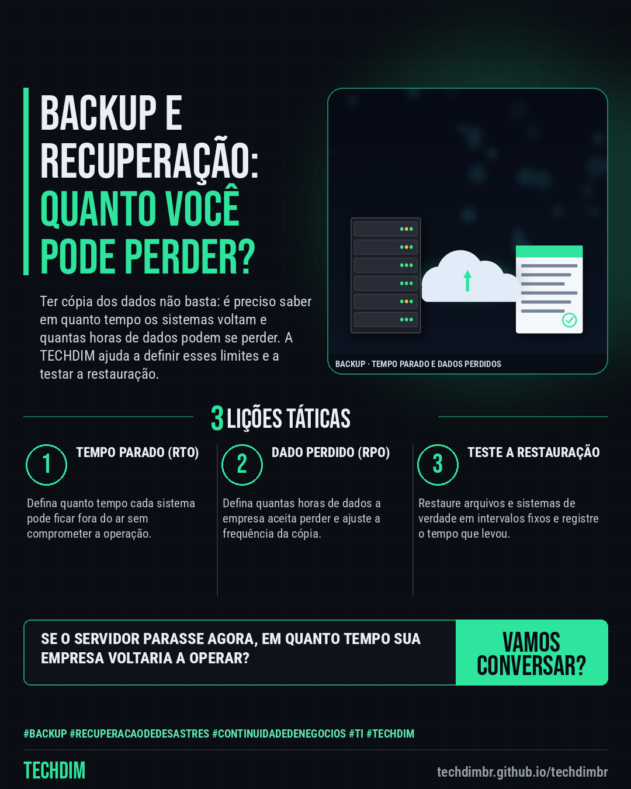

# TECHDIM · Serviços — Backup e recuperação: quanto tempo sua empresa aguenta parada e quanto dado pode perder?

- **Data:** 2026-10-21, 17:24 (horário de Brasília)
- **Curadoria:** Claude (Routine) — pauta do dia
- **Execução no Actions:** https://github.com/Techdimbr/Publi-midia-Techdim/actions/runs/39669817401
- **Por que esta pauta:** Apresenta o serviço de backup e recuperação da TECHDIM com ângulo novo (tempo parado e dados perdidos, RTO e RPO), sem promessa de preço, prazo ou resultado.

## Resultado

| Rede | Status | Link | 1º comentário |
|---|---|---|---|
| linkedin | ✅ publicado | https://www.linkedin.com/feed/update/urn:li:share:7518768977695694848/ | — |
| facebook | ✅ publicado | https://www.facebook.com/122132402349390486/posts/122137632087390486 | ✅ |
| instagram | ✅ publicado | https://www.instagram.com/p/DexQmEkEXS3/ | — |

## Linkedin

```text
Backup e recuperação: quanto tempo sua empresa aguenta parada e quanto dado pode perder?

01. Dois números guiam o backup: quanto tempo a empresa aguenta parada (RTO) e quantas horas de dados aceita perder (RPO). Sem defini-los, a cópia pode não servir
02. A TECHDIM ajuda a definir esses limites, escolher o que proteger, manter cópias fora do local e testar a restauração, com registro do resultado
03. Conte quais sistemas não podem parar. A TECHDIM avalia a situação atual e propõe um plano de backup e recuperação, sem compromisso

Se o servidor parasse agora, em quanto tempo sua empresa voltaria? Converse com a TECHDIM: techdimbr.github.io/techdimbr

TECHDIM — Infraestrutura · Segurança · IA
https://techdimbr.github.io/techdimbr/

#Backup #RecuperacaoDeDesastres #ContinuidadeDeNegocios #TI #TECHDIM
```



## Facebook

```text
Backup e recuperação: quanto tempo sua empresa aguenta parada e quanto dado pode perder?

• Dois números guiam o backup: quanto tempo a empresa aguenta parada (RTO) e quantas horas de dados aceita perder (RPO). Sem defini-los, a cópia pode não servir
• A TECHDIM ajuda a definir esses limites, escolher o que proteger, manter cópias fora do local e testar a restauração, com registro do resultado
• Conte quais sistemas não podem parar. A TECHDIM avalia a situação atual e propõe um plano de backup e recuperação, sem compromisso

Se o servidor parasse agora, em quanto tempo sua empresa voltaria? Converse com a TECHDIM: techdimbr.github.io/techdimbr

Fale com a TECHDIM — link no primeiro comentário 👇

#Backup #RecuperacaoDeDesastres #ContinuidadeDeNegocios #TECHDIM
```

Primeiro comentário:

```text
🌐 TECHDIM — Infraestrutura · Segurança · IA: https://techdimbr.github.io/techdimbr/
```


## Instagram

```text
Backup e recuperação: quanto tempo sua empresa aguenta parada e quanto dado pode perder?

1️⃣ Dois números guiam o backup: quanto tempo a empresa aguenta parada (RTO) e quantas horas de dados aceita perder (RPO). Sem defini-los, a cópia pode não servir
2️⃣ A TECHDIM ajuda a definir esses limites, escolher o que proteger, manter cópias fora do local e testar a restauração, com registro do resultado
3️⃣ Conte quais sistemas não podem parar. A TECHDIM avalia a situação atual e propõe um plano de backup e recuperação, sem compromisso

Se o servidor parasse agora, em quanto tempo sua empresa voltaria? Converse com a TECHDIM: techdimbr.github.io/techdimbr

🔗 Link na bio: techdimbr.github.io/techdimbr

#backup #recuperacaodedesastres #continuidadedenegocios #ti #techdim #suportetecnico #ciberseguranca #automacao
```


