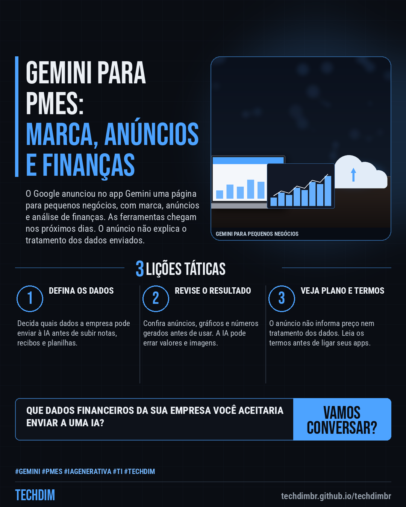

# Notícias de Tecnologia — Gemini para pequenos negócios: Google lança ferramentas de marca, anúncios e finanças

- **Data:** 2026-10-22, 07:59 (horário de Brasília)
- **Curadoria:** Claude (Routine) — pauta do dia
- **Execução no Actions:** https://github.com/Techdimbr/Publi-midia-Techdim/actions/runs/39767113333
- **Por que esta pauta:** Anúncio de IA voltado a pequenas empresas, confirmado no blog do Google e na imprensa brasileira, com a ressalva de que preço e tratamento dos dados enviados não foram detalhados.

## Resultado

| Rede | Status | Link | 1º comentário |
|---|---|---|---|
| linkedin | ✅ publicado | https://www.linkedin.com/feed/update/urn:li:share:7518989357664583681/ | — |
| facebook | ✅ publicado | https://www.facebook.com/122132402349390486/posts/122137743333390486 | ✅ |
| instagram | ✅ publicado | https://www.instagram.com/p/Dey0wZXFgjm/ | ✅ |
| Stories | ✅ publicado | https://www.instagram.com/stories/techdimbr/4013502364464355261 | — |

## Fontes

- [blog.google](https://blog.google/innovation-and-ai/products/gemini-app/new-tools-small-business-owners/)
- [seudinheiro.com](https://www.seudinheiro.com/2026/seu-negocio/inteligencia-artificial-nos-pequenos-negocios-google-lanca-3-novas-ferramentas-no-gemini-para-pmes-giov/)

## Linkedin

```text
Gemini para pequenos negócios: Google lança ferramentas de marca, anúncios e finanças

01. O Google lançou no app Gemini uma página para pequenos negócios que reúne marca, anúncios e finanças e conecta apps como Google Ads, Workspace, Canva, Shopify e Wix
02. O Gemini guarda logotipo, cores e fontes para criar imagens com a sua marca e transforma recibos, compras e planilhas em gráficos. Chega nos próximos dias, diz o Google
03. Na sua empresa: antes de enviar notas e planilhas a uma IA, defina quais dados podem sair, revise o que ela gerar e confira preço e termos, que o anúncio não traz

Que dados financeiros da sua empresa você aceitaria enviar a uma IA? Defina a regra antes de ligar a ferramenta.

Fontes: https://blog.google/innovation-and-ai/products/gemini-app/new-tools-small-business-owners/ · https://www.seudinheiro.com/2026/seu-negocio/inteligencia-artificial-nos-pequenos-negocios-google-lanca-3-novas-ferramentas-no-gemini-para-pmes-giov/

TECHDIM — Infraestrutura · Segurança · IA
https://techdimbr.github.io/techdimbr/

#Gemini #PMEs #IAGenerativa #TI #TECHDIM
```



## Facebook

```text
Gemini para pequenos negócios: Google lança ferramentas de marca, anúncios e finanças

• O Google lançou no app Gemini uma página para pequenos negócios que reúne marca, anúncios e finanças e conecta apps como Google Ads, Workspace, Canva, Shopify e Wix
• O Gemini guarda logotipo, cores e fontes para criar imagens com a sua marca e transforma recibos, compras e planilhas em gráficos. Chega nos próximos dias, diz o Google
• Na sua empresa: antes de enviar notas e planilhas a uma IA, defina quais dados podem sair, revise o que ela gerar e confira preço e termos, que o anúncio não traz

Que dados financeiros da sua empresa você aceitaria enviar a uma IA? Defina a regra antes de ligar a ferramenta.

Fale com a TECHDIM — fontes e site no primeiro comentário 👇

#Gemini #PMEs #IAGenerativa #TECHDIM
```

Primeiro comentário:

```text
📎 Fontes:
• blog.google: https://blog.google/innovation-and-ai/products/gemini-app/new-tools-small-business-owners/
• seudinheiro.com: https://www.seudinheiro.com/2026/seu-negocio/inteligencia-artificial-nos-pequenos-negocios-google-lanca-3-novas-ferramentas-no-gemini-para-pmes-giov/

🌐 TECHDIM — Infraestrutura · Segurança · IA: https://techdimbr.github.io/techdimbr/
```


## Instagram

```text
Gemini para pequenos negócios: Google lança ferramentas de marca, anúncios e finanças

1️⃣ O Google lançou no app Gemini uma página para pequenos negócios que reúne marca, anúncios e finanças e conecta apps como Google Ads, Workspace, Canva, Shopify e Wix
2️⃣ O Gemini guarda logotipo, cores e fontes para criar imagens com a sua marca e transforma recibos, compras e planilhas em gráficos. Chega nos próximos dias, diz o Google
3️⃣ Na sua empresa: antes de enviar notas e planilhas a uma IA, defina quais dados podem sair, revise o que ela gerar e confira preço e termos, que o anúncio não traz

Que dados financeiros da sua empresa você aceitaria enviar a uma IA? Defina a regra antes de ligar a ferramenta.

🔗 Link na bio: techdimbr.github.io/techdimbr
Fontes no primeiro comentário 👇

#gemini #pmes #iagenerativa #ti #techdim #tecnologia #inteligenciaartificial #ia
```

Primeiro comentário:

```text
📎 Fontes: blog.google · seudinheiro.com
```


## Stories


