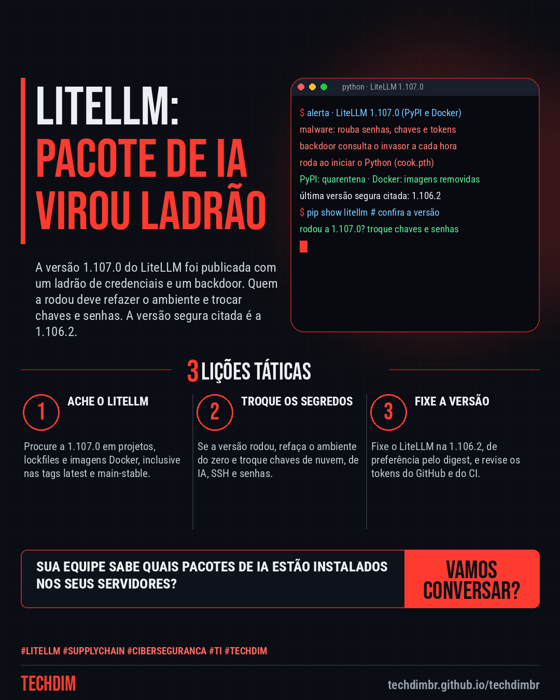
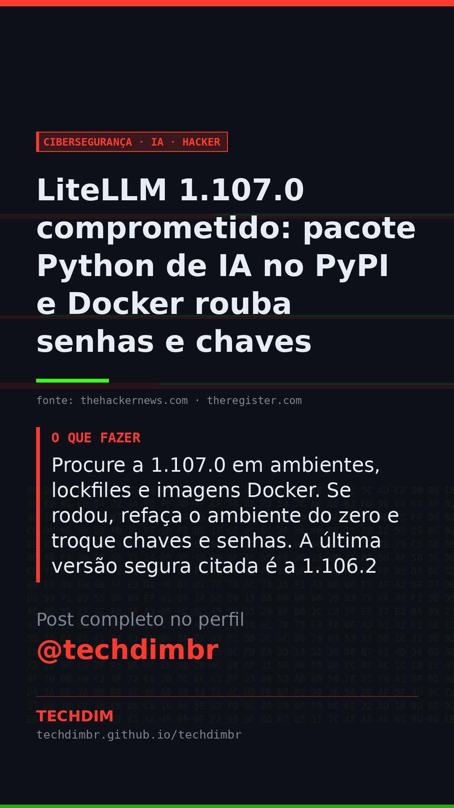

# Cibersegurança · IA · Hacker — LiteLLM 1.107.0 comprometido: pacote Python de IA no PyPI e Docker rouba senhas e chaves

- **Data:** 2026-10-22, 11:09 (horário de Brasília)
- **Curadoria:** Claude (Routine) — pauta do dia
- **Execução no Actions:** https://github.com/Techdimbr/Publi-midia-Techdim/actions/runs/39793139653
- **Por que esta pauta:** Ataque à cadeia de suprimentos de um pacote de IA muito usado por equipes de desenvolvimento, com versão afetada e passos de resposta confirmados por duas fontes.

## Resultado

| Rede | Status | Link | 1º comentário |
|---|---|---|---|
| linkedin | ✅ publicado | https://www.linkedin.com/feed/update/urn:li:share:7519037104794787840/ | — |
| facebook | ✅ publicado | https://www.facebook.com/122132402349390486/posts/122137770981390486 | ✅ |
| instagram | ✅ publicado | https://www.instagram.com/p/DezKeFsmDrJ/ | ✅ |
| Stories | ✅ publicado | https://www.instagram.com/stories/techdimbr/4013597914383784539 | — |

## Fontes

- [thehackernews.com](https://thehackernews.com/2026/10/litellm-compromised-in-supply-chain.html)
- [theregister.com](https://www.theregister.com/security/2026/10/21/litellm-supply-chain-attack-hoovers-up-passwords-and-secrets/5304548)

## Linkedin

```text
LiteLLM 1.107.0 comprometido: pacote Python de IA no PyPI e Docker rouba senhas e chaves

01. A versão 1.107.0 do LiteLLM, gateway de IA em Python, foi publicada com malware no PyPI e no Docker. O PyPI a colocou em quarentena e as imagens foram removidas
02. O código rouba senhas, chaves de nuvem, de APIs de IA e SSH, e abre um backdoor que consulta o invasor a cada hora. Roda quando o Python inicia, pelo arquivo cook.pth
03. Procure a 1.107.0 em ambientes, lockfiles e imagens Docker. Se rodou, refaça o ambiente do zero e troque chaves e senhas. A última versão segura citada é a 1.106.2

Sua empresa ou seu fornecedor usa LiteLLM? Peça a conferência da versão e a troca das chaves se a 1.107.0 rodou.

Fontes: https://thehackernews.com/2026/10/litellm-compromised-in-supply-chain.html · https://www.theregister.com/security/2026/10/21/litellm-supply-chain-attack-hoovers-up-passwords-and-secrets/5304548

TECHDIM — Infraestrutura · Segurança · IA
https://techdimbr.github.io/techdimbr/

#LiteLLM #SupplyChain #Ciberseguranca #TI #TECHDIM
```



## Facebook

```text
LiteLLM 1.107.0 comprometido: pacote Python de IA no PyPI e Docker rouba senhas e chaves

• A versão 1.107.0 do LiteLLM, gateway de IA em Python, foi publicada com malware no PyPI e no Docker. O PyPI a colocou em quarentena e as imagens foram removidas
• O código rouba senhas, chaves de nuvem, de APIs de IA e SSH, e abre um backdoor que consulta o invasor a cada hora. Roda quando o Python inicia, pelo arquivo cook.pth
• Procure a 1.107.0 em ambientes, lockfiles e imagens Docker. Se rodou, refaça o ambiente do zero e troque chaves e senhas. A última versão segura citada é a 1.106.2

Sua empresa ou seu fornecedor usa LiteLLM? Peça a conferência da versão e a troca das chaves se a 1.107.0 rodou.

Fale com a TECHDIM — fontes e site no primeiro comentário 👇

#LiteLLM #SupplyChain #Ciberseguranca #TECHDIM
```

Primeiro comentário:

```text
📎 Fontes:
• thehackernews.com: https://thehackernews.com/2026/10/litellm-compromised-in-supply-chain.html
• theregister.com: https://www.theregister.com/security/2026/10/21/litellm-supply-chain-attack-hoovers-up-passwords-and-secrets/5304548

🌐 TECHDIM — Infraestrutura · Segurança · IA: https://techdimbr.github.io/techdimbr/
```


## Instagram

```text
LiteLLM 1.107.0 comprometido: pacote Python de IA no PyPI e Docker rouba senhas e chaves

1️⃣ A versão 1.107.0 do LiteLLM, gateway de IA em Python, foi publicada com malware no PyPI e no Docker. O PyPI a colocou em quarentena e as imagens foram removidas
2️⃣ O código rouba senhas, chaves de nuvem, de APIs de IA e SSH, e abre um backdoor que consulta o invasor a cada hora. Roda quando o Python inicia, pelo arquivo cook.pth
3️⃣ Procure a 1.107.0 em ambientes, lockfiles e imagens Docker. Se rodou, refaça o ambiente do zero e troque chaves e senhas. A última versão segura citada é a 1.106.2

Sua empresa ou seu fornecedor usa LiteLLM? Peça a conferência da versão e a troca das chaves se a 1.107.0 rodou.

🔗 Link na bio: techdimbr.github.io/techdimbr
Fontes no primeiro comentário 👇

#litellm #supplychain #ciberseguranca #ti #techdim #seguranca #hacker #infraestrutura
```

Primeiro comentário:

```text
📎 Fontes: thehackernews.com · theregister.com
```


## Stories


