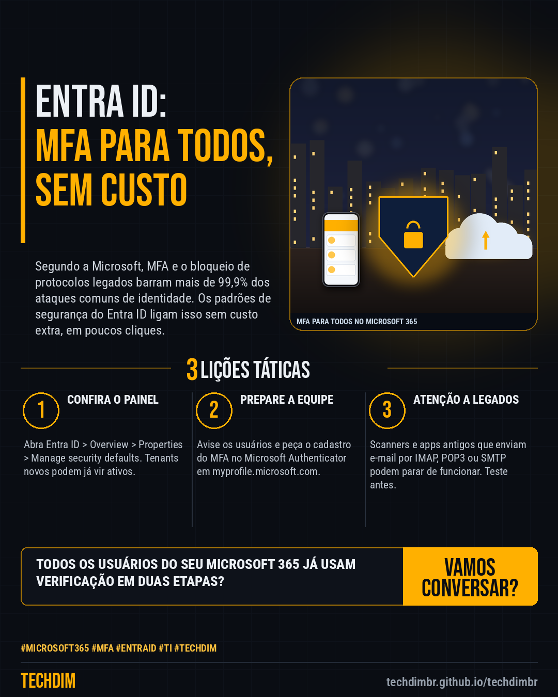

# Conhecimento — Microsoft Entra: ative os padrões de segurança e exija MFA de todos no Microsoft 365

- **Data:** 2026-10-22, 14:24 (horário de Brasília)
- **Curadoria:** Claude (Routine) — pauta do dia
- **Execução no Actions:** https://github.com/Techdimbr/Publi-midia-Techdim/actions/runs/39822234172
- **Por que esta pauta:** Passo a passo baseado na documentação da Microsoft para exigir MFA de todos e bloquear a autenticação legada no Microsoft 365, sem custo extra, com os avisos de compatibilidade.

## Resultado

| Rede | Status | Link | 1º comentário |
|---|---|---|---|
| linkedin | ✅ publicado | https://www.linkedin.com/feed/update/urn:li:share:7519086145746391040/ | — |
| facebook | ✅ publicado | https://www.facebook.com/122132402349390486/posts/122137812999390486 | ✅ |
| instagram | ✅ publicado | https://www.instagram.com/p/DezgxOhF6yQ/ | ✅ |

## Fontes

- [learn.microsoft.com/entra (padrões de segurança)](https://learn.microsoft.com/en-us/entra/fundamentals/security-defaults)

## Linkedin

```text
Microsoft Entra: ative os padrões de segurança e exija MFA de todos no Microsoft 365

01. 1) Entre em entra.microsoft.com como Administrador de Acesso Condicional ou superior. 2) Vá em Entra ID > Overview > Properties e abra Manage security defaults
02. 3) Defina Security defaults como Enabled e clique em Save. Isso exige MFA de todos, bloqueia protocolos legados (IMAP, POP3, SMTP) e protege o acesso ao portal do Azure
03. 4) Antes, veja se algum scanner ou app antigo usa protocolo legado. 5) Peça o cadastro do MFA em myprofile.microsoft.com. Com licença P1 ou P2, prefira Acesso Condicional

Seu Microsoft 365 exige MFA de todos? Confira os padrões de segurança, avise a equipe e teste os apps antigos antes.

Fontes: https://learn.microsoft.com/en-us/entra/fundamentals/security-defaults

TECHDIM — Infraestrutura · Segurança · IA
https://techdimbr.github.io/techdimbr/

#Microsoft365 #MFA #EntraID #TI #TECHDIM
```



## Facebook

```text
Microsoft Entra: ative os padrões de segurança e exija MFA de todos no Microsoft 365

• 1) Entre em entra.microsoft.com como Administrador de Acesso Condicional ou superior. 2) Vá em Entra ID > Overview > Properties e abra Manage security defaults
• 3) Defina Security defaults como Enabled e clique em Save. Isso exige MFA de todos, bloqueia protocolos legados (IMAP, POP3, SMTP) e protege o acesso ao portal do Azure
• 4) Antes, veja se algum scanner ou app antigo usa protocolo legado. 5) Peça o cadastro do MFA em myprofile.microsoft.com. Com licença P1 ou P2, prefira Acesso Condicional

Seu Microsoft 365 exige MFA de todos? Confira os padrões de segurança, avise a equipe e teste os apps antigos antes.

Fale com a TECHDIM — fontes e site no primeiro comentário 👇

#Microsoft365 #MFA #EntraID #TECHDIM
```

Primeiro comentário:

```text
📎 Fontes:
• learn.microsoft.com/entra (padrões de segurança): https://learn.microsoft.com/en-us/entra/fundamentals/security-defaults

🌐 TECHDIM — Infraestrutura · Segurança · IA: https://techdimbr.github.io/techdimbr/
```


## Instagram

```text
Microsoft Entra: ative os padrões de segurança e exija MFA de todos no Microsoft 365

1️⃣ 1) Entre em entra.microsoft.com como Administrador de Acesso Condicional ou superior. 2) Vá em Entra ID > Overview > Properties e abra Manage security defaults
2️⃣ 3) Defina Security defaults como Enabled e clique em Save. Isso exige MFA de todos, bloqueia protocolos legados (IMAP, POP3, SMTP) e protege o acesso ao portal do Azure
3️⃣ 4) Antes, veja se algum scanner ou app antigo usa protocolo legado. 5) Peça o cadastro do MFA em myprofile.microsoft.com. Com licença P1 ou P2, prefira Acesso Condicional

Seu Microsoft 365 exige MFA de todos? Confira os padrões de segurança, avise a equipe e teste os apps antigos antes.

🔗 Link na bio: techdimbr.github.io/techdimbr
Fontes no primeiro comentário 👇

#microsoft365 #mfa #entraid #ti #techdim #conhecimento #aprendati #tecnologia
```

Primeiro comentário:

```text
📎 Fontes: learn.microsoft.com/entra (padrões de segurança)
```


