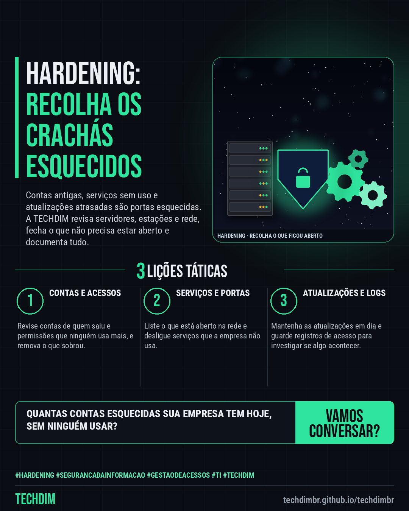

# TECHDIM · Serviços — Hardening: recolha os crachás esquecidos da sua TI, de contas antigas a serviços abertos

- **Data:** 2026-10-22, 17:24 (horário de Brasília)
- **Curadoria:** Claude (Routine) — pauta do dia
- **Execução no Actions:** https://github.com/Techdimbr/Publi-midia-Techdim/actions/runs/39848427259
- **Por que esta pauta:** Apresenta o serviço de segurança e hardening com uma analogia nova (crachás esquecidos), sem promessa de preço, prazo ou risco zero.

## Resultado

| Rede | Status | Link | 1º comentário |
|---|---|---|---|
| linkedin | ✅ publicado | https://www.linkedin.com/feed/update/urn:li:share:7519131469001322496/ | — |
| facebook | ✅ publicado | https://www.facebook.com/122132402349390486/posts/122137843953390486 | ✅ |
| instagram | ✅ publicado | https://www.instagram.com/p/Dez1X0cFxVb/ | — |

## Linkedin

```text
Hardening: recolha os crachás esquecidos da sua TI, de contas antigas a serviços abertos

01. Crachá de ex-funcionário não recolhido abre portas. Na TI, é a conta antiga ativa, o serviço aberto sem uso e a atualização atrasada. Hardening é recolher o que sobrou
02. A TECHDIM revisa contas, permissões, serviços e portas abertas, atualizações, firewall e registros de servidores, estações e rede, e entrega um relatório em português
03. Conte como é o seu ambiente. A TECHDIM avalia o que está exposto e propõe o que ajustar primeiro, sem compromisso e sem prometer risco zero

Quantas contas e serviços esquecidos sua TI tem hoje? Converse com a TECHDIM: techdimbr.github.io/techdimbr

TECHDIM — Infraestrutura · Segurança · IA
https://techdimbr.github.io/techdimbr/

#Hardening #SegurancaDaInformacao #GestaoDeAcessos #TI #TECHDIM
```



## Facebook

```text
Hardening: recolha os crachás esquecidos da sua TI, de contas antigas a serviços abertos

• Crachá de ex-funcionário não recolhido abre portas. Na TI, é a conta antiga ativa, o serviço aberto sem uso e a atualização atrasada. Hardening é recolher o que sobrou
• A TECHDIM revisa contas, permissões, serviços e portas abertas, atualizações, firewall e registros de servidores, estações e rede, e entrega um relatório em português
• Conte como é o seu ambiente. A TECHDIM avalia o que está exposto e propõe o que ajustar primeiro, sem compromisso e sem prometer risco zero

Quantas contas e serviços esquecidos sua TI tem hoje? Converse com a TECHDIM: techdimbr.github.io/techdimbr

Fale com a TECHDIM — link no primeiro comentário 👇

#Hardening #SegurancaDaInformacao #GestaoDeAcessos #TECHDIM
```

Primeiro comentário:

```text
🌐 TECHDIM — Infraestrutura · Segurança · IA: https://techdimbr.github.io/techdimbr/
```


## Instagram

```text
Hardening: recolha os crachás esquecidos da sua TI, de contas antigas a serviços abertos

1️⃣ Crachá de ex-funcionário não recolhido abre portas. Na TI, é a conta antiga ativa, o serviço aberto sem uso e a atualização atrasada. Hardening é recolher o que sobrou
2️⃣ A TECHDIM revisa contas, permissões, serviços e portas abertas, atualizações, firewall e registros de servidores, estações e rede, e entrega um relatório em português
3️⃣ Conte como é o seu ambiente. A TECHDIM avalia o que está exposto e propõe o que ajustar primeiro, sem compromisso e sem prometer risco zero

Quantas contas e serviços esquecidos sua TI tem hoje? Converse com a TECHDIM: techdimbr.github.io/techdimbr

🔗 Link na bio: techdimbr.github.io/techdimbr

#hardening #segurancadainformacao #gestaodeacessos #ti #techdim #suportetecnico #ciberseguranca #automacao
```


